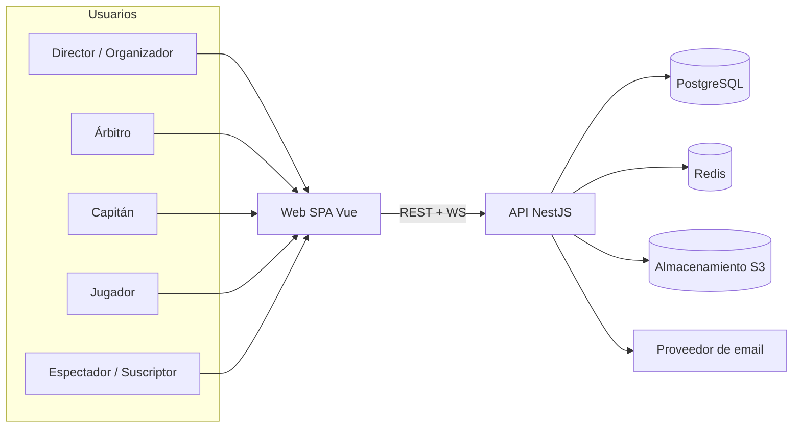
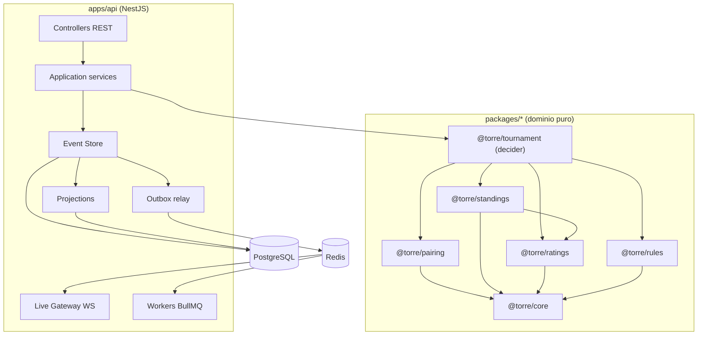

# ARCHITECTURE.md — Tecnologías, estructura y decisiones

> Documento de referencia para humanos e IA. Está escrito para ser **consultado por secciones**: cada sección es autocontenida. Las decisiones tienen ID (`DEC-nnn`) y estado; el registro completo está en §20.
>
> Marcas: `[DECIDIDO]` (lo dijo la persona responsable) · `[PROPUESTO]` (recomendación por defecto, no confirmada) · `[ABIERTO]` · `[PENDIENTE-ASCUN]` · `[VERIFICAR]`. Ver `README.md`.

## 1. Cómo usar este documento

- Si implementas una historia, lee su archivo en `docs/stories/` y **solo** las secciones de aquí que cite.
- Palabras normativas: **MUST** (obligatorio), **SHOULD** (recomendado, justificar si no se sigue), **MUST NOT / NEVER** (prohibido).
- Las **versiones** de las dependencias no se fijan en este documento. Al ejecutar `US-001`, verificar la última versión estable de cada una y registrarlas en `ADR-0001`.
- Producto: **Torre**; paquetes `@torre/*` (`DEC-063`, `OQ-021` resuelta).

## 2. Visión general

### 2.1 Qué se construye

Un **monolito modular** (`DEC-006`) en NestJS con un **núcleo de dominio puro** (`DEC-007`) compartido con el frontend Vue. La competencia (torneo) se modela con **event sourcing** y se consulta mediante **proyecciones** (`DEC-008`). Los clientes se actualizan en tiempo real por WebSocket con Redis como bus (`DEC-012`).

### 2.2 Diagrama de contexto



### 2.3 Diagrama de componentes (backend)



### 2.4 Flujo de un comando (p. ej. registrar un resultado)

```mermaid
sequenceDiagram
  participant Cl as Cliente
  participant Ct as Controller
  participant Ap as Application service
  participant Dm as Dominio (decide/evolve)
  participant Es as Event Store (PG)
  participant Rl as Outbox relay
  participant Ws as WS Gateway

  Cl->>Ct: PUT /tournaments/{id}/games/{gid}/result (Idempotency-Key)
  Ct->>Ap: comando validado (Zod)
  Ap->>Ap: autorizar (CASL + membresía)
  Ap->>Es: cargar eventos del stream
  Ap->>Dm: evolve(eventos) → estado; decide(estado, comando)
  Dm-->>Ap: eventos nuevos (o error de dominio)
  Ap->>Es: TX{ append(expectedSeq) + proyecciones síncronas + outbox }
  Es-->>Ap: commit
  Ap-->>Cl: 200 {streamVersion, ...}
  Rl->>Ws: publica cambio (Redis pub/sub)
  Ws-->>Cl: tournament.updated {version}
```

## 3. Stack tecnológico

| Capa | Tecnología | Estado | Notas / razón |
|---|---|---|---|
| Lenguaje | TypeScript estricto en todo (`DEC-001`) | `[DECIDIDO]` | Flags de §3.1 decididos |
| Runtime | Node.js LTS (fijado en `.nvmrc` y `engines`) | `[DECIDIDO]` (LTS vigente al iniciar, `DEC-063`) | Versión exacta: `ADR-0001` |
| Gestor / monorepo | pnpm workspaces (`DEC-004`) | `[DECIDIDO]` | Nx/Turborepo solo si el tiempo de build lo exige |
| Backend | NestJS sobre Express (`DEC-002`) | `[DECIDIDO]` | Fastify descartado por compatibilidad de middlewares |
| Validación y contratos | Zod como único lenguaje de esquemas (`DEC-037`); contratos de API con **oRPC** (`@orpc/nest`, `@orpc/openapi`, `@orpc/vue-query`) (`DEC-060`), confirmado por la prueba previa (`ADR-0002`); `nestjs-zod` (`DEC-020`) queda sin usar | `[DECIDIDO]` | Servidor, cliente tipado y OpenAPI desde un solo contrato |
| Autenticación | Estilo Fortify propio sobre `@nestjs/passport` (`passport-local`, `passport-jwt`) + `@nestjs/jwt` + `argon2`; 2FA TOTP con `otplib` (`DEC-057`) | `[DECIDIDO]` | Piezas maduras; mantiene JWT + refresh rotativo (`DEC-010`) |
| Autorización | Roles y permisos estilo Spatie en tablas propias, evaluados con CASL (`@casl/ability`, `@casl/prisma`, `@casl/vue`) (`DEC-011`, `DEC-058`) | `[DECIDIDO]` | Permisos editables por `platform_admin`; condiciones sobre el recurso |
| Base de datos | PostgreSQL (`DEC-005`) | `[DECIDIDO]` | JSONB, RLS, FTS, `pg_trgm`, `unaccent`, locks |
| Acceso a datos | Prisma para CRUD + SQL parametrizado para el event store | `[DECIDIDO]` | Riesgo R1 (RLS con Prisma) §18 |
| Redis | Pub/sub, BullMQ, caché corta | `[DECIDIDO]` | |
| Colas | BullMQ (`DEC-013`) | `[DECIDIDO]` | |
| Tiempo real | WebSocket con Socket.IO + adaptador Redis (`DEC-012`) | `[DECIDIDO]` | Transporte detrás de una interfaz (puede cambiar a `ws`/SSE) |
| PDF | pdfmake detrás de un puerto (`DEC-014`) | `[DECIDIDO]` | Sin Chromium; alternativa: Playwright→PDF si el diseño lo exige |
| Email | Puerto `MailPort`; SMTP/Nodemailer en dev con Mailpit (`DEC-015`) | `[DECIDIDO]` puerto; Mailpit hasta desplegar (`OQ-006`) | |
| Archivos | S3 compatible (RustFS en local, `ADR-0003`) (`DEC-016`) | `[DECIDIDO]` | Solo PDFs y logos |
| Frontend | Vue 3 + Vite + Composition API + `<script setup>` (`DEC-003`) | `[DECIDIDO]` | Sin SEO requerido; OG tags vía endpoint (`DEC-041`) |
| Estado | Pinia (UI) + TanStack Vue Query (servidor) (`DEC-018`) | `[DECIDIDO]` | |
| UI | shadcn-vue (Reka UI) + Tailwind, estilo 100 % Tailwind con superficies de vidrio (`DEC-017`, `DEC-085`) | `[DECIDIDO]` | Ver `UI-UX.md` |
| Formularios | VeeValidate + Zod | `[DECIDIDO]` | |
| Tablas | TanStack Table (+ Virtual) | `[DECIDIDO]` | |
| i18n | vue-i18n (`DEC-019`) | `[DECIDIDO]` | es → en → pt |
| Búsqueda | PostgreSQL `pg_trgm` + `unaccent` (`DEC-039`) | `[DECIDIDO]` | |
| Pruebas | Vitest en todo el monorepo (en `apps/api`, su transformador oxc emite los metadatos de los decoradores: `ADR-0004`), fast-check, Supertest, Testcontainers, Playwright, k6 (`DEC-021`) | `[DECIDIDO]` | Ver `TESTING.md` y `TEST-PLAN.md` |
| Calidad | ESLint (flat config), Prettier, Husky + lint-staged, commitlint | `[DECIDIDO]` | |
| CI/CD | GitHub Actions (`DEC-022`) | `[DECIDIDO]` | `OQ-007` resuelta |
| Contenedores | Docker, docker-compose para desarrollo (`DEC-023`) | `[DECIDIDO]` | |
| Observabilidad | pino + correlation id + health; OTel/Sentry después (`DEC-024`) | `[DECIDIDO]` | |
| Ajedrez (utilidades) | `chess.js` para FEN/PGN/jugadas (`DEC-032`); componente de tablero según licencia (`OQ-018`) | `[DECIDIDO]` | Revisar licencia (`OQ-018`) |

### 3.1 Configuración TypeScript estricta (`DEC-001`)

Todos los paquetes extienden `packages/config/tsconfig.base.json`:

- `strict: true`
- `noUncheckedIndexedAccess: true`
- `exactOptionalPropertyTypes: true`
- `noImplicitOverride: true`
- `noFallthroughCasesInSwitch: true`
- `noUnusedLocals`, `noUnusedParameters`: `true`
- `verbatimModuleSyntax: true`
- ESLint: `@typescript-eslint/no-explicit-any: error`, `no-non-null-assertion: error` (salvo tests), `consistent-type-imports`, `no-floating-promises`, `switch-exhaustiveness-check`.

> Nota para Nest: decoradores requieren `experimentalDecorators` y `emitDecoratorMetadata` en `apps/api`. Esto **no** debe filtrarse a `packages/*` (los paquetes de dominio no usan decoradores).

> Módulos (`DEC-071`): **ESM en todo el monorepo** (`"type": "module"`). `apps/api` y `packages/*` usan `module` y `moduleResolution` `nodenext` (imports relativos con `.js`); `apps/web` usa `bundler` (Vite). Nest 12 publica sus paquetes solo como ESM (`SOURCES.md` §6). `ADR-0001` fija las versiones de Node, TypeScript (6 o 7) y Nest.

### 3.2 Librerías complementarias (`DEC-061`)

> `[DECIDIDO]` (`DEC-061`, 2026-10-26). Cada una resuelve una necesidad concreta de una historia y evita escribir infraestructura a mano. Versiones y licencias se verifican y fijan en `ADR-0001` antes de instalar (regla 10 de `CLAUDE.md`).

| Necesidad | Librería | Dónde | Historia |
|---|---|---|---|
| Compilación de Nest y pruebas con decoradores | `tsc` para compilar; el transformador de Vitest para las pruebas (sin SWC, `ADR-0004`) | api | US-005 |
| Configuración tipada | `@nestjs/config` + esquema Zod | api | US-005 |
| Contexto por petición (tenant, usuario, correlación) | `nestjs-cls` | api | US-022 (usuario), US-025 (tenant) |
| Logs estructurados | `nestjs-pino` + `pino-http` | api | US-006 |
| Salud | `@nestjs/terminus` | api | US-006 |
| Límites de tasa compartidos entre instancias | `@nestjs/throttler` + almacenamiento Redis (`@nest-lab/throttler-storage-redis`) | api | US-006, US-022 |
| Autenticación (estilo Fortify) | `@nestjs/passport`, `passport-local`, `passport-jwt`, `@nestjs/jwt`, `argon2`; 2FA con `otplib` + `qrcode` | api | US-022, US-107 |
| Autorización (estilo Spatie) | `@casl/ability`, `@casl/prisma`, `@casl/vue` | api, web | US-024, US-108 |
| Contratos de API | `@orpc/contract`, `@orpc/nest`, `@orpc/openapi`, `@orpc/vue-query` | contracts, api, web | US-008, US-009 |
| Colas | `@nestjs/bullmq` + `bullmq` | api | US-061 |
| WebSocket con varias instancias | `@socket.io/redis-adapter` | api | US-050 |
| Email | `nodemailer` + `mjml` (HTML *responsive*) | api | US-061 |
| Métricas | `prom-client` | api | US-114 |
| Gráficas | Apache ECharts (`DEC-067`) | web | US-053, US-096 |
| Fuentes autoalojadas | `@fontsource` (Fira Sans, `DEC-082`) | web | US-069 |
| CSV (importar y exportar) | `papaparse` | api, web | US-031, US-081 |
| Datos sintéticos con semilla | `@faker-js/faker` (locale `es`) | testing | US-095 |
| Propiedades dentro de Vitest | `@fast-check/vitest` | paquetes | US-011 en adelante |
| Simular el API en pruebas de UI | `msw` | web | US-009 en adelante |
| Contenedores en pruebas | `@testcontainers/postgresql`, `@testcontainers/redis` | api | US-007 |
| Accesibilidad en e2e | `@axe-core/playwright` | web | US-079 |
| Pruebas de mutación (opcional) | `@stryker-mutator/core` + `@stryker-mutator/vitest-runner` | paquetes | `TEST-PLAN.md` TC-065 |
| Higiene del monorepo | `knip` (código y dependencias sin uso), `syncpack` (versiones alineadas) | raíz | US-002 |
| Árbitro sin conexión | `dexie` (IndexedDB) | web | US-091 |
| PWA | `vite-plugin-pwa` (Workbox) | web | US-090 |
| Tablero de ajedrez | `cm-chessboard` (MIT) | web | US-092 |

**Evaluadas y descartadas:**

| Opción | Por qué no |
|---|---|
| Better Auth | Su núcleo son sesiones, no JWT con refresh rotativo, y su modelo de organizaciones duplica alcances, permisos y RLS |
| SuperTokens | Exige un servicio aparte (SuperTokens Core) y el multi-tenant autoalojado es de pago |
| Casbin + `nest-authz` | Mantenimiento lento, tabla de políticas genérica y peores condiciones sobre el recurso que CASL |
| Emmett (event store) | Licencia no confirmada; el event store es parte de la profundidad técnica que se quiere demostrar |
| `speakeasy` (2FA) | Sin versiones desde 2016; se usa `otplib` |
| `@graph-algorithm/maximum-matching` (oráculo de pruebas) | AGPL-3.0 y sin versiones desde 2021; se usan fuerza bruta (*n* ≤ 10) y bbpPairings (`DEC-072`) |
| JaVaFo (motor de referencia) | Versión 2.2 de 2018, anterior al Dutch 2026; sin texto de licencia (`DEC-072`) |
| chessground / vue3-chessboard | GPL-3.0 (`OQ-018`) |
| `prisma-extension-soft-delete` | Innecesaria: el borrado lógico lo impone la base de datos (§8.4) |
| Turborepo / Nx | Solo si el tiempo de build lo exige (`DEC-004`) |

## 4. Estructura del repositorio

```
/
├── CLAUDE.md
├── README.md
├── .nvmrc
├── package.json                 # workspaces, scripts raíz
├── pnpm-workspace.yaml
├── docker-compose.yml           # postgres, redis (Valkey), mailpit, s3 (RustFS) (US-003)
├── apps/
│   ├── api/                     # NestJS
│   │   ├── src/
│   │   │   ├── main.ts
│   │   │   ├── app.module.ts
│   │   │   ├── common/          # filtros, interceptores, pipes, errores, tenant context
│   │   │   ├── config/          # carga y validación de env
│   │   │   ├── database/        # Prisma, transacciones, RLS, migraciones, seeds
│   │   │   └── modules/
│   │   │       ├── auth/ users/ roles/ organizations/ institutions/ players/ ratings/ rulesets/
│   │   │       ├── admin/ privacy/
│   │   │       ├── tournaments/ championships/ event-store/ projections/ live/
│   │   │       ├── subscriptions/ notifications/ reports/ search/ storage/ jobs/
│   │   │       └── health/ audit/
│   │   ├── prisma/              # schema.prisma + migrations SQL
│   │   └── test/                # e2e con Testcontainers
│   └── web/                     # Vue SPA
│       └── src/ (ver §13)
├── packages/
│   ├── config/                  # tsconfig, eslint, prettier compartidos
│   ├── core/                    # tipos base, Result, PRNG con semilla, medios puntos, ids
│   ├── rules/                   # esquema RuleSet (Zod) + presets (ascun-draft, fide-dutch…)
│   ├── standings/               # puntos, desempates, equipos, ranking institucional (championship)
│   ├── pairing/                 # round-robin, suizo, eliminación, matching
│   ├── ratings/                 # Elo, TPR (Glicko-2 después)
│   ├── tournament/              # decider: comandos → eventos; evolve; esquemas de eventos
│   ├── contracts/               # DTOs Zod de API y WS, códigos de error
│   ├── scheduler/               # (F6) CSP de calendario
│   └── testing/                 # builders, simulador, arbitraries fast-check (solo dev)
├── infra/
│   ├── docker/                  # Dockerfiles multi-stage
│   ├── nginx/                   # config de ejemplo
│   └── k6/                      # pruebas de carga
├── tools/                       # scripts de verificación: test:trace, test:report, manifiesto de ejecución
├── docs/                        # este paquete de documentación
└── .github/workflows/
```

## 5. Reglas de dependencia (MUST)

```
apps/web ─┬─> packages/contracts ──> packages/core
          ├─> packages/tournament (solo para validación local/offline)
          └─> packages/rules, standings, pairing, ratings (solo funciones puras si se necesitan)

apps/api ─┬─> packages/contracts
          └─> packages/tournament ─┬─> pairing ─────────────┐
                                   ├─> standings ─> ratings ┼─> rules ──> core
                                   └─> ratings ─────────────┘
packages/testing ──> (todos, solo en devDependencies)
```

Reglas:

1. `packages/*` **MUST NOT** importar `@nestjs/*`, `prisma`, `ioredis`, `vue`, ni nada de Node con I/O (`fs`, `net`, `http`, `crypto` para aleatoriedad…).
2. `packages/*` **MUST NOT** usar `Date.now()`, `new Date()` sin argumento, ni `Math.random()`. El tiempo y la aleatoriedad llegan **como parámetros** (ver `BR-GEN-01`).
3. `packages/core` no depende de ningún otro paquete interno.
4. Un paquete **MUST NOT** depender de otro que esté "por encima" en el grafo anterior (se hace cumplir con `eslint-plugin-boundaries` o `dependency-cruiser` en CI).
5. `apps/web` **MUST NOT** importar nada de `apps/api`.
6. Los módulos de `apps/api` se comunican por servicios exportados por su módulo; **MUST NOT** importar archivos internos de otro módulo.
7. `standings` puede importar `ratings` (los desempates `TPR` y `AVG_OPPONENT_RATING` usan sus funciones); `ratings` **MUST NOT** importar `standings`.

## 6. Backend (NestJS)

### 6.1 Capas dentro de un módulo

| Capa | Responsabilidad | Prohibido |
|---|---|---|
| `*.controller.ts` | HTTP: parseo/validación con Zod, mapeo a casos de uso, códigos HTTP | Lógica de negocio, acceso a BD |
| `*.service.ts` (application) | Caso de uso: autorización, transacción, orquestación | Reglas de ajedrez (van en `packages/*`) |
| `*.repository.ts` / adapters | Persistencia, Redis, S3, SMTP | Decidir reglas de negocio |
| Dominio (`packages/*`) | Reglas puras | I/O |

### 6.2 Módulos y responsabilidades

| Módulo | Responsabilidad | Historias |
|---|---|---|
| `config` | Carga y validación de variables de entorno (falla al arrancar) | US-005 |
| `database` | Prisma, transacciones, contexto de tenant (RLS), migraciones, seeds | US-007, US-025 |
| `common` | Filtro global de errores (problem+json), logger, correlation id, pipes, interceptores | US-006 |
| `auth` | Autenticación estilo Fortify: registro, login, 2FA, refresh rotativo, sesiones, verificación de email, recuperación y confirmación de contraseña (`AUTHORIZATION.md` §11) | US-022, US-027, US-107 |
| `roles` | Catálogo de permisos, roles del sistema y propios, `RolesService` estilo Spatie, caché de permisos | US-024, US-108 |
| `admin` | Consola de plataforma: papelera y restauración, suspensión de cuentas, instituciones, auditoría de plataforma | US-109, US-110 |
| `privacy` | Derechos del titular (Ley 1581) y anonimización | US-111 |
| `users` | Perfil de usuario, preferencias (idioma, tema) | US-022 |
| `organizations` | Organizaciones, membresías, cambio directo de rol, solicitudes de rol, invitaciones | US-023, US-026, US-028, US-029 |
| `institutions` | Catálogo de universidades (código SNIES opcional) | US-031 |
| `players` | Registro de jugadores por organización, importación CSV, vinculación con cuenta | US-031, US-102 |
| `ratings` | Importación de ratings FIDE/nacionales e historial del Elo interno | US-104, US-019 |
| `rulesets` | CRUD de `RuleSet` con versiones y estado | US-010 |
| `tournaments` | Casos de uso de comandos y consultas del torneo (incluye reclamaciones y premiación) | EP-03, US-101, US-103 |
| `championships` | Campeonatos y ranking institucional | US-100 |
| `event-store` | Append/lectura de eventos, idempotencia, concurrencia, outbox | US-045 |
| `projections` | Proyecciones síncronas y reconstrucción | US-046 |
| `live` | Gateway WebSocket, rooms, resincronización | EP-05 |
| `subscriptions` | Suscripciones y consentimiento | US-060, US-063 |
| `notifications` | Emails (plantillas, cola, reintentos, deduplicación) y centro de avisos en la app | US-061, US-062, US-112 |
| `reports` | Generación y descarga de PDF | US-064, US-065 |
| `search` | Búsqueda difusa | US-072 |
| `storage` | Adaptador S3 | US-065 |
| `jobs` | Colas BullMQ y workers | US-061 |
| `health` | `/health/live`, `/health/ready` | US-006 |
| `audit` | Registro de acciones no ligadas a eventos del torneo | US-047 |

### 6.3 Contexto de tenant y petición

- `nestjs-cls` (o `AsyncLocalStorage`) guarda: `requestId/correlationId`, `userId`, `organizationId`, `memberships`.
- Cada transacción de base de datos **MUST** ejecutar `SELECT set_config('app.organization_id', $1, true)` (equivalente a `SET LOCAL`) antes de cualquier consulta (`DEC-009`), y también `app.user_id`, que usan las políticas por usuario (p. ej. `role_requests`, `BR-ROLE-05`). Implementado en `withTransaction` (`US-007`): sin tenant o sin usuario fija `''`, porque una variable ya usada en la sesión vuelve a `''` (no a `NULL`) al terminar la transacción; las políticas la leen con `NULLIF(current_setting(…, true), '')::uuid` y, sin tenant, no ven filas. Hoy el contexto se pasa como parámetro; `US-025` lo toma del contexto de la petición (`nestjs-cls`).
- Las consultas públicas (torneos `PUBLIC`) usan un rol/política de solo lectura distinta (§8.3).

### 6.4 Manejo de errores

- Los fallos de dominio (`DomainError` con `code`) se convierten en `ApiError` con `fromDomainError` y un filtro global (`ProblemDetailsFilter`, `US-006`) los responde como `application/problem+json`; también los errores del *framework* (ruta inexistente, cuerpo ilegible, límite de tasa), solo con su código.
- Códigos de error son **estables y por clave** (p. ej. `GAME_ALREADY_HAS_RESULT`), no textos; el front los traduce con i18n (`DEC-019`). Catálogo: `packages/contracts/src/errors.ts` (formato en `CONVENTIONS.md` §6).
- Errores inesperados: `500` con `correlationId`, detalle solo en logs.

## 7. Event sourcing y CQRS (`DEC-008`, `DEC-038`)

### 7.1 Qué es y qué no es event-sourced

| Es event-sourced | No lo es (CRUD normal) |
|---|---|
| El **torneo** (stream `tournament`): configuración, inscripciones, equipos, rondas, emparejamientos, resultados, correcciones, cierres | Usuarios, organizaciones, membresías, instituciones, catálogo de jugadores, suscripciones, reportes (metadatos), `rulesets` |

Razón: auditoría completa, correcciones sin pérdida, reconstrucción de clasificaciones bajo cualquier regla y reproducibilidad. Costo aceptado: complejidad (riesgo R3).

### 7.2 Sobre de evento (envelope)

```ts
interface EventEnvelope<T extends string = string, P = unknown> {
  eventId: string;            // UUID v7
  organizationId: string;
  streamType: 'tournament';
  streamId: string;           // tournamentId
  sequence: number;           // 1,2,3… por stream, sin huecos
  type: T;                    // p. ej. 'GameResultRecorded'
  schemaVersion: number;      // para upcasting
  payload: P;
  occurredAt: string;         // ISO-8601 UTC (momento de negocio, puede venir del cliente)
  recordedAt: string;         // ISO-8601 UTC (servidor)
  actor: { userId: string; role: string; deviceId?: string };
  correlationId: string;
  causationId?: string;       // evento/comando que lo causó
  idempotencyKey?: string;
  reason?: string;            // obligatorio en correcciones, reaperturas y overrides
}
```

### 7.3 Catálogo inicial de eventos (extensible; el esquema Zod vive en `@torre/tournament`)

| Evento | Cuándo | Reglas |
|---|---|---|
| `TournamentCreated` | Se crea el torneo | `BR-LIFE-01` |
| `TournamentConfigured` | Se fija/cambia configuración y se **incrusta el snapshot del RuleSet** | `BR-GEN-02`, `BR-GEN-04` |
| `RegistrationOpened` / `RegistrationClosed` | Ventana de inscripción | `BR-REG-03` |
| `ParticipantRegistered` / `ParticipantWithdrawn` / `ParticipantReinstated` | Individuales (el registro incluye la marca de elegibilidad y la instantánea de ratings) | `BR-REG-*`, `BR-WD-*`, `BR-RAT-07` |
| `SeedingAdjusted` | El director cambia el orden inicial | `BR-REG-04` |
| `TeamRegistered` / `RosterUpdated` / `LineupSubmitted` | Equipos | `BR-TEAM-*` |
| `TournamentStarted` | Pasa a `IN_PROGRESS` | `BR-LIFE-01` |
| `RoundScheduled` | Se fija o cambia la hora programada de una ronda | `BR-LIFE-06` |
| `ByeRequested` / `ByeRequestWithdrawn` | Bye solicitado antes de emparejar / retirado | `BR-WD-03` |
| `RoundPaired` | Se genera el borrador de emparejamientos (incluye semilla, versión de motor, hash de entrada) | `BR-PAIR-13` |
| `RoundDraftDiscarded` | Se descarta un borrador para regenerarlo | `BR-LIFE-02` |
| `PairingAdjusted` | Cambio manual en borrador (restaurar el original es un ajuste con `restoreOriginal: true`) | `BR-PAIR-08` |
| `RoundPublished` | Emparejamientos oficiales | `BR-LIFE-02` |
| `ByeAssigned` | Bye asignado por emparejamiento o solicitado | `BR-PAIR-05`, `BR-WD-03` |
| `GameResultRecorded` | Primer resultado de una partida | `BR-SCORE-05` |
| `GameResultCorrected` | Corrección (con `reason` y `scope`: `STANDINGS` o `RATING_ONLY`) | `BR-AUD-01`, `BR-AUD-03` |
| `ForfeitRecorded` | Incomparecencia/forfeit | `BR-SCORE-03`, `BR-WD-04` |
| `MatchResultRecorded` | Resultado agregado del enfrentamiento por equipos. Lo emite el *decider* automáticamente cuando todos los tableros tienen resultado; ningún comando lo pide | `BR-TEAM-03` |
| `RoundCompleted` | Todos los resultados de la ronda están | `BR-LIFE-02` |
| `RoundMarkedStale` / `StaleRoundAcknowledged` | Ronda posterior afectada por una corrección / el director decide mantenerla | `BR-AUD-03` |
| `RoundClosed` / `RoundReopened` | Cierre (incluye la instantánea oficial de la clasificación) / reapertura de ronda | `BR-LIFE-04`, `BR-AUD-05` |
| `RoundStandingsReissued` | Nueva instantánea oficial tras una corrección administrativa | `BR-AUD-03`, `BR-AUD-05` |
| `CheckInOpened` / `CheckInClosed` / `PlayerCheckedIn` / `PlayerCheckInRevoked` | Check-in por ronda (opcional) | `BR-WD-06` |
| `TieResolvedByLot` / `PlayoffScheduled` | Sorteo de desempate con semilla / partidas de desempate | `BR-TIE-05` |
| `ClaimFiled` / `ClaimResolved` | Reclamación y su resolución | `BR-AUD-07` |
| `TournamentFinished` / `TournamentClosed` / `TournamentReopened` / `TournamentCancelled` | Cierre del torneo (`TournamentClosed` incluye la instantánea final) | `BR-LIFE-05`, `BR-AUD-05` |
| `PrizesAwarded` | Premios asignados al cerrar el torneo | `BR-PRZ-01` |

Regla de evolución: **NEVER** modificar el esquema de un evento ya publicado; se crea `schemaVersion` nueva y un *upcaster* puro (`vN → vN+1`) cubierto por pruebas. Los *payloads* **MUST NOT** contener datos personales, solo identificadores (`BR-AUD-06`).

### 7.3.1 Catálogo de comandos

`TD+` = `tournament_director` o un rol superior (`org_admin`, `org_owner`, `platform_admin`). El detalle de permisos y condiciones está en `AUTHORIZATION.md` §4.

| Comando | Eventos que emite | Quién | Reglas |
|---|---|---|---|
| `CreateTournament` | `TournamentCreated`, `TournamentConfigured` | `org_owner`, `org_admin` | `BR-GEN-02` |
| `ConfigureTournament` | `TournamentConfigured` | `TD+` | `BR-LIFE-07` |
| `OpenRegistration` / `CloseRegistration` | `RegistrationOpened` / `RegistrationClosed` | `TD+` | `BR-REG-03` |
| `RegisterParticipant` | `ParticipantRegistered` | `TD+`; `captain` (su institución) | `BR-REG-01..06` |
| `AdjustSeeding` | `SeedingAdjusted` | `TD+` | `BR-REG-04` |
| `WithdrawParticipant` / `ReinstateParticipant` | `ParticipantWithdrawn` (+ `ForfeitRecorded`) / `ParticipantReinstated` | `TD+`; `captain` (solo retiro) | `BR-WD-01`, `BR-WD-05` |
| `RequestBye` / `WithdrawByeRequest` | `ByeRequested` / `ByeRequestWithdrawn` | `TD+` | `BR-WD-03` |
| `StartTournament` | `TournamentStarted` | `TD+` | `BR-LIFE-01` |
| `ScheduleRound` | `RoundScheduled` | `TD+` | `BR-LIFE-06` |
| `PairRound` / `DiscardRoundDraft` | `RoundPaired` (+ `ByeAssigned`) / `RoundDraftDiscarded` | `TD+` (`PairRound` se ejecuta en la cola `pairing`, `DEC-079`) | `BR-PAIR-*`, `BR-LIFE-03` |
| `AdjustPairing` | `PairingAdjusted` | `TD+` (override: permiso especial) | `BR-PAIR-08` |
| `PublishRound` | `RoundPublished` | `TD+` | `BR-LIFE-02` |
| `RecordGameResult` | `GameResultRecorded` (+ `MatchResultRecorded`, `RoundCompleted`) | `arbiter`, `TD+` | `BR-SCORE-05` |
| `RecordForfeit` | `ForfeitRecorded` (+ `RoundCompleted`) | `arbiter`, `TD+` | `BR-SCORE-03`, `BR-WD-04` |
| `CorrectGameResult` | `GameResultCorrected` (+ `RoundMarkedStale`, `RoundStandingsReissued`) | `arbiter` (ronda abierta); `TD+` (corrección administrativa) | `BR-AUD-01`, `BR-AUD-03` |
| `AcknowledgeStaleRound` | `StaleRoundAcknowledged` | `TD+` | `BR-AUD-03` |
| `CloseRound` / `ReopenRound` | `RoundClosed` / `RoundReopened` | `TD+` | `BR-LIFE-04`, `BR-AUD-05` |
| `ResolveTieByLot` | `TieResolvedByLot` | `TD+` | `BR-TIE-05` |
| `OpenCheckIn` / `CloseCheckIn` | `CheckInOpened` / `CheckInClosed` | `TD+` | `BR-WD-06` |
| `CheckIn` / `RevokeCheckIn` | `PlayerCheckedIn` / `PlayerCheckInRevoked` | `player` (el propio), `arbiter`, `TD+` | `BR-WD-06` |
| `FinishTournament` / `CloseTournament` | `TournamentFinished` / `TournamentClosed` (+ `PrizesAwarded`) | `TD+` | `BR-LIFE-05`, `BR-PRZ-01` |
| `ReopenTournament` / `CancelTournament` | `TournamentReopened` / `TournamentCancelled` | `org_owner`, `org_admin` / `TD+` | `BR-LIFE-01`, `BR-LIFE-05` |
| `FileClaim` / `ResolveClaim` | `ClaimFiled` / `ClaimResolved` | `captain`, `player` (propias), `TD+` / `TD+` | `BR-AUD-07` |
| `RegisterTeam` / `UpdateRoster` / `SubmitLineup` | `TeamRegistered` / `RosterUpdated` / `LineupSubmitted` | `captain` (su equipo), `TD+` | `BR-TEAM-*` |

### 7.4 Patrón decider (dominio puro)

```ts
// packages/tournament
type State = /* estado del torneo plegado de eventos */;
function evolve(state: State, event: TournamentEvent): State;
function decide(state: State, command: TournamentCommand, ctx: DecisionContext): Result<TournamentEvent[], DomainError>;
// ctx lleva: now (ISO), prng seed, ids pre-generados, versión del motor… NUNCA se leen de globals.
```

- `decide` **MUST** ser pura y determinista.
- La capa de aplicación: carga eventos → `evolve` → `decide` → `append`.

### 7.5 Concurrencia e idempotencia

- Un stream por torneo. Escritura con **concurrencia optimista**: `UNIQUE(stream_id, sequence)` + `expectedSequence`.
- Ante conflicto de versión, el servicio **reintenta el comando** (máx. 3 veces, con retroceso corto) **recargando el estado y revalidando** (`decide` se vuelve a ejecutar). Si tras el reintento el comando ya no es válido, devuelve el error de dominio correspondiente.
- Los comandos mutantes **MUST** llevar cabecera `Idempotency-Key`. La clave se guarda en `idempotency_keys` (§8.1, `DEC-046`) junto con el hash de la petición y la respuesta, en la misma transacción del append. Repetir la clave con el mismo cuerpo devuelve la respuesta original sin duplicar eventos; con otro cuerpo devuelve `IDEMPOTENCY_KEY_REUSED_WITH_DIFFERENT_PAYLOAD`. La clave se **reclama de forma atómica** antes de ejecutar el comando (inserción con estado `IN_PROGRESS`, protegida por la clave primaria); un duplicado que llega mientras la primera petición sigue en curso recibe `409 IDEMPOTENCY_REQUEST_IN_PROGRESS` y el cliente reintenta con retroceso. Las claves se conservan **7 días**, así que la cola offline del árbitro caduca a los 7 días (`DEC-062`, `US-091`).
- Los IDs de entidades (partidas, rondas…) se generan en el dominio/servidor con UUID v7 o los aporta el cliente en modo offline (`DEC-026`).

### 7.6 Proyecciones (CQRS)

| Proyección | Contenido | Estrategia |
|---|---|---|
| `tournament_summaries` | Estado, ronda actual, conteos | Síncrona (misma transacción) |
| `participants_view`, `teams_view` | Inscritos, estados | Síncrona |
| `rounds_view`, `pairings_view`, `games_view` | Rondas, mesas, resultados | Síncrona |
| `standings_view` | Puesto, puntos, valores de desempate por ronda | Síncrona; recalcula con `@torre/standings` (completo, optimizable) |
| `crosstable_view` | Cuadro cruzado | Derivable en lectura o síncrona |
| `audit_view` | Línea de tiempo legible | Síncrona |
| Notificaciones, reportes | Efectos secundarios | **Asíncronas** vía outbox + BullMQ |

- Las proyecciones síncronas dan lectura-tras-escritura al árbitro. Costo: latencia de escritura (medida en `US-048`).
- Cada fila de proyección guarda `stream_version` y `computation_version`.
- **Reconstrucción:** comando `projections:rebuild --tournament <id>`; debe producir exactamente las mismas filas (`INV-E-3`).
- **Rondas cerradas:** la clasificación de una ronda `CLOSED` se llena desde la instantánea del evento (`BR-AUD-05`), no desde un recálculo. Así `INV-E-3` se cumple aunque cambie `computation_version`; un recálculo con otra versión solo produce un informe de diferencias (`INV-E-6`).
- **Snapshots:** solo si la medición lo justifica (`US-048`); regla: snapshot cada N eventos + eventos posteriores.

### 7.7 Outbox y publicación

- En la misma transacción del append se inserta una fila en `outbox`.
- Un *relay* (worker) lee `outbox` con `FOR UPDATE SKIP LOCKED`, publica en Redis (`tournament:{id}`) y marca `published_at`. Entrega **al menos una vez**; los consumidores deben ser idempotentes (`BR-NOTIF-03`).

## 8. Modelo de datos (PostgreSQL)

Convenciones: `snake_case`, claves primarias UUID v7, `timestamptz` en UTC, `created_at`/`updated_at` donde aplique, `organization_id` en toda tabla de tenant. Migraciones SQL versionadas por Prisma; **NEVER** `synchronize`/`db push` en entornos compartidos.

### 8.1 Tablas

**Escritura (event store):**

| Tabla | Columnas clave | Restricciones |
|---|---|---|
| `events` | `global_position bigserial`, `event_id`, `organization_id`, `stream_type`, `stream_id`, `sequence`, `type`, `schema_version`, `payload jsonb`, `metadata jsonb`, `occurred_at`, `recorded_at` | `UNIQUE(stream_id, sequence)`, `UNIQUE(event_id)`; **trigger** que bloquea `UPDATE`/`DELETE`; `REVOKE UPDATE, DELETE` al rol de la app; el `payload` no contiene datos personales (`BR-AUD-06`) |
| `outbox` | `id`, `event_id`, `topic`, `payload`, `created_at`, `published_at` | índice parcial `WHERE published_at IS NULL` |
| `idempotency_keys` | `organization_id`, `key`, `request_hash`, `state` (`IN_PROGRESS`/`COMPLETED`), `stream_id`, `response_status`, `response_body jsonb`, `created_at`, `expires_at` (creación + 7 días) | PK `(organization_id, key)`; se escribe en la misma transacción del append (`DEC-046`) |
| `snapshots` (opcional) | `stream_id`, `sequence`, `state jsonb` | PK `(stream_id, sequence)` |

**Referencia / CRUD:**

| Tabla | Descripción |
|---|---|
| `organizations` | Tenant: `name`, `slug`, `logo_key` (nullable, `US-116`) |
| `institutions` | Universidades: `name`, `snies_code` (nullable), `city`. Global (sin RLS por tenant) |
| `users` | `email` (en minúsculas, único entre cuentas no borradas), `display_name` (1 a 100 caracteres, `DEC-089`), `password_hash`, `locale`, `theme`, `email_verified_at`, `status` (`ACTIVE`/`SUSPENDED`/`ANONYMIZED`), `two_factor_secret` (cifrado), `two_factor_confirmed_at`, `privacy_policy_version`, `privacy_accepted_at` |
| `auth_sessions` | `id` (= familia de refresh), `user_id`, `created_at`, `last_seen_at`, `user_agent`, `ip_hash`, `password_confirmed_at`, `two_factor_passed_at`, `revoked_at` (`BR-AUTH-02`, `BR-AUTH-05`) |
| `refresh_tokens` | `user_id`, `token_hash`, `family_id` (→ `auth_sessions`), `expires_at`, `revoked_at`, `replaced_by` (rotación y detección de reutilización) |
| `two_factor_recovery_codes` | `user_id`, `code_hash`, `used_at` (`BR-AUTH-06`) |
| `permissions` | `key`, `group`, `description`, `reserved`, `scope_types`; global, sincronizada desde el código (`permissions:sync`, `AUTHORIZATION.md` §4.1) con el rol de migraciones: la app solo la lee. Un permiso reservado solo existe en `PLATFORM` (`US-024a`, `DEC-103`) |
| `roles` | `organization_id` (nulo = rol del sistema), `key`, `name`, `scope_type`, `is_system`; columnas de borrado lógico |
| `role_permissions` | `role_id`, `permission_key`; cada cambio se audita con el antes y el después. Un *trigger* rechaza un permiso reservado fuera de `platform_admin` (`INV-T-6`) y un permiso fuera de los alcances del rol (`DEC-103`) |
| `memberships` | `organization_id` (nulo solo en alcance `PLATFORM`), `user_id`, `scope_type`, `scope_id`, `role_id` (→ `roles`), `source` (`BOOTSTRAP`/`CREATOR`/`DIRECT`/`REQUEST`), `granted_by`, `grant_reason`, `role_request_id` (nullable), `revoked_at`, `revoked_by`, `revoke_reason` (ver `AUTHORIZATION.md` §9). Una membresía viva por usuario, rol y alcance; el rol solo en su alcance; cada organización conserva un `org_owner` vivo, comprobado al confirmar la transacción (`US-023`, `DEC-099`) |
| `role_requests` | `organization_id` (nulo solo para una nueva organización), `requester_id`, `requested_role`, `scope_type`, `scope_id` (nullable), `proposed_org_name` (nullable), `reason`, `affiliation` (nullable), `status`, `reviewer_id`, `review_reason`, `membership_id` (nullable), `created_at`, `resolved_at`, `expires_at`; índice único parcial `NULLS NOT DISTINCT (requester_id, requested_role, scope_type, scope_id) WHERE status = 'PENDING'` (`US-029`) |
| `notifications` | `organization_id` (nullable), `user_id`, `kind`, `payload jsonb` (sin datos personales innecesarios), `link`, `read_at`, `created_at`; RLS por `app.user_id` (`US-112`) |
| `data_subject_requests` | `user_id`, `type` (`ACCESS`/`UPDATE`/`REVOKE`/`SUPPRESS`), `status`, `received_at`, `due_at`, `resolved_by`, `resolved_at`, `resolution` (`US-111`) |
| `players` | `organization_id`, `display_name`, `first_name`, `last_name`, `institution_id`, `branch`, `user_id` (nullable, `US-102`), `fide_id` (nullable), `fide_title` (nullable: GM, IM, WGM, FM, WIM, CM, WFM, WCM; `DEC-069`), `rating_internal` (Elo no oficial; 1500 al empezar, `DEC-070`). Sin datos académicos (`DEC-048`) |
| `player_ratings` | `organization_id`, `player_id`, `source` (`FIDE`/`NATIONAL`), `rating`, `list_date`, `imported_at` (`US-104`) |
| `rulesets` | `organization_id` (nullable: `NULL` = preset de plataforma, `DEC-047`), `key`, `version`, `status` (`DRAFT`/`APPROVED`/`DEPRECATED`), `definition jsonb`, `source jsonb`; `UNIQUE NULLS NOT DISTINCT (organization_id, key, version)`; inmutable una vez `APPROVED` |
| `championships` | `organization_id`, `name`, `slug` (único por organización), `edition`, `visibility` (`PUBLIC`/`UNLISTED`/`PRIVATE`, `DEC-084`), `config jsonb` (tabla de puntos institucionales y fuente), `status` (`US-100`) |
| `championship_tournaments` | `organization_id`, `championship_id`, `tournament_id`, `branch`, `modality` |
| `subscriptions` | `email` o `user_id`, `target_type`, `target_id`, `locale`, `consent_at`, `consent_text_version`, `unsubscribed_at`, `token_hash` |
| `notification_log` | `subscription_id`, `dedup_key`, `status`, `provider_message_id`, `sent_at`; `UNIQUE(subscription_id, dedup_key)` |
| `reports` | `tournament_id`, `kind`, `params_hash`, `source_stream_version`, `storage_key`, `status`, `sha256` |
| `audit_log` | Acciones fuera del stream del torneo (login, cambios de rol, acciones de plataforma): `id`, `organization_id` (nullable), `actor_user_id`, `action`, `target_type`, `target_id`, `reason`, `changes jsonb` (claves antes y después, sin datos personales), `ip_hash`, `correlation_id`, `occurred_at`. **Solo inserción** (`DEC-077`): `REVOKE UPDATE, DELETE` al rol de la app y un trigger que los bloquea. Guarda ids, no datos personales; `reason` es texto libre y la UI advierte que no se escriban datos personales (como en `BR-AUD-06`) |
| `rating_history` | `player_id`, `tournament_id`, `before`, `after`, `computation_version` |

**Borrado lógico:** toda tabla de negocio CRUD lleva `deleted_at`, `deleted_by`, `delete_reason` y `deletion_batch_id` (§8.4).

**Alcance de tenant:** todas las tablas llevan `organization_id` + RLS, salvo `institutions`, `users`, `auth_sessions`, `refresh_tokens`, `two_factor_recovery_codes` y `permissions` (globales) y los presets de `rulesets` (`organization_id NULL`, de solo lectura para los tenants). `role_requests` usa además `app.user_id`: el autor ve las suyas, el revisor las de su alcance, y las de nueva organización (`organization_id NULL`) solo las ven su autor y `platform_admin` (`BR-ROLE-05`). En particular, `subscriptions`, `notification_log`, `reports`, `rating_history`, `player_ratings`, `championships` y `championship_tournaments` llevan `organization_id`.

**Proyecciones:** `tournament_summaries`, `participants_view`, `teams_view`, `rounds_view`, `pairings_view`, `games_view`, `standings_view`, `crosstable_view`, `audit_view`, `claims_view`, `prizes_view` (todas con `organization_id`, `tournament_id`, `stream_version`).

### 8.2 Índices mínimos

- `events(stream_id, sequence)`, `events(organization_id, recorded_at)`.
- `standings_view(tournament_id, round, rank)`.
- `players` y búsqueda: GIN con `gin_trgm_ops` sobre `unaccent(lower(display_name))`.
- `memberships(user_id, revoked_at)` y `memberships(scope_type, scope_id)`.

### 8.3 Row-Level Security (`DEC-009`)

```sql
ALTER TABLE players ENABLE ROW LEVEL SECURITY;
CREATE POLICY tenant_isolation ON players
  USING (organization_id = NULLIF(current_setting('app.organization_id', true), '')::uuid);
```

- Rol de aplicación **sin** `BYPASSRLS` y sin ser dueño de las tablas (`FORCE ROW LEVEL SECURITY`).
- Lectura pública: política adicional `USING (visibility = 'PUBLIC')` sobre las vistas públicas, o un rol `app_public_reader`. Detalle de implementación en `US-025`.
- Pruebas obligatorias: ninguna consulta con tenant A devuelve filas de tenant B (`INV-T-1`).

### 8.4 Borrado lógico (`DEC-059`, `AUTHORIZATION.md` §10)

```sql
-- el rol de la aplicación no puede borrar físicamente
REVOKE DELETE ON ALL TABLES IN SCHEMA public FROM app_user;

-- política restrictiva: se combina (AND) con la de tenant
CREATE POLICY hide_deleted ON players AS RESTRICTIVE
  USING (deleted_at IS NULL OR current_setting('app.include_deleted', true) = 'on');

-- unicidad solo entre filas vivas
CREATE UNIQUE INDEX players_unique_active ON players (organization_id, display_name, institution_id)
  WHERE deleted_at IS NULL;
```

- Columnas en toda tabla de negocio CRUD: `deleted_at`, `deleted_by`, `delete_reason`, `deletion_batch_id`.
- El repositorio expone `softDelete(id, reason)` y `restoreBatch(batchId, reason)`; un `delete` del ORM falla, porque el rol no tiene el privilegio.
- `app.include_deleted` solo lo fija el servicio de papelera, dentro de la transacción y después de verificar `trash.view` (`platform_admin`).
- Una prueba enumera las tablas desde el catálogo y falla si alguna tabla de negocio carece de las columnas, de la política o conserva `DELETE` para el rol de la app (`INV-D-1`, `INV-D-2`).
- Los torneos (event-sourced) no se borran: se archivan con eventos (`BR-DEL-06`).

## 9. API

### 9.1 Convenciones

- Base `/api/v1`. Recursos en plural y `kebab-case`. JSON. Fechas ISO-8601 UTC. IDs UUID.
- Esquemas de petición/respuesta: **Zod** en `packages/contracts` (fuente de verdad), declarados como **contratos oRPC** con ruta y método (`DEC-060`). El servidor los implementa con `@orpc/nest`, la web los consume con `@orpc/vue-query` y el **OpenAPI** sale de `@orpc/openapi` (servido en `/api/docs` fuera de producción). Confirmado por la prueba de `US-008` (`ADR-0002`): objetos `z.strictObject`, cabeceras declaradas con `inputStructure: 'detailed'`, errores lanzados como `ApiError` y una prueba que falla si una ruta de Nest no viene de `apiContract`.
  - *Difiere de la sugerencia inicial del chat* (cliente generado desde OpenAPI) porque en un monorepo TypeScript compartir los esquemas evita deriva con menos maquinaria. Si el front crece o se abre la API a terceros, se puede añadir generación de cliente sin cambiar contratos.
- Errores: `application/problem+json` con `code` (clave estable), `title`, `status`, `detail`, `correlationId`, `errors[]` por campo (`path`, `code`, `message`). Con oRPC, los errores de los *handlers* vuelven a Nest (`experimental_RethrowHandlerPlugin`) y los responde `ProblemDetailsFilter` (`ADR-0002`).
- Paginación: por cursor (`?limit=&cursor=`) en listados; clasificaciones y emparejamientos devuelven la lista completa (acotada por tamaño del torneo).
- Orden y filtro: `?sort=-points,name&filter[round]=3`. Los filtros de UI viven en la URL (`DEC-040`).
- Concurrencia: lecturas de proyecciones devuelven `streamVersion` y `ETag`; soportan `If-None-Match`.
- `Idempotency-Key` obligatorio en comandos mutantes del torneo.
- Cabecera `X-Correlation-Id` aceptada/generada y devuelta.
- Límites de tasa (`DEC-062`): autenticación (login, desafío 2FA, registro, recuperación) con 10 intentos cada 15 min por IP y por cuenta, y bloqueo temporal de 15 min tras 10 fallos seguidos; API general con 300 peticiones/min por usuario o IP. Contadores en Redis.

### 9.2 Endpoints principales (esquema; el detalle lo define cada historia)

| Método y ruta | Descripción | Historia |
|---|---|---|
| `POST /auth/register`, `/auth/login`, `/auth/two-factor-challenge`, `/auth/refresh`, `/auth/logout` | Sesión (rutas al estilo Fortify) | US-022, US-107 |
| `PUT /user/password`, `PUT /user/profile-information`, `POST /user/confirm-password` | Cuenta propia | US-022, US-107 |
| `POST` y `DELETE /user/two-factor-authentication`, `POST /user/confirmed-two-factor-authentication`, `GET` y `POST /user/two-factor-recovery-codes` | 2FA | US-107 |
| `GET /user/sessions`, `DELETE /user/other-sessions` | Sesiones activas | US-022 |
| `GET /me/abilities` | Reglas de CASL empaquetadas para la UI | US-024 |
| `GET/POST /organizations`, `GET /organizations/{id}`, `GET /me/memberships`, `/organizations/{id}/members` | Organizaciones, membresías propias y miembros (crear: `organization.create`, solo `platform_admin`; `DEC-101`, `DEC-104`) | US-023, US-024, US-026 |
| `POST /memberships`, `PUT /memberships/{id}`, `DELETE /memberships/{id}` (con `reason`) | Cambio directo de rol | US-028 |
| `POST /role-requests`, `GET /me/role-requests`, `POST /role-requests/{id}/withdraw` | Solicitudes propias | US-029 |
| `GET /role-requests?status=PENDING`, `POST /role-requests/{id}/approve`, `POST /role-requests/{id}/reject` | Bandeja del revisor | US-029 |
| `GET /admin/permissions`, `GET` y `POST /admin/roles`, `PUT /admin/roles/{id}/permissions`, `POST /admin/roles/{id}/reset` | Roles y permisos (solo `platform_admin`) | US-108 |
| `DELETE /<recurso>/{id}` (con `reason`), `GET /admin/trash`, `POST /admin/trash/{batchId}/restore` | Borrado lógico y papelera (solo `platform_admin`) | US-109 |
| `POST /tournaments/{id}/archive`, `POST /tournaments/{id}/unarchive` | Archivo de torneos (solo `platform_admin`) | US-109 |
| `POST /admin/users/{id}/suspend`, `POST /admin/users/{id}/reactivate`, `GET /admin/audit` | Consola de plataforma | US-110 |
| `GET /me/data-export`, `POST /me/privacy-requests`, `GET` y `POST /admin/privacy-requests/{id}/resolve` | Derechos del titular | US-111 |
| `GET /me/notifications`, `POST /me/notifications/read` | Centro de avisos | US-112 |
| `GET /public/tournaments` | Directorio público | US-113 |
| `GET /metrics` (protegido) | Métricas | US-114 |
| `GET/POST /rulesets` | Reglas | US-010 |
| `GET/POST /players`, `POST /players/import` | Jugadores | US-031 |
| `POST /tournaments`, `PATCH /tournaments/{id}` | Crear/configurar | US-030 |
| `POST /tournaments/{id}/participants`, `POST …/participants/{pid}/withdraw` | Inscripción individual | US-032, US-038 |
| `POST /tournaments/{id}/teams`, `PUT …/teams/{tid}/roster`, `PUT …/matches/{mid}/lineup` | Equipos | US-033, US-040 |
| `POST /tournaments/{id}/rounds` | Encolar la generación del borrador de ronda: `202` con el id del trabajo (`DEC-079`) | US-035 |
| `GET /tournaments/{id}/pairing-jobs/{jobId}` | Estado del trabajo: `QUEUED`, `RUNNING`, `DONE` (con la ronda) o `FAILED` (con el error y `diagnostics`) | US-035 |
| `PUT /organizations/{id}/logo` | Subir o reemplazar el logo (`DEC-076`) | US-116 |
| `POST /tournaments/{id}/rounds/{n}/publish`, `…/close`, `…/reopen` | Ciclo de la ronda | US-035, US-039 |
| `POST /tournaments/{id}/rounds/{n}/check-in/open`, `…/check-in/close`; `PUT`/`DELETE …/check-in/{participantId}` | Check-in de la ronda (`BR-WD-06`) | US-115 |
| `PUT /tournaments/{id}/games/{gid}/result` | Registrar resultado | US-036 |
| `POST /tournaments/{id}/games/{gid}/result-corrections` | Corrección | US-037 |
| `GET /tournaments/{id}/standings?round=`, `/pairings?round=`, `/crosstable`, `/audit` | Lecturas | US-046, US-047 |
| `POST /tournaments/{id}/registration/open`, `…/registration/close`, `…/start`, `…/finish`, `…/close`, `…/reopen`, `…/cancel` | Transiciones del torneo | US-034, US-039 |
| `PUT /tournaments/{id}/seeding` | Ajustar la siembra | US-032 |
| `POST /tournaments/{id}/participants/{pid}/reinstate`, `POST …/bye-requests`, `DELETE …/bye-requests/{bid}` | Reincorporación y byes solicitados | US-038 |
| `PUT /tournaments/{id}/rounds/{n}/schedule`, `DELETE …/rounds/{n}` (descartar borrador), `PATCH …/rounds/{n}/pairings`, `POST …/rounds/{n}/stale-acknowledgement` | Programación, borrador, ajuste y marca `STALE` | US-035, US-041, US-037 |
| `POST /tournaments/{id}/games/{gid}/forfeit` | Forfeit | US-038 |
| `POST /tournaments/{id}/claims`, `POST …/claims/{cid}/resolution` | Reclamaciones | US-103 |
| `GET /tournaments/{id}/prizes` | Premiación | US-101 |
| `GET/POST /championships`, `GET /championships/{id}/institution-standings` | Campeonatos y ranking institucional | US-100 |
| `POST /players/ratings/import`, `POST /players/{id}/link` | Ratings y vinculación jugador↔cuenta | US-104, US-102 |
| `GET /me`, `GET /me/games` | Perfil y vista del jugador | US-022, US-102 |
| `POST /organizations/{id}/invitations`, `POST /invitations/{token}/accept` | Invitaciones | US-026 |
| `POST /auth/verify-email`, `/auth/forgot-password`, `/auth/reset-password` | Cuenta | US-027 |
| `POST /subscriptions/confirm?token=` | Doble confirmación | US-060 |
| `GET /tournaments/{id}/exports/{kind}?format=csv\|json\|trf` | Exportaciones | US-080, US-081 |
| `GET /public/tournaments/{orgSlug}/{slug}` | Vista pública (`DEC-083`) | US-070 |
| `GET /share/tournaments/{orgSlug}/{slug}` | HTML mínimo con meta OG (vista previa de enlaces) | US-070, `DEC-041` |
| `GET /public/championships/{orgSlug}/{slug}` | Ranking institucional público de un campeonato `PUBLIC` o `UNLISTED` (`DEC-084`) | US-100 |
| `POST /subscriptions`, `GET /subscriptions/unsubscribe?token=` | Suscripciones | US-060, US-063 |
| `POST /tournaments/{id}/reports`, `GET /reports/{id}` | Reportes | US-064, US-065 |
| `GET /search?q=` | Búsqueda | US-072 |
| `GET /health/live`, `/health/ready` | Salud | US-006 |

## 10. Tiempo real (`DEC-012`)

- **Transporte:** Socket.IO en modo **solo WebSocket** (evita necesitar sesión pegajosa) con adaptador Redis para varias instancias. Todo detrás de una interfaz `LiveTransport` para poder cambiarlo (`OQ-010` resuelta: WebSocket).
- **Salas:** `tournament:{id}`. Torneos `PUBLIC` aceptan conexión anónima de solo lectura; los privados exigen token válido y autorización.
- **Reautenticación en caliente (`DEC-074`):** antes de que venza el token de acceso (5 min), el cliente envía `auth.refresh { token }` por el mismo socket. Si el token no llega a tiempo o no es válido, el servidor saca el socket de las salas privadas (las públicas siguen). Revocar una membresía o cerrar una sesión publica un aviso en Redis y el servidor desconecta al instante los sockets afectados.
- **Límites (`DEC-075`):** ≤ 10 salas por conexión; mensajes del cliente ≤ 4 KB y ≤ 30 por minuto por conexión.
- **Mensajes servidor→cliente:** `tournament.updated { tournamentId, version, kinds: ['standings','pairings','games', …] }`. El cliente decide qué refrescar vía REST (`ETag`).
- **Orden y huecos:** `version` es la secuencia del stream (`BR-LIVE-01`). Si el cliente detecta un salto, hace *resync* (REST) en lugar de confiar en el stream.
- **Visibilidad:** nunca se emiten borradores de emparejamientos (`BR-LIVE-02`).
- **Coalescencia:** mensajes de un mismo torneo se agrupan en ventanas cortas `[DECIDIDO: 200 ms por defecto, configurable con LIVE_COALESCE_MS]` (`BR-LIVE-04`).
- **Escalado:** el relay publica en Redis; cada instancia reenvía a sus sockets locales.

## 11. Trabajos en segundo plano (`DEC-013`)

| Cola | Trabajo | Reintentos | Idempotencia |
|---|---|---|---|
| `emails` | Envío de resultados | 5, retroceso exponencial | `notification_log` único por `(subscription, dedup_key)` |
| `reports` | Generar PDF y subir a S3 | 3 | `params_hash` + `source_stream_version` |
| `ratings` | Recalcular ratings al cerrar torneo | 3 | clave `(tournament_id, computation_version)` |
| `pairing` | Generar el borrador de una ronda con el motor del `RuleSet` (`DEC-079`) | 3 solo ante fallos de infraestructura; `NO_VALID_PAIRING` no se reintenta | `jobId` = `tournamentId:round`; un trabajo activo por torneo; *append* con versión esperada |
| `projections-rebuild` | Reconstruir proyecciones | 1 | por torneo |
| `maintenance` | Purga de claves de idempotencia y tokens vencidos; vencimiento de solicitudes de rol (`BR-ROLE-04`). Usa el rol de base de datos de mantenimiento (`DEC-078`) | 3 | por lote |

- Política común (`DEC-086`, `apps/api/src/jobs/queues.ts`): retroceso exponencial desde 1 s (1 s, 2 s, 4 s…); trabajos completados conservados 24 h o los últimos 1 000; fallidos, 7 días; concurrencia por *worker* de 1 en `pairing` y 5 en el resto; al recibir `SIGTERM` el *worker* espera 30 s a que terminen los trabajos en curso y sale (los que no terminan vuelven como *stalled*).
- Fallos definitivos quedan en estado `failed` con su motivo en el log. **Reproceso manual:** `pnpm --filter @torre/api jobs:retry <cola> <jobId>` devuelve el trabajo a la cola con todos sus intentos (`JobsService.retry`); el estado se consulta con `JobsService.status`. Un trabajo sin contexto válido falla sin reintentos (`UnrecoverableError`).
- Los *workers* se ejecutan en el mismo binario con modo `WORKER=true` o proceso aparte `[DECIDIDO: mismo código, proceso aparte]`. Implementado en `US-117`: `main.ts` lee `WORKER` (entorno y luego `.env`) y arranca un contexto de Nest sin HTTP con los procesadores; la API solo produce trabajos. Los procesadores heredan de `TenantJobProcessor`, que valida el contexto y abre las transacciones con su tenant.
- **Tenant en los trabajos (`DEC-078`):** cada trabajo lleva `organizationId`, `actor` y `correlationId`; el *worker* los pone en el contexto (`nestjs-cls`) y abre cada transacción con `withTransaction`, igual que la API, así que rige RLS. Solo la cola `maintenance` usa un rol aparte (`DATABASE_MAINTENANCE_URL`) con `BYPASSRLS` y permisos únicamente sobre sus tablas; es el único que puede purgar datos técnicos vencidos.
- **Emparejamiento asíncrono (`DEC-079`):** generar una ronda tarda hasta segundos y bloquearía el hilo de Node, así que corre en la cola `pairing`. La API responde `202` con el id del trabajo; el *worker* ejecuta el motor y añade `RoundPaired` (borrador) con el actor que lo pidió; si el *stream* cambió mientras tanto, vuelve a leer y recalcula (máximo 3 veces, §7). Recalcular la clasificación sigue siendo síncrono en las proyecciones (≤ 100 ms p95, §17).
- Redis debe tener `maxmemory-policy noeviction` (BullMQ, `SRC-22`); el *worker* comprueba la política al arrancar y falla si es otra.

## 12. Autenticación y autorización (resumen)

- **AuthN (`DEC-010`, `DEC-057`):** módulo propio estilo Fortify sobre `@nestjs/passport` (`passport-local` para el login, `passport-jwt` en cada petición) y `@nestjs/jwt`. Access token JWT de vida corta (en memoria del cliente) + refresh token **opaco, rotativo**, guardado hasheado en BD y entregado en la cookie `__Host-refresh` (`HttpOnly; Secure; SameSite=Strict`); acceso de 5 min y sesión de 24 h absolutas (`DEC-062`). Detección de reutilización de refresh (revoca la familia). Contraseñas con **argon2id**. Verificación de email y recuperación de contraseña por email con tokens de un solo uso; 2FA TOTP opcional y confirmación de contraseña para acciones sensibles (`AUTHORIZATION.md` §11).
- **AuthZ (`DEC-011`, `DEC-058`):** roles y permisos estilo Spatie en tablas propias (catálogo fijo en código; roles del sistema y propios, editables solo por `platform_admin`), evaluados con CASL por alcance (`PLATFORM`, `ORGANIZATION`, `TOURNAMENT`, `TEAM`). Los permisos se cargan por petición con caché en Redis invalidada al cambiar roles; **no** van en el JWT.
- **Borrado (`DEC-059`):** solo lógico y solo `platform_admin` (§8.4).
- **Obtención de roles (`DEC-056`):** toda cuenta nace como espectador; los roles se asignan directamente con razón (`US-028`) o por solicitud aprobada (`US-029`). Detalle: `AUTHORIZATION.md` §9.
- Detalle y matriz: `AUTHORIZATION.md`.

## 13. Frontend

### 13.1 Estructura

```
apps/web/src/
├── app/                # bootstrap, router, providers (query, i18n, theme), guards
├── shared/
│   ├── ui/             # capa de diseño: wrappers de shadcn-vue (única entrada a la UI)
│   ├── lib/            # utilidades (fechas con Intl, formateo de puntos)
│   ├── api/            # cliente oRPC + utilidades de Vue Query (@orpc/vue-query), cliente WS, manejo de errores
│   └── composables/    # useShortcuts, useTheme, useProjectorMode, useDraftForm…
├── features/
│   ├── auth/ organizations/ tournaments/ registration/ pairings/ results/
│   ├── standings/ live/ teams/ subscriptions/ reports/ search/ settings/
│   └── <feature>/{components,composables,api,stores,views,routes,tests}
└── locales/            # es.json, en.json, pt.json
```

### 13.2 Reglas (MUST)

1. Las vistas importan componentes **solo** desde `shared/ui` (regla ESLint `no-restricted-imports` sobre librerías de UI).
2. Una feature **MUST NOT** importar archivos internos de otra; usa su `index.ts` público.
3. Estado del servidor en Vue Query; Pinia solo para estado de UI/sesión.
4. Los filtros/orden/paginación de tablas viven en la URL (`DEC-040`).
5. Formularios con VeeValidate + el esquema Zod de `packages/contracts`. Los borradores largos usan autoguardado local; **NEVER** para resultados de partidas.
6. Textos solo por i18n; fechas con `Intl` y zona `America/Bogota`; formatear puntos desde enteros en medios puntos (`BR-NUM-01`).
7. Estados de carga/vacío/error obligatorios; toasts accesibles (`aria-live`).
8. Para el árbitro: toda acción frecuente tiene atajo de teclado (`UI-UX.md` §6).

### 13.2.1 Cliente de la API (`US-009b`)

- `shared/api/client.ts`: `createApiClient({ baseUrl, refreshSession })` sobre `OpenAPILink` con `X-Correlation-Id` por petición, cookies (`credentials: 'include'`) y un único reintento tras renovar la sesión ante un 401; `createQueryUtils` da las opciones y claves de Vue Query por contrato (`orpc.system.ping.queryOptions()`, `orpc.system.key()`).
- `shared/api/problem.ts`: `toApiProblem(error)` → `{ code, status, correlationId, detail, errors }`; los textos salen de `errors.<CODE>` en i18n. `NETWORK_ERROR` es solo del cliente (la petición no llegó a la API).
- El cliente oRPC solo interpreta `application/json`: el `fetch` del cliente reetiqueta `application/problem+json` (RFC 9457) para que el cuerpo llegue parseado en `ORPCError.data.body`.
- `app/error-handler.ts`: `app.config.errorHandler` lleva lo no manejado a `/403` (si la API respondió `FORBIDDEN`) o a `/500` con el `correlationId`.

### 13.3 Cliente en vivo

`shared/api/live.ts`: se suscribe a `tournament:{id}`, compara `version`, invalida *query keys* de Vue Query y hace *resync* si detecta un salto. Reconexión con retroceso exponencial.

### 13.4 Vista previa de enlaces (`DEC-041`)

Como la SPA no ejecuta JS en los rastreadores de vista previa (WhatsApp, etc.), `GET /share/tournaments/{orgSlug}/{slug}` devuelve HTML mínimo con metaetiquetas Open Graph y redirige a la SPA. Los botones de compartir usan ese enlace.

## 14. Seguridad

| Tema | Regla |
|---|---|
| Cabeceras | `helmet` en API; CSP estricta en el hosting del front |
| CORS | Lista explícita de orígenes por entorno; credenciales solo para el origen del front |
| Cookies y CSRF | Refresh en la cookie `__Host-refresh` con `HttpOnly; Secure; SameSite=Strict; Path=/`. `/auth/refresh` y `/auth/logout` rechazan peticiones cross-site según `Sec-Fetch-Site`, con respaldo de `Origin`/`Referer`; ninguna operación cambia estado por `GET` (OWASP CSRF Prevention Cheat Sheet, `DEC-062`) |
| Contraseñas | Política NIST SP 800-63B-4 (`BR-AUTH-09`); hash argon2id con 19 MiB, t=2, p=1 (OWASP Password Storage Cheat Sheet) |
| Rate limiting | `@nestjs/throttler` con almacenamiento en Redis: 300/min por usuario o IP en general; 10 intentos cada 15 min en login, desafío 2FA, registro y recuperación (`DEC-062`). Desde `US-022a2` los contadores son compartidos entre instancias (`CountersModule`: almacén propio sobre `ioredis` con scripts Lua atómicos, sin dependencias nuevas; claves con SHA-256, nunca un email ni una IP en claro). El límite general cuenta por usuario si el *access token* es válido y si no por IP (IPv6 agrupada por /64), con un solo contador para toda la API; `/health/*` queda fuera. Si Redis no responde, el límite general deja pasar con un aviso en el log y los de autenticación fallan cerrados (`DEC-090`). Las pruebas de unidad usan el almacén en memoria (`AppModule.forRoot({ counters: 'memory' })`) |
| Entrada | Zod en modo estricto (rechaza campos desconocidos). Límites (`DEC-075`): cuerpo JSON ≤ 1 MB; importaciones (CSV, TRF, PGN) ≤ 2 MB, y CSV ≤ 5 000 filas |
| SQL | Parámetros siempre; `$queryRaw` solo con plantillas parametrizadas |
| Secretos | Solo por variables de entorno/gestor de secretos; `.env.example` completo; escaneo (gitleaks) en CI |
| Dependencias | `pnpm audit` en CI; actualización automatizada (Renovate/Dependabot) |
| Logs | Solo ids (usuario, organización, torneo) y `correlationId`, sin datos personales ni secretos (`DEC-080`). `pino` redacta las cabeceras `Authorization`, `Cookie` y `Set-Cookie`, y los campos de contraseñas, códigos TOTP y de recuperación, tokens y emails (`INV-PRIV-2`) |
| Datos personales | Minimización y consentimiento (`BR-PRIV-*`, `BR-NOTIF-01`); enlace de baja en todo email |
| Archivos | Solo PDFs generados por el sistema y logos (`DEC-076`): PNG, JPEG o WebP, sin SVG, ≤ 512 KB, verificados por la firma del archivo y no por la extensión; reemplazar un logo crea un objeto nuevo y no borra el anterior |
| Acciones sensibles | Confirmación de contraseña reciente; 2FA obligatorio para `platform_admin` y opcional para los demás (`BR-AUTH-05`, `BR-AUTH-06`) |
| Amenazas | Modelo STRIDE y clasificación de datos en `THREAT-MODEL.md` |
| Borrado | Solo lógico y solo `platform_admin`; el rol de la app no tiene `DELETE` (`BR-DEL-*`) |

## 15. Observabilidad (`DEC-024`)

- **Logs:** `pino` estructurado (JSON), nivel por entorno, `requestId`/`correlationId`/`userId`/`organizationId`/`tournamentId`.
- **Salud:** `/health/live` (proceso) y `/health/ready` (BD, Redis).
- **Métricas (F3+):** tiempos de comando, tamaño de cola, latencia de relay outbox→WS, conexiones WS.
- **Trazas/errores (después):** OpenTelemetry y Sentry `[DECIDIDO: después]`.
- **Alertas mínimas:** relay atrasado, cola `failed` creciente, errores 5xx.

## 16. Entornos, configuración y despliegue

### 16.1 Entornos

| Entorno | Propósito | Notas |
|---|---|---|
| `local` | Desarrollo | `docker-compose` con Postgres, Redis (Valkey), Mailpit y S3 (RustFS); sin Docker, Postgres nativo y, en Windows con WSL, Valkey desempaquetado de los paquetes de Ubuntu (`pnpm dev:infra`) |
| `ci` | Pruebas automáticas | Testcontainers para BD |
| `staging` | Demo en la nube (opcional) | Plan en §16.5 (`DEC-050`) |
| `production` | Opcional, según el plan de §16.5 | `DEC-050` |

### 16.2 Variables de entorno (validadas con Zod al arrancar; `.env.example` completo)

| Variable | Ámbito | Descripción |
|---|---|---|
| `NODE_ENV`, `PORT`, `LOG_LEVEL` | api | Básicas |
| `DATABASE_URL` | api | Rol de aplicación (sin `BYPASSRLS`) |
| `DATABASE_MIGRATION_URL` | api/CI | Rol con permisos de migración |
| `DATABASE_MAINTENANCE_URL` | worker | Rol de mantenimiento con `BYPASSRLS`, solo sobre las tablas de la cola `maintenance` (`DEC-078`) |
| `BODY_LIMIT` (1 MB), `IMPORT_MAX_BYTES` (2 MB), `IMPORT_MAX_ROWS` (5 000), `LOGO_MAX_BYTES` (512 KB) | api | `DEC-075`, `DEC-076` |
| `WS_MAX_ROOMS` (10), `WS_MAX_MESSAGE_BYTES` (4 KB), `WS_MAX_MESSAGES_PER_MINUTE` (30) | api | `DEC-075` |
| `REDIS_URL` | api | |
| `JWT_ACCESS_SECRET`, `JWT_ACCESS_TTL` (5 min) | api | `DEC-062` |
| `REFRESH_TTL_HOURS` (24, absoluto por sesión), `COOKIE_SECURE` | api | La cookie `__Host-` no admite atributo `Domain` |
| `ARGON2_MEMORY_KIB` (19456), `ARGON2_TIME_COST` (2), `ARGON2_PARALLELISM` (1) | api | OWASP |
| `TWO_FACTOR_ENCRYPTION_KEYS`, `TWO_FACTOR_ACTIVE_KEY_ID` | api | Claves AES-256-GCM versionadas (`BR-AUTH-10`) |
| `PASSWORD_CONFIRMATION_TTL` (15 min) | api | `BR-AUTH-05` |
| `IP_HASH_SECRET` | api | Clave del HMAC-SHA-256 con que se guarda la IP de sesiones y `audit_log` (`DEC-096`); cambiarla deja de relacionar los hashes viejos con los nuevos |
| `IDEMPOTENCY_TTL_DAYS` (7) | api | `DEC-062` |
| `LIVE_COALESCE_MS` (200) | api | `BR-LIVE-04` |
| `METRICS_TOKEN` | api | Protege `/metrics` (`US-114`) |
| `E2E_TEST_HOOKS` | api | Solo pruebas; el arranque falla si vale `true` con `NODE_ENV=production` |
| `CORS_ORIGINS` | api | Lista separada por comas |
| `PUBLIC_WEB_URL` | api | Para enlaces en emails y OG |
| `S3_ENDPOINT`, `S3_REGION`, `S3_BUCKET`, `S3_ACCESS_KEY`, `S3_SECRET_KEY` | api | |
| `MAIL_PROVIDER`, `MAIL_FROM`, `SMTP_URL` (u otras credenciales del proveedor) | api | |
| `AUTH_THROTTLE_LIMIT` (10), `AUTH_THROTTLE_WINDOW` (15 min), `AUTH_LOCKOUT_DURATION` (15 min), `API_THROTTLE_LIMIT` (300/min) | api | `DEC-062` |
| `WORKER` | api | `true` para proceso de workers |
| `SENTRY_DSN`, `OTEL_EXPORTER_OTLP_ENDPOINT` | api | Opcionales |
| `VITE_API_BASE_URL`, `VITE_WS_URL`, `VITE_DEFAULT_LOCALE` | web | Nunca secretos |

Validación (`US-005`, `apps/api/src/config/env.schema.ts`): un arranque con variables faltantes o inválidas se detiene y lista **todas** por nombre, nunca su valor. Además de los valores por defecto de la tabla, `PORT` vale 3000, `LOG_LEVEL` `info`, `WORKER` y `E2E_TEST_HOOKS` `false` y `COOKIE_SECURE` `true` (seguro por defecto; en local, `.env.example` lo pone en `false`). El resto es obligatorio, salvo `DATABASE_MIGRATION_URL` (solo la usan las migraciones), `DATABASE_MAINTENANCE_URL` (obligatoria con `WORKER=true`), `SMTP_URL` (obligatoria con `MAIL_PROVIDER=smtp`), `SENTRY_DSN` y `OTEL_EXPORTER_OTLP_ENDPOINT`. Un valor vacío cuenta como no definido. Formatos: duraciones como `500ms`, `30s`, `15m`, `24h` o `7d`; tamaños como `512kb` o `1mb`; booleanos solo `true` o `false`; `CORS_ORIGINS` con orígenes sin ruta. El código lee la configuración solo con `AppConfig` (ESLint prohíbe `process.env` fuera de `apps/api/src/config`), y `AppConfig` oculta los secretos al serializarse.

### 16.3 Docker

- Dockerfiles multi-stage para `api` y `web` (build → runtime mínimo, usuario no root).
- `docker-compose.yml` de desarrollo: `postgres` (con extensiones `pg_trgm`, `unaccent`), `redis` (Valkey 8), `mailpit`, `s3` (RustFS, `ADR-0003`) y el trabajo `s3-init` que crea el *bucket*.
- Producción: imágenes versionadas por commit SHA.

### 16.4 CI/CD (`DEC-022`)

Etapas: instalar (lockfile congelado) → lint → typecheck → pruebas unitarias de paquetes → build → pruebas de integración de API (Testcontainers) → pruebas de web → e2e Playwright (rama principal/nocturno) → `pnpm audit` + escaneo de secretos → build de imágenes (rama principal) → despliegue (opcional, §16.5).

Reglas: PR no se fusiona si algo falla; migraciones se ejecutan de forma controlada (job aparte), nunca al arrancar la API en producción.

Además hay una ejecución **nocturna** (`pnpm test:nightly`). Cada ejecución publica su evidencia: resultados JSON y JUnit, cobertura, reporte de Playwright, matriz de trazabilidad y manifiesto (`TEST-PLAN.md` §6.1–§6.2).

### 16.5 Plan de despliegue (`DEC-050`) `[DECIDIDO]`

> **No es obligatorio ejecutarlo**: la demo corre en local con Docker (`OQ-004`). Este plan documenta cómo se desplegaría y qué riesgos tiene (`US-105`). Los precios, las capas gratuitas y los datos de `SOURCES.md` §6 cambian: se vuelven a comprobar al ejecutar el plan.

| Componente | Servicio propuesto | Notas |
|---|---|---|
| Web (SPA Vue) | Vercel (sitio estático) | Build `pnpm --filter web build`; variables `VITE_*`; reescritura `/api/*` → API para que las cookies sean del mismo sitio |
| API (NestJS) + WebSocket | Render (Web Service con Docker) | Vercel no aloja servidores WebSocket de larga duración: el gateway vive en la API |
| Workers (BullMQ, *outbox relay*) | Render (Background Worker) o el mismo proceso con `WORKER=true` | Si la capa gratuita no incluye workers, el relay corre dentro de la API |
| PostgreSQL | Neon | Postgres gestionado con RLS; `pg_trgm` y `unaccent` disponibles en PG14–PG18 (`SRC-20`). Migraciones por conexión directa; la app usa el *pooler* |
| Redis | Render Key Value (Valkey 8) | BullMQ exige `maxmemory-policy noeviction` (Render lo admite) y recomienda persistencia AOF; el plan gratuito de Render no persiste, así que un reinicio puede perder trabajos en cola (`SRC-21`, `SRC-22`). Upstash no se ha verificado |
| Archivos (PDF) | S3 compatible; el proveedor se elige al desplegar, igual que el email (RustFS en local, `ADR-0003`) | Necesario desde EP-06 |
| Email | Proveedor transaccional (`OQ-006`) | Necesario desde EP-06 |

Consideraciones (MUST si se despliega):
1. **Pooler de Neon (modo transacción):** `set_config('app.organization_id', $1, true)` vale solo dentro de la transacción, así que funciona con el *pooler* siempre que cada consulta vaya dentro de `withTransaction` (`US-025`). Prisma necesita la URL directa para migrar (`DATABASE_MIGRATION_URL`).
2. **Cookies entre dominios:** `vercel.app` y `onrender.com` son sitios distintos. Una cookie de refresh `SameSite=Lax` no viajaría, y `SameSite=None` sufre el bloqueo de cookies de terceros (p. ej. Safari). Con `DEC-062` (cookie `__Host-refresh` con `SameSite=Strict`) la web y la API **deben** ser del mismo sitio: reescritura en Vercel (`/api` → Render, mismo origen) o dominio propio con subdominios (`app.` y `api.`). Sin una de las dos, el refresh no funciona.
3. **WebSocket:** el navegador se conecta directo a Render (`VITE_WS_URL`). Render no limita la duración de las conexiones, pero las cierra en cada despliegue (SIGTERM con 30 s de margen, ampliable a 300 s) y recomienda ping/pong y reconexión con retroceso (`SRC-21`), que es lo que hace `US-051`.
4. **Arranque en frío:** los servicios gratuitos pueden suspenderse por inactividad. Para la sustentación, "despertarlos" antes o usar la demo local.
5. **Secretos:** en el panel de cada servicio; nunca en el repositorio (§14).
6. **Migraciones:** job aparte antes de desplegar la API (§16.4), nunca al arrancar.
7. **Respaldo:** restauración a un punto en el tiempo de Neon: 6 h en el plan gratuito, hasta 7 días en Launch y hasta 30 en Scale (`SRC-20`); el simulacro está en `US-098`.

## 17. Requisitos no funcionales y presupuestos

> Todos son **objetivos a validar**, no promesas. Se miden en historias específicas.

| Aspecto | Objetivo `[DECIDIDO]` (`DEC-064`) | Se mide en |
|---|---|---|
| Recalcular clasificación (500 jugadores, 9 rondas, desempates típicos) | ≤ 100 ms p95 | US-012, US-013, US-048 |
| Generar ronda Suiza (200 jugadores) | ≤ 500 ms p95 | US-015, US-017 |
| Generar ronda Suiza (500 jugadores) | ≤ 3 s p95 | US-017 |
| Lecturas de proyecciones (API) | ≤ 150 ms p95 | US-046 |
| Comando de resultado (extremo a extremo) | ≤ 300 ms p95 | US-036, US-048 |
| Difusión en vivo (commit → cliente) | ≤ 1 s p95 con 2 000 conexiones por instancia | US-054 |
| Accesibilidad | WCAG 2.2 AA en páginas públicas y flujo del árbitro (`DEC-053`) | US-079 |
| Navegadores | Últimas 2 versiones de Chrome, Edge, Firefox y Safari de escritorio, Safari de iOS y Chrome de Android (`DEC-066`) | US-079 |
| RPO/RTO | No aplica a la demo local (`OQ-004` resuelta); plan en §16.5 | US-098 |
| Cobertura | Paquetes de dominio ≥ 90 % líneas y ramas; propiedades clave 100 % de invariantes listados | `TESTING.md` |

## 18. Riesgos técnicos

| ID | Riesgo | Prob. | Impacto | Mitigación |
|---|---|---|---|---|
| R1 | Prisma + RLS (variable de sesión por transacción) es incómodo | Media | Media | Wrapper de transacción único; pruebas `INV-T-1`; alternativa Kysely/Drizzle para el event store (ADR) |
| R2 | Integración de oRPC con Nest (guards, formato de errores, cabeceras, ETag) | Baja (prueba superada, `ADR-0002`) | Media | Las pruebas de `apps/api/src/system/contracts.spec.ts` vigilan cada punto; el *plugin* de errores es experimental: alternativa con `customErrorResponseBodyEncoder` |
| R3 | Event sourcing aumenta complejidad para una persona | Media | Alta | Limitado al torneo; patrón decider puro; proyecciones síncronas; herramientas de reconstrucción |
| R4 | Implementación incorrecta del Suizo | Alta | Alta | Invariantes, propiedades, referencia externa, fallos explícitos (`BR-PAIR-09`) |
| R5 | Escalado de WS y sesiones | Baja | Media | WebSocket-only, adaptador Redis, prueba de carga |
| R6 | Fidelidad del PDF con pdfmake | Media | Baja | Puerto `PdfPort`; plan B Playwright |
| R7 | La IA se desvía de las reglas | Media | Alta | `CLAUDE.md`, historias pequeñas, tests primero, `BR-GEN-03` |
| R8 | Contención de versión en el stream (varios árbitros) | Baja | Baja | Reintento con revalidación (§7.5) |
| R9 | Errores de zona horaria/locale | Media | Media | UTC en BD, `Intl`, pruebas con fechas límite |
| R10 | Conflictos en modo offline | Media | Alta | IDs de cliente, comandos idempotentes, política de resolución documentada (`US-091`) |
| R11 | Reglamento ASCUN no disponible | Alta | Alta | `RuleSet` parametrizable, `OQ-001` |
| R12 | Licencias (tablero, motores de referencia) | Media | Media | `OQ-018` antes de adoptar; bbpPairings es Apache-2.0 (`SRC-08`) |
| R13 | Alcance amplio para una persona + IA | Alta | Alta | Rebanadas verticales, prioridad MUST/SHOULD/COULD y niveles de dependencia (`USER-STORIES.md` §5, §7); los tiempos los gestiona el responsable |
| R14 | Cookies de sesión entre dominios al desplegar (Vercel ↔ Render) | Alta si no se mitiga | Alta | Obligatorio: reescritura `/api` o dominio propio (§16.5, `DEC-062`) |
| R15 | Las reglas FIDE cambian (C.07 en 2026-03, C.04.3 en 2026-02) | Media | Media | `ruleVersion` en el `RuleSet`, fuentes con fecha en `SOURCES.md` |

## 19. No-objetivos técnicos (ahora)

- Microservicios, Kubernetes, multi-región.
- GraphQL.
- SSR/SEO completo (Nuxt) — solo el endpoint de OG (`DEC-041`).
- Pagos y facturación (`DEC-028`).
- Event sourcing de todo el sistema.

## 20. Registro de decisiones (DEC)

Estado: `DECIDIDO` = lo afirmó la persona responsable; `PROPUESTO` = recomendación por defecto pendiente de confirmar; `ABIERTO` = hay pregunta.

| ID | Decisión | Estado | Razón | Alternativas descartadas / pendientes | Costo de cambio |
|---|---|---|---|---|---|
| DEC-001 | TypeScript estricto en todo el repo | DECIDIDO (flags incluidos, 2026-10-26) | Corrección y seguridad con ayuda de IA | JS, TS laxo | Alto |
| DEC-002 | NestJS en backend; sobre Express | DECIDIDO (Nest y Express) | Estructura modular, ecosistema; Express por compatibilidad | Fastify (rendimiento, menos compatibilidad), Express solo | Medio |
| DEC-003 | Vue 3 + Vite SPA, sin SSR | DECIDIDO (Vue, Vite, sin SSR) | Sin necesidad de SEO | Nuxt | Medio |
| DEC-004 | Monorepo con pnpm workspaces | DECIDIDO (2026-10-26) | Compartir dominio y contratos | npm/yarn, Nx/Turborepo | Medio |
| DEC-005 | PostgreSQL + Prisma (SQL crudo para event store) | DECIDIDO (2026-10-26) | JSONB, RLS, FTS; Prisma por tipado y migraciones | MySQL, MongoDB; TypeORM, Drizzle, Kysely | Alto |
| DEC-006 | Monolito modular | DECIDIDO (2026-10-26) | Un equipo pequeño; evitar costo distribuido | Microservicios | Alto |
| DEC-007 | Dominio en paquetes puros sin I/O | DECIDIDO (2026-10-26) | Pruebas, reutilización en front/offline | Lógica en servicios Nest | Alto |
| DEC-008 | Event sourcing para el torneo + CQRS | DECIDIDO (2026-10-26) | Auditoría, correcciones, reproducibilidad | CRUD con tabla de historial | Alto |
| DEC-009 | Multi-tenant con `organization_id` + RLS | DECIDIDO (2026-10-26) | Aislamiento defensa en profundidad | Esquema por tenant, BD por tenant | Alto |
| DEC-010 | JWT corto + refresh opaco rotativo en cookie; argon2id (implementado con Passport, `DEC-057`) | DECIDIDO (2026-10-25) | Seguridad y UX | Sesiones de servidor, solo JWT | Medio |
| DEC-011 | CASL + membresías con alcance; ampliado por `DEC-058` (permisos asignables) | DECIDIDO (2026-10-25) | Permisos contextuales | RBAC plano, Casbin, OpenFGA/Cerbos | Medio |
| DEC-012 | WebSocket (Socket.IO) + Redis; interfaz de transporte | DECIDIDO (2026-10-26) | Tiempo real escalable | SSE, `ws` puro | Medio |
| DEC-013 | BullMQ + Redis para trabajos | DECIDIDO (2026-10-26) | Reintentos, colas, métricas | pg-boss, cron simple | Medio |
| DEC-014 | PDF con pdfmake tras `PdfPort` | DECIDIDO (2026-10-26) | Ligero, declarativo | Playwright→PDF, PDFKit | Bajo |
| DEC-015 | Email por `MailPort`; Mailpit en dev; proveedor abierto | DECIDIDO (2026-10-26): Mailpit; proveedor real al desplegar (`OQ-006`) | Desacople | SES, SendGrid, Resend | Bajo |
| DEC-016 | Almacenamiento S3 compatible (RustFS en local desde `ADR-0003`, porque MinIO dejó de publicar binarios; el proveedor se elige al desplegar) | DECIDIDO (2026-10-26) | Estándar | Disco local | Bajo |
| DEC-017 | UI: shadcn-vue + Tailwind + TanStack Table + VeeValidate + Sonner + Lucide | DECIDIDO (2026-10-26) | Homogeneidad por tokens, código propio | PrimeVue, Nuxt UI, Vuetify | Medio |
| DEC-018 | Pinia + TanStack Vue Query | DECIDIDO (2026-10-26) | Separar estado de UI y de servidor | Solo Pinia | Medio |
| DEC-019 | i18n con vue-i18n; es → en → pt; códigos de error estables | DECIDIDO (2026-10-26) | Alcance por fases | Textos fijos | Medio |
| DEC-020 | Contratos Zod compartidos + `nestjs-zod`; OpenAPI generado | ALTERNATIVA de `DEC-060` (vigente solo si la prueba de oRPC falla) | Menos deriva en monorepo TS | Cliente generado desde OpenAPI | Bajo |
| DEC-021 | Vitest en todo (paquetes, web y api), fast-check, Supertest, Testcontainers, Playwright, k6 | DECIDIDO (2026-10-26) | Pirámide completa; un solo *runner* | Cypress; Jest en api | Bajo |
| DEC-022 | GitHub Actions | DECIDIDO (2026-10-26) | Estándar | GitLab CI | Bajo |
| DEC-023 | Docker + docker-compose en desarrollo | DECIDIDO (2026-10-26) | Reproducibilidad | Servicios locales | Bajo |
| DEC-024 | pino + correlation id + health; OTel/Sentry después | DECIDIDO (2026-10-26) | Mínimo útil primero | Stack completo desde el inicio | Bajo |
| DEC-025 | Guardar en UTC; mostrar `America/Bogota`; locale `es-CO` | DECIDIDO (Colombia) | Contexto | — | Medio |
| DEC-026 | UUID v7; claves de idempotencia; IDs aportables por el cliente | DECIDIDO (2026-10-26) | Offline y reintentos seguros | UUID v4/seriales | Alto |
| DEC-027 | Reglas como datos (`RuleSet`); ASCUN primero | DECIDIDO (reglas ASCUN y mecanismo) | Reglamentos variables | Reglas fijas en código | Alto |
| DEC-028 | Sin pagos ni facturación por ahora | DECIDIDO | Foco técnico | — | — |
| DEC-029 | Cumplimiento básico de Ley 1581 (consentimiento, baja, minimización; `SRC-10`) | DECIDIDO (2026-10-26); riesgo legal aceptado (`DEC-065`) | Datos personales | — | Medio |
| DEC-030 | Modo offline para árbitro en F6; restricciones de diseño desde ya | DECIDIDO (2026-10-26) | Diferenciador | — | Alto si se ignora |
| DEC-031 | Sin validación con usuarios; éxito = técnico | DECIDIDO | Objetivo declarado | — | — |
| DEC-032 | `chess.js` para FEN/PGN; tablero abierto (licencia) | DECIDIDO (2026-10-26) para chess.js; tablero según licencia (`OQ-018`) | Reglas de movimiento ya resueltas | Implementación propia | Bajo |
| DEC-033 | Elo configurable primero; Glicko-2 después | DECIDIDO (2026-10-26) | Simplicidad | Glicko-2 desde el inicio | Bajo |
| DEC-034 | Motor de emparejamiento propio: base → basado en matching; comparar con bbpPairings (`SRC-08`) | DECIDIDO (2026-10-26) | Aprendizaje y control | Wrapper de motor externo | Alto |
| DEC-035 | Código e identificadores en inglés; docs y UI en español | DECIDIDO (2026-10-26) | Estándar de industria + audiencia local | Todo en español | Medio |
| DEC-036 | Puntos como enteros en medios puntos (fijo: el `RuleSet` no cambia la unidad) | DECIDIDO (2026-10-26) | Evitar errores de coma flotante | `number` decimal; unidad configurable | Alto |
| DEC-037 | Zod como único lenguaje de esquemas (en contratos oRPC, `DEC-060`) | DECIDIDO (2026-10-26) | Un lenguaje de esquemas, compartible | `class-validator` | Medio |
| DEC-038 | Proyecciones síncronas en la transacción para lecturas centrales; asíncronas para efectos | DECIDIDO (2026-10-26) | Lectura-tras-escritura del árbitro | Todo asíncrono | Medio |
| DEC-039 | Búsqueda con `pg_trgm` + `unaccent` | DECIDIDO (2026-10-26) | Sin infraestructura extra | Meilisearch/Elastic | Bajo |
| DEC-040 | Filtros/orden de tablas en la URL | DECIDIDO (2026-10-26) | Compartible y recargable | Estado local | Bajo |
| DEC-041 | Vista previa de enlaces con endpoint de metadatos OG (sin SSR) | DECIDIDO (2026-10-26) | WhatsApp no ejecuta JS | Prerender, Nuxt | Bajo |
| DEC-042 | Entidad `Championship` (CRUD) que agrupa torneos y calcula el ranking institucional | DECIDIDO (2026-10-25) | ASCUN compite por rama × modalidad y premia a la institución ("todo evento") | Torneos aislados | Medio |
| DEC-043 | Suizo = FIDE Dutch 2026 por etapas; se elimina la variante `SIMPLIFIED` | DECIDIDO (2026-10-25) | Variante pública y la que usa Swiss Manager; evita inventar reglas | Variante propia simplificada | Alto |
| DEC-044 | Clasificación oficial congelada en `RoundClosed`/`TournamentClosed` (instantánea + hash) | DECIDIDO (2026-10-26) | Los resultados oficiales no cambian con una versión nueva del algoritmo | Recalcular siempre | Medio |
| DEC-045 | Eventos sin datos personales (solo IDs) | DECIDIDO (2026-10-26) | Hace compatibles la inmutabilidad y la supresión de datos (Ley 1581) | Cifrado con borrado de clave (*crypto-shredding*) | Alto |
| DEC-046 | Tabla `idempotency_keys` con hash de la petición y respuesta guardada | DECIDIDO (2026-10-26) | Devolver la respuesta original y detectar el reuso con otro cuerpo | Solo `UNIQUE` en `events` | Bajo |
| DEC-047 | `rulesets.organization_id` opcional: `NULL` = preset de plataforma, que solo aprueba `platform_admin` | DECIDIDO (2026-10-26) | Evita que un tenant apruebe reglas globales | RuleSets solo globales o solo por tenant | Medio |
| DEC-048 | Elegibilidad verificada fuera (marca + referencia), sin datos académicos | DECIDIDO (2026-10-25) | ASCUN verifica en su plataforma; minimización | Guardar promedio, matrícula y documento | Bajo |
| DEC-049 | Ratings: consumir FIDE/nacional para sembrar; Elo interno logístico rotulado "no oficial" | DECIDIDO (2026-10-25) | ASCUN no calcula ratings; FIDE usa tablas propias | Replicar FIDE exacto; no calcular | Bajo |
| DEC-050 | Demo local con Docker + plan de despliegue documentado (Vercel + Render + Neon), sin despliegue obligatorio | DECIDIDO (2026-10-25) | Costo cero; despliegue opcional | Desplegar en la nube | Bajo |
| DEC-051 | Correcciones según FIDE C.04.2 Art. 4.3: antes del final de la ronda siguiente se recalcula la clasificación y la ronda siguiente se marca `STALE` (una ronda publicada no se cambia); después, la corrección cuenta solo para el rating y el TRF y la clasificación del torneo no cambia | DECIDIDO (2026-10-25; ajustado a FIDE el 2026-10-26) | Errores de digitación detectados tarde | Recalcular siempre; re-emparejar | Medio |
| DEC-052 | ~~Creación de organizaciones *self-service*~~ | REEMPLAZADO por DEC-056 (2026-10-25) | — | — | — |
| DEC-053 | Accesibilidad WCAG 2.2 AA (antes 2.1) | DECIDIDO (2026-10-26) | Versión vigente de la recomendación W3C | 2.1 AA | Bajo |
| DEC-054 | Torneos por equipos: motor genérico con prioridad SHOULD; ranking institucional MUST | DECIDIDO (2026-10-25) | ASCUN 2012 no tiene equipos | Equipos MUST | Medio |
| DEC-055 | ~~Alcance de entrega MVP con fecha~~ | ANULADO (2026-10-25): los tiempos y el alcance de cada entrega los gestiona el responsable, fuera de esta documentación | — | — | — |
| DEC-056 | Cuentas nuevas = espectador; roles por asignación directa con razón o por solicitud con razón que aprueba quien podría otorgarlos; organizaciones nuevas por solicitud que aprueba `platform_admin`. Avisos en la app (`US-112`) | DECIDIDO (2026-10-25) | Control sobre quién opera torneos; trazabilidad de cada rol | *Self-service* (DEC-052); solo asignación directa | Medio |
| DEC-057 | Autenticación estilo Fortify propia sobre `@nestjs/passport` (`passport-local`, `passport-jwt`) + `@nestjs/jwt` + `argon2`; 2FA TOTP opcional por usuario (`otplib`); confirmación de contraseña para acciones sensibles | DECIDIDO (2026-10-25) | Piezas maduras con el diseño de tokens ya decidido | Better Auth, SuperTokens, Keycloak | Medio |
| DEC-058 | Roles y permisos estilo Spatie: catálogo fijo en código, roles del sistema editables y roles propios por organización, editados **solo** por `platform_admin`; permisos reservados no asignables; evaluación con CASL (+ `@casl/prisma`, `@casl/vue`) | DECIDIDO (2026-10-25) | Configurable sin cambiar código, sin perder condiciones sobre el recurso | Casbin + `nest-authz`; roles fijos | Alto |
| DEC-059 | Borrado lógico en todo lo CRUD; solo `platform_admin` borra y restaura; sin `DELETE` físico (la base lo impide); torneos archivados con eventos; eliminación definitiva solo por anonimización | DECIDIDO (2026-10-25) | Nada se pierde; todo se explica y se puede restaurar | Borrado físico; purga a los N días | Alto |
| DEC-060 | Contratos de API con oRPC (`@orpc/nest`, `@orpc/vue-query`, `@orpc/openapi`), con prueba previa en `US-008` y vuelta atrás a `DEC-020` si falla | DECIDIDO (2026-10-25); prueba superada el 2026-10-27 (`ADR-0002`) | Cliente tipado y claves de caché sin código manual | `nestjs-zod` + cliente propio; ts-rest | Medio |
| DEC-061 | Librerías complementarias de §3.2 | DECIDIDO (2026-10-26) | Evitar infraestructura escrita a mano | Implementación propia | Bajo |
| DEC-062 | Parámetros de seguridad: contraseña NIST SP 800-63B-4; argon2id 19 MiB/t=2/p=1; acceso de 5 min y sesión de 24 h absolutas; cookie `__Host-refresh` `Strict` + Fetch Metadata con respaldo de `Origin`; 10 intentos/15 min en autenticación y 300/min en la API; idempotencia con 409 en curso y retención de 7 días; secreto TOTP con AES-256-GCM y clave versionada | DECIDIDO (2026-10-26) | Recomendaciones de OWASP y NIST | Valores más laxos | Medio |
| DEC-063 | Monorepo en esta carpeta; producto **Torre** con paquetes `@torre/*`; CI en GitHub Actions; Node: la LTS vigente al iniciar `US-001` (`ADR-0001`) | DECIDIDO (2026-10-26) | Sin copiar documentación; nombre propio | Repo aparte; `@chess/*` | Bajo |
| DEC-064 | Barra de calidad en `CONSTRAINTS.md`: todo control bloquea; control rápido ≤ 90 s; umbrales de `TESTING.md` §9 y de §17 | DECIDIDO (2026-10-26) | Agentes trabajando sin supervisión continua | Advertir en vez de bloquear | Bajo |
| DEC-065 | Temas legales (Ley 1581) sin revisión jurídica: riesgo aceptado por ser un proyecto académico sin datos reales ni producción | DECIDIDO (2026-10-26) | Alcance académico | Revisión jurídica previa | Medio |
| DEC-066 | Navegadores: últimas 2 versiones de Chrome, Edge, Firefox y Safari de escritorio, Safari de iOS y Chrome de Android; e2e en Chromium, Firefox y WebKit | DECIDIDO (2026-10-26) | Uso en sala con móviles | Solo escritorio | Bajo |
| DEC-067 | Gráficas con Apache ECharts | DECIDIDO (2026-10-26) | Cubre cuadros cruzados, evolución y mapas de calor | Unovis | Bajo |
| DEC-068 | Check-in por ronda opcional por torneo: lo abre y lo cierra el director; lo marcan el jugador vinculado y el árbitro; sin check-in = bye de cero puntos | DECIDIDO (2026-10-26) | No emparejar ausentes | Sin check-in | Bajo |
| DEC-069 | Ranking inicial de FIDE C.04.2 Art. 2.2: fuerza, título FIDE, orden alfabético e id; los TPN no cambian después de emparejar la ronda 4 | DECIDIDO (2026-10-26) | Seguir la norma supletoria | Sin título | Bajo |
| DEC-070 | Elo interno: 1500 para quien aún no lo tiene, configurable en el `RuleSet` (`rating.initialRating`) | DECIDIDO (2026-10-26) | Simple y sin mezclar ratings oficiales | Método de FIDE B.02 Art. 8.2 | Bajo |
| DEC-071 | ESM en todo el monorepo (`nodenext` en la API y los paquetes, `bundler` en la web) | DECIDIDO (2026-10-26) | Nest 12 es solo ESM; Vite es ESM | CommonJS en la API | Medio |
| DEC-072 | Referencias del motor de emparejamiento: bbpPairings (Apache-2.0) y oráculo de fuerza bruta (*n* ≤ 10); sin JaVaFo ni oráculos de terceros | DECIDIDO (2026-10-26) | Licencias y vigencia de las reglas | Oráculo AGPL; `edmonds-blossom` | Bajo |
| DEC-073 | Plazos de la Ley 1581 contados en días calendario (10 para consultas, 15 para reclamos): siempre vencen antes que los legales en días hábiles | DECIDIDO (2026-10-26) | Sin calendario de festivos ni dependencias | Tabla de festivos; librería de festivos | Bajo |
| DEC-074 | WebSocket: reautenticación en caliente antes de vencer el token; sin token válido, fuera de las salas privadas; revocar acceso desconecta al instante | DECIDIDO (2026-10-26) | Tokens de 5 min sin cortar los avisos | Desconectar al vencer; validar solo al conectar | Bajo |
| DEC-075 | Límites de entrada: JSON ≤ 1 MB; importaciones ≤ 2 MB y CSV ≤ 5 000 filas; WebSocket ≤ 10 salas, mensajes ≤ 4 KB y ≤ 30 por minuto | DECIDIDO (2026-10-26) | Negación de servicio | Valores más estrictos | Bajo |
| DEC-076 | Logo de la organización: lo sube el dueño o el admin de la organización; PNG, JPEG o WebP, sin SVG, ≤ 512 KB, verificado por firma de archivo | DECIDIDO (2026-10-26) | El PDF reserva espacio para el logo | Sin logo | Bajo |
| DEC-077 | `audit_log` solo admite inserción (REVOKE y trigger, como `events`) | DECIDIDO (2026-10-26) | No repudio | Tabla normal | Bajo |
| DEC-078 | Los *workers* fijan el tenant como la API; solo la cola `maintenance` usa un rol aparte con `BYPASSRLS` y permisos sobre sus tablas | DECIDIDO (2026-10-26) | Defensa en profundidad en segundo plano | Todos los *workers* con `BYPASSRLS` | Medio |
| DEC-079 | Emparejamiento asíncrono en la cola `pairing` (`202` + estado del trabajo); la clasificación sigue síncrona | DECIDIDO (2026-10-26) | No bloquear el hilo de Node | `worker_threads`; en el hilo principal | Medio |
| DEC-080 | Logs sin datos personales ni secretos: solo ids y `correlationId`, con redacción en `pino` | DECIDIDO (2026-10-26) | Minimización (`BR-PRIV-01`) | Redactar solo secretos | Bajo |
| DEC-081 | Sistema visual: estilo minimalista y suizo, denso; azul marino con acento ámbar; temas claro, oscuro y proyector (≥ 7:1); Fira Sans con cifras tabulares; Lucide; solo transiciones CSS (`UI-UX.md` §3) | DECIDIDO (2026-10-26) | Herramienta de datos con uso en sala y proyector | Títulos en Fira Code; otra paleta | Bajo |
| DEC-082 | Fuentes autoalojadas con `@fontsource` | DECIDIDO (2026-10-26) | Sin terceros y compatible con la CSP | Google Fonts por CDN; fuente del sistema | Bajo |
| DEC-083 | URL públicas con la organización: `/t/:orgSlug/:tournamentSlug` (y `/public`, `/share`); el *slug* del torneo sigue siendo único por organización | DECIDIDO (2026-10-26) | Dos organizaciones pueden repetir un *slug* | *Slug* único global | Bajo |
| DEC-084 | Campeonatos con visibilidad propia (`PUBLIC`, `UNLISTED`, `PRIVATE`) y página pública del ranking institucional; solo puede ser `PUBLIC` o `UNLISTED` si todos sus torneos lo son | DECIDIDO (2026-10-26) | No revelar resultados de torneos privados | Todo campeonato público | Bajo |
| DEC-085 | Superficies de vidrio estilo *Liquid Glass* en el cromo y las capas flotantes (barras, diálogos, menús, toasts, tarjetas sobre el fondo); tablas densas y proyector opacos; estilo 100 % con utilidades de Tailwind v4 y tokens `--glass-*` sobre la paleta de `DEC-081`; fallback opaco con `prefers-reduced-transparency`, `prefers-contrast: more` o la preferencia del usuario; contraste medido sobre el peor fondo (`UI-UX.md` §3.3) | DECIDIDO (2026-10-27) | Identidad visual actual sin perder legibilidad ni WCAG AA | Vidrio en todo, incluidas tablas; solo el cromo; paleta nueva estilo iOS; quitar shadcn-vue o Reka UI | Medio |
| DEC-086 | Parámetros operativos de las colas: retroceso exponencial desde 1 s; completados 24 h o los últimos 1 000; fallidos 7 días; concurrencia 1 en `pairing` y 5 en el resto; 30 s de gracia al apagar | DECIDIDO (2026-10-27) | Reintentos rápidos ante fallos pasajeros, memoria de Redis acotada (`noeviction` no libera nada) y el tiempo de apagado de Render | Retroceso desde 5 s o fijo de 10 s; fallidos sin vencimiento; más concurrencia | Bajo |
| DEC-087 | Valores del vidrio: tarjetas al 35 % y capas flotantes al 55 % en claro (40 % y 60 % en oscuro); desenfoque de 24 px y 40 px con saturación 150 %; fondo de marca al 18 %; radios de 12, 16 y 24 px (`UI-UX.md` §3.3) | DECIDIDO (2026-10-27) | Lo más cercano a iOS que el responsable pidió ("bien transparente"); el contraste AA se cumple en todos los casos medidos | Opacidad media o leve; desenfoque 16/24 o 32/48; radios 8/12/16 o 16/24/32 | Bajo |
| DEC-088 | Versión de la política de tratamiento: constante `PRIVACY_POLICY_VERSION` en `@torre/contracts`, con el texto en `docs/legal/`; el registro envía la versión que mostró y la API rechaza otra | DECIDIDO (2026-10-27) | La versión viaja con el código y la web la conoce sin otro endpoint | Tabla de políticas en la base; variable de entorno | Bajo |
| DEC-089 | Nombre de la cuenta: `display_name` obligatorio (1 a 100 caracteres), sin separar nombres y apellidos | DECIDIDO (2026-10-27) | Mínimo de datos personales en una cuenta que puede ser solo espectadora (`BR-PRIV-01`) | `first_name` + `last_name`; sin nombre | Bajo |
| DEC-090 | Contadores de los límites de tasa en Redis con un almacén propio sobre `ioredis` (sin paquete nuevo); límite general por usuario autenticado o IP, uno para toda la API y sin `/health/*`; si Redis no responde, el límite general falla abierto con aviso y los de autenticación fallan cerrados (500) | DECIDIDO (2026-10-27) | Varias instancias ven los mismos contadores; una caída de Redis no deja sin servicio a la API pública ni abre la puerta a la fuerza bruta | `@nest-lab/throttler-storage-redis` (dependencia y ADR); cerrado en toda la API; dejarlo para `US-022b` | Medio |
| DEC-091 | CSRF de `/auth/refresh` y `/auth/logout`: `Sec-Fetch-Site: same-origin` pasa y `cross-site` se rechaza; `same-site`, `none` o sin la cabecera exigen un `Origin` (o `Referer` si falta) de `CORS_ORIGINS`/`PUBLIC_WEB_URL`; sin ninguno, o con `Origin: null`, 403 `FORBIDDEN` | DECIDIDO (2026-10-27) | OWASP CSRF Prevention Cheat Sheet: `same-site` solo si se confía en los subdominios hermanos, y bloquear ante la ausencia en rutas sensibles; sirve al despliegue con subdominios (§16) sin confiar en cualquier subdominio | Rechazar solo `cross-site` y dejar pasar peticiones sin cabeceras | Bajo |
| DEC-092 | Rotación estricta del *refresh*: gastar el token es un *compare-and-set*; el perdedor de una carrera cuenta como reutilización y revoca la familia (`INV-A-1`); sin ventana de gracia. La web serializa la renovación entre pestañas con Web Locks (`US-066`) | DECIDIDO (2026-10-27) | Cumple `INV-A-1` al pie de la letra; la carrera entre pestañas se evita en el cliente | Ventana de gracia de unos segundos en el servidor | Bajo |
| DEC-093 | Límites de autenticación (`BR-AUTH-07`): la "cuenta" es el email normalizado, exista o no; cuentan todos los intentos de registro y de login, cada acción con sus contadores; la racha de fallos es solo del login, se reinicia con un éxito o tras 15 min sin fallos y su umbral es `AUTH_THROTTLE_LIMIT`; el bloqueo rechaza también la contraseña correcta; 429 `RATE_LIMITED` con `Retry-After` | DECIDIDO (2026-10-27) | Un límite o un bloqueo solo sobre cuentas reales revelaría qué emails están registrados (`TC-104`); una racha sin caducidad bloquearía cuentas por fallos viejos | Solo cuentas existentes (por id); racha que solo reinicia un login correcto | Bajo |
| DEC-094 | La cobertura de `apps/api` (≥ 80 % de líneas) se juzga con las pruebas unitarias y las de integración combinadas: `test:ci` y `test:e2e` dejan reportes *blob* de Vitest y `pnpm test:coverage` los une (`--merge-reports`) con el umbral de `vitest.coverage.config.ts`; el dominio conserva su umbral solo con unitarias. En la CI lo corre el trabajo `integration` | DECIDIDO (2026-10-27) | El código con PostgreSQL y Redis se prueba en integración: medir solo unitarias castiga poner cada prueba donde corresponde (en `main` ya marcaba 71,6 %) | Pruebas de unidad con Prisma y Redis simulados; una excepción temporal | Bajo |
| DEC-095 | Eventos de seguridad en `audit_log` (`US-022b`, `BR-AUTH-07`): `auth.login.succeeded` (destino: la sesión), `auth.login.failed` (sin actor; destino: la cuenta solo si existe ese email; nunca el email), `auth.login.refused` (contraseña correcta de una cuenta suspendida o anonimizada), `auth.refresh.reused`, `auth.refresh.refused`, `auth.logout` (solo si la sesión seguía abierta) y `auth.sessions.revoked_others` (`changes`: número de sesiones). Cada fila lleva el hash de la IP y el `correlationId`; se escribe en la misma transacción que la acción. La tabla nace de solo inserción (`REVOKE UPDATE` y *triggers* contra `UPDATE`, `DELETE` y `TRUNCATE`, `DEC-077`), sin claves foráneas | PROPUESTO (2026-10-27, pendiente de confirmar) | El criterio 7 pide login, reutilización y logout; los fallos y los rechazos por estado son los eventos que explican un ataque o una suspensión | Solo los tres eventos del criterio; registrar también el bloqueo por intentos | Bajo |
| DEC-096 | La IP se guarda solo como HMAC-SHA-256 con una clave propia, `IP_HASH_SECRET` (≥ 32 caracteres), sobre la dirección normalizada como en los límites (IPv6 agrupada por /64); en `auth_sessions.ip_hash` y `audit_log.ip_hash`. Nunca se devuelve por la API | PROPUESTO (2026-10-27, pendiente de confirmar) | Un SHA-256 sin clave de una IPv4 se revierte probando las 2³² direcciones; con la clave, los hashes solo se comparan entre sí | SHA-256 sin clave (como los contadores de Redis, que vencen); derivar la clave de `JWT_ACCESS_SECRET`; no guardar la IP | Bajo |
| DEC-097 | Sesiones (`US-022:AC9`): `GET /user/sessions` lista las sesiones vivas (sin revocar ni vencidas) por `last_seen_at` descendente, con `id`, fechas, `userAgent` y `current`; `DELETE /user/other-sessions` (204) revoca las demás sesiones vivas y sus *refresh*, y exige que la sesión del *access token* siga abierta. Los *access tokens* ya emitidos viven sus 5 minutos (`DEC-062`); la confirmación de contraseña llega con `US-107` | PROPUESTO (2026-10-27, pendiente de confirmar) | Lo que muestra la pantalla de seguridad (`SCR-14`) sin datos de red; cerrar las demás sesiones desde una sesión ya cerrada sería un abuso con un token robado | Revisar la sesión en cada petición (una consulta por petición) | Bajo |
| DEC-098 | Cuentas no activas (`BR-AUTH-08`, `US-022:AC10`): el login comprueba primero la contraseña; solo con la correcta responde 403 `ACCOUNT_SUSPENDED` (suspendida o anonimizada) y no crea sesión. El *refresh* de una cuenta que dejó de estar activa revoca la familia y responde 403 `ACCOUNT_SUSPENDED`; luego, 401 | PROPUESTO (2026-10-27, pendiente de confirmar) | No revela el estado de una cuenta a quien no tiene la contraseña; la suspensión corta las sesiones aunque `US-110` todavía no exista | Responder `ACCOUNT_SUSPENDED` antes de comprobar la contraseña | Bajo |
| DEC-099 | `US-023` crea la tabla `roles` con los 7 roles del sistema (`organization_id` nulo, `is_system`, el alcance de `ROLE_SCOPES` de `@torre/contracts`, nombres en español) y `memberships.role_id` apunta a ella con la clave compuesta `(role_id, scope_type)` → `roles(id, scope_type)`: un rol solo se otorga en su alcance. `US-024` añade `permissions` y `role_permissions` con la matriz. Unicidad: una membresía viva por usuario, rol y alcance (`NULLS NOT DISTINCT … WHERE revoked_at IS NULL`); el *slug* de la organización, único entre las vivas, de 3 a 63 caracteres (`a-z`, `0-9` y guiones simples), lo elige quien la crea; el nombre, de 1 a 120 caracteres. "Al menos un `org_owner`" lo garantiza la base: *triggers* de restricción diferidos al `COMMIT` que bloquean la fila de la organización (`FOR UPDATE`) y cuentan los dueños vivos, así que dos revocaciones concurrentes no la dejan sin dueño y una transacción puede traspasar la propiedad en cualquier orden | PROPUESTO (2026-10-27, pendiente de confirmar) | Sigue el modelo de §8.1 (`role_id` → `roles`) sin esperar a `US-024`, y evita migrar un texto a una clave foránea después; la regla del último dueño vale para la API, la consola y el SQL a mano | Columna `role` de texto hasta `US-024`; comprobar el último dueño solo en el servicio de `US-028`; *slug* derivado del nombre | Bajo |
| DEC-100 | Hasta `US-024` (`@RequirePermission('organization.create')`), `POST /organizations` se autoriza con una membresía viva en el alcance `PLATFORM`: solo `platform_admin` se otorga ahí (`AUTHORIZATION.md` §3) y los roles propios nunca (restricción `roles_platform_scope_is_system`). Sin ella, 403 `FORBIDDEN`. La comprobación lleva `TODO(US-024)` | REEMPLAZADO por `DEC-104` (2026-10-28) | Cumple "solo `platform_admin` crea" sin decidir por el nombre de un rol (`CLAUDE.md` regla 13) ni adelantar el catálogo de permisos | Adelantar a `US-023` el catálogo y `@RequirePermission`; comparar la clave del rol | Bajo |
| DEC-101 | Rutas de `US-023`: `POST /organizations` (201 con `id`, `name`, `slug`; *slug* ocupado = 400 `VALIDATION_FAILED` en `slug` con `code: taken`, como el email del registro), `GET /organizations` (las organizaciones vivas donde la cuenta tiene una membresía viva en cualquier alcance, por nombre) y `GET /me/memberships` (las membresías vivas, la más antigua primero, con `role`, `scopeType`, `scopeId`, `organizationId`, `source` y `grantedAt`). Crear una organización deja en `audit_log`, en la misma transacción, `organization.created` (`changes`: nombre y *slug*) y `membership.granted` (`changes`: cuenta, rol, alcance y origen `CREATOR`) | PROPUESTO (2026-10-27, pendiente de confirmar) | Lo mínimo para el criterio 4 y para `BR-AUD-02`; `/me/memberships` sigue la familia de `/me/abilities` y `/me/role-requests` | Un 409 propio para el *slug*; `GET /user/memberships`; listar todas las organizaciones al `platform_admin` (es la consola de `US-110`) | Bajo |
| DEC-102 | Fusión automática de los PR: el repositorio activa *auto-merge* y el borrado de ramas fusionadas; el workflow `auto-merge.yml` pone en *auto-merge* (con *merge commit*) cada PR no borrador que el dueño abre contra `main` desde una rama propia. GitHub fusiona solo cuando pasan `quality`, `security`, `infra` e `integration` con la rama al día. La revisión humana de `AI-WORKFLOW.md` §2 pasa a ser posterior a la fusión; para revisar antes, borrador o `gh pr merge --disable-auto` | DECIDIDO (2026-10-28, responsable) | Que la IA avance de una historia a la siguiente sin esperar una fusión manual; el modo automático de Claude Code no le deja ejecutar `gh pr merge`. La protección de `main` sigue igual | Fusionar a mano (como hasta ahora); permitir a la IA `gh pr merge --auto` en la configuración de Claude Code; PR apilados (se perdieron #3 y #4, recuperados en #5) | Medio |
| DEC-103 | Catálogo y semilla de permisos (`US-024a`): (1) el catálogo de `@torre/contracts` da a cada clave su grupo, si es reservada, su descripción y el sujeto de CASL (la columna "Recurso" de la matriz); la **acción de CASL es la clave misma** (`can('game.record', game)`), más `read` para lo público; (2) la matriz de `AUTHORIZATION.md` §4 gana la columna "Permisos" y se separan las filas cuyas claves no van a los mismos roles (check-in de cualquiera / propio, retirar / reincorporar, corregir / corrección administrativa); se añaden las filas de `privacy.resolve`, `profile.update_own` y `privacy.request_own`, el permiso `game.view_own` (la fila "Ver mis partidas" no tenía clave) y la lista cerrada de `*.delete`; (3) `scope_types` de un permiso = los alcances de los roles del sistema que lo tienen por defecto (los reservados, solo `PLATFORM`; los de la cuenta propia, ninguno) y un *trigger* lo exige en `role_permissions`; (4) `permissions:sync` corre con el rol de migraciones tras cada `db:deploy`, en una transacción: inserta o actualiza el catálogo, siembra la matriz **solo** para los permisos que entran por primera vez (respeta lo que edite `platform_admin`) y se detiene si la base tiene una clave que el código ya no tiene; (5) un permiso con alcance se limita con el campo del recurso (`organizationId`, `tournamentId`, `teamId`; todo recurso autorizable expone su `organizationId`) y las comprobaciones se hacen sobre recursos cargados (`subject()`), nunca sobre el nombre del sujeto; la lectura pública incluye `UNLISTED` (la matriz lo permite con enlace) y excluye lo archivado | PROPUESTO (2026-10-28, pendiente de confirmar) | Que `INV-T-8` compare la tabla del documento con el código sin una traducción escondida en la prueba; que ningún camino (API, consola, SQL) asigne un reservado | Acciones genéricas de CASL (`record`, `correct`…) con una tabla de traducción; sembrar la matriz en una migración; condiciones distintas por permiso desde ya | Medio |
| DEC-104 | Autorización por petición (`US-024b`): `AuthorizationService` expone `can`/`assertCan(usuario, acción, sujeto, atributos)` y `holds(usuario, permiso)` sin tipos de CASL; carga los permisos de las membresías vivas (en organizaciones vivas y con roles vivos) una vez por petición (memoria en `nestjs-cls`) y los guarda en Redis (`SharedCache`, misma conexión que los contadores) bajo la cuenta y una **versión global** de roles, con vida de 60 s; quien cambie un rol, sus permisos o una membresía llama a `invalidate()` después de confirmar (sube la versión). Si Redis falla, se leen de la base y la invalidación perdida dura como mucho esos 60 s. `@RequirePermission(clave)` es un *guard* por ruta (tras el JWT global) que exige tener el permiso en algún alcance; el servicio comprueba luego el recurso cargado. Condiciones: por defecto, el campo del alcance de la membresía; `organization.view` vale para cualquier membresía en la organización (la matriz: "solo con membresía en ella"). Reemplaza la comprobación provisional de `DEC-100` en `POST /organizations`. Nueva ruta `GET /organizations/{id}`: 403 para una organización ajena existente, 404 si no existe | PROPUESTO (2026-10-28, pendiente de confirmar) | Criterios 2 a 4 sin una consulta extra por cada comprobación y sin permisos viejos más de un minuto; versión global en vez de borrar claves por usuario: una membresía cambia los permisos de una sola cuenta, pero un rol los de muchas | Caché por usuario con borrado explícito; sin caché; middleware de oRPC en vez de *guard* de Nest; 404 también para organizaciones ajenas | Medio |
