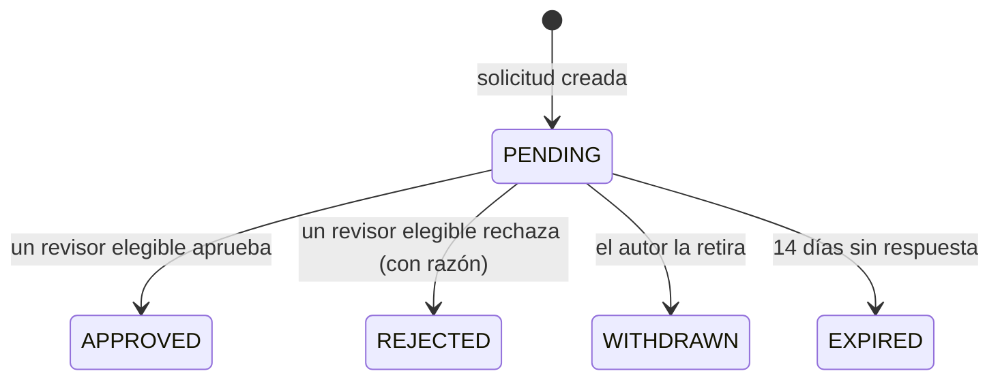

# AUTHORIZATION.md — Autenticación, roles, alcances y permisos

> Estado: `[DECIDIDO]` (matriz confirmada el 2026-10-26, `OQ-005`). La obtención de roles (§9) está `[DECIDIDO]` (`DEC-056`). También están decididos los permisos asignables estilo Spatie con CASL (§4.1, §6, `DEC-058`), el borrado lógico solo por `platform_admin` (§10, `DEC-059`) y la autenticación estilo Fortify (§11, `DEC-057`). La matriz se ajustará cuando se conozca el reglamento de ASCUN vigente (quién inscribe, quién alinea, plazos). Los plazos de reclamación siguen `SRC-01` Art. 5 (`BR-AUD-07`).
> Implementación: CASL + membresías con alcance (`DEC-011`). Historias: `US-023`, `US-024`, `US-025`, `US-026`.

## 1. Principios

1. **El permiso es acción + recurso + condición**, no solo rol. Un árbitro lo es *de un torneo concreto*; un capitán *de su equipo*.
2. **La API siempre autoriza.** La UI usa `can()` solo para mostrar u ocultar controles.
3. **Defensa en profundidad:** guard (rol y condición) → servicio de dominio (reglas de estado) → RLS (aislamiento por organización).
4. **Mínimo privilegio:** cada rol recibe solo lo necesario; los permisos de excepción (override, reapertura) son explícitos y exigen `reason`.
5. **Todo lo sensible se audita** (`BR-AUD-02`): cambios de rol, reaperturas, overrides, acciones de plataforma.
6. **Fallar cerrado:** sin membresía aplicable, la acción se niega.
7. Los permisos **no viajan en el JWT**; se cargan por petición con caché corta (`ARCHITECTURE.md` §12).
8. **Toda cuenta nueva es espectador.** Los roles solo se obtienen por asignación directa con razón o por solicitud aprobada (§9).
9. **Un rol es un conjunto de permisos** del catálogo (§4.1). Los roles del sistema traen la matriz de §4 por defecto; solo el `platform_admin` los cambia o crea roles propios por organización (`DEC-058`).
10. **Solo el `platform_admin` borra**, y siempre de forma lógica (§10).

## 2. Alcances (scopes)

| Alcance | `scope_id` | Descripción |
|---|---|---|
| `PLATFORM` | — | Operación de la plataforma |
| `ORGANIZATION` | `organization_id` | Una universidad, liga o federación (tenant) |
| `TOURNAMENT` | `tournament_id` | Un torneo concreto dentro de una organización |
| `TEAM` | `team_id` (o `institution_id` si el equipo aún no existe) | Un equipo/delegación |

Un permiso en un alcance **incluye** los alcances contenidos (p. ej. `org_admin` actúa sobre todos los torneos de su organización), nunca al revés.

## 3. Roles

| Rol | Alcance | Descripción | Quién puede asignarlo |
|---|---|---|---|
| `platform_admin` | PLATFORM | Opera la plataforma: es el único que borra, restaura, archiva, anonimiza, suspende cuentas y edita roles y permisos (acciones auditadas) | Solo por comando de consola auditado (`BR-ROLE-01`); nunca por API |
| `org_owner` | ORGANIZATION | Dueño; puede todo dentro de la organización salvo borrar (solo `platform_admin`, §10) | `platform_admin` / `org_owner` |
| `org_admin` | ORGANIZATION | Administra torneos y miembros | `org_owner` |
| `tournament_director` | TOURNAMENT | Configura y dirige un torneo | `org_owner`, `org_admin` |
| `arbiter` | TOURNAMENT | Registra y corrige resultados de su torneo | `tournament_director` y superiores |
| `captain` | TEAM | Gestiona su equipo (plantilla y alineaciones) | `tournament_director` y superiores |
| `player` | TOURNAMENT | Jugador vinculado a una cuenta; ve su información | `tournament_director` y superiores (o vinculación) |
| *(rol propio)* | El que declare | Rol de una organización con un subconjunto del catálogo de permisos; lo crea y edita solo `platform_admin` (§4.1) | Según la regla de no escalada |
| `viewer` (espectador) | — | Rol por defecto de toda cuenta nueva y de los visitantes anónimos: sin membresías, solo lectura pública y suscripciones (`BR-ROLE-01`) | Automático al registrarse |

> **Implementación (`US-023`, 2026-10-27; decisiones `PROPUESTO`):** tablas `roles` (los 7 roles del sistema, sin permisos todavía: llegan con `US-024`), `organizations` y `memberships`; un rol solo se otorga en su alcance (clave compuesta con `roles`) y hay una membresía viva por usuario, rol y alcance (`DEC-099`). Las enumeraciones de rol, alcance y origen viven en `@torre/contracts` (`ROLE_KEYS`, `ROLE_SCOPES`, `SCOPE_TYPES`, `MEMBERSHIP_SOURCES`) y la web nombra cada una en español. "Debe existir siempre al menos un `org_owner`" lo garantiza la base con *triggers* diferidos al `COMMIT` que bloquean la organización y cuentan sus dueños. `POST /organizations` exige, hasta `US-024`, una membresía viva en el alcance `PLATFORM` (`DEC-100`); quien crea queda como `org_owner` con origen `CREATOR`, y la creación y el rol quedan en `audit_log` (`DEC-101`). `GET /organizations` y `GET /me/memberships` listan lo propio.

**Regla de no escalada (con permisos editables):** se puede otorgar el rol *R* en el alcance *S* solo si quien lo otorga tiene el permiso `membership.grant` en *S* **y** todos los permisos de *R* (subconjunto). Nunca fuera de su alcance, y `platform_admin` nunca por API. Debe existir siempre al menos un `org_owner` por organización.

Con los permisos por defecto, esta regla equivale a la jerarquía `org_owner` > `org_admin` > `tournament_director` > `arbiter` > `captain` > `player` > `viewer`; un `arbiter` no otorga nada porque no tiene `membership.grant`. Si el `platform_admin` edita un rol, manda la regla del subconjunto.

## 4. Matriz de permisos por defecto de los roles del sistema

> Esta matriz es la **semilla** de los permisos de cada rol del sistema (`DEC-058`); el `platform_admin` puede cambiarla. La prueba `INV-T-8` (`apps/api/src/authz/matrix.spec.ts`) lee esta tabla y verifica que la semilla del código (`SYSTEM_ROLE_PERMISSIONS`) coincide con ella: un rol marcado ✓ o ✓* en una fila recibe **todas** las claves de su columna "Permisos". Las filas "todos…" con clave son permisos de la cuenta propia (§4.1), que tiene toda cuenta con sesión sin pasar por un rol; sin clave ("—"), son lectura o acción pública. Las claves están en §4.1 (columna añadida y filas separadas por clave en `US-024a`, `DEC-103`).

Leyenda: ✓ permitido · ✓* permitido **con condición** (ver columna) · — no permitido. `PA` platform_admin, `OO` org_owner, `OA` org_admin, `TD` tournament_director, `AR` arbiter, `CP` captain, `PL` player.

| Acción | Recurso | Permisos | PA | OO | OA | TD | AR | CP | PL | Condición |
|---|---|---|---|---|---|---|---|---|---|---|
| Gestionar catálogo de instituciones | Institution | `institution.manage` | ✓ | — | — | — | — | — | — | |
| Crear organización | Organization | `organization.create` | ✓ | — | — | — | — | — | — | Directamente solo PA; las demás cuentas, por solicitud que aprueba PA (`BR-ROLE-05`, `DEC-056`). Quien la crea o la solicita queda como `org_owner` |
| Ver organización | Organization | `organization.view` | ✓ | ✓* | ✓* | ✓* | ✓* | ✓* | ✓* | Solo con membresía en ella |
| Editar organización | Organization | `organization.update` | ✓ | ✓ | ✓* | — | — | — | — | OA: datos generales |
| Borrar organización (lógico) | Organization | `organization.delete` | ✓ | — | — | — | — | — | — | Permiso reservado; sin torneos en curso; razón y confirmación de contraseña (§10) |
| Gestionar miembros y roles (cambio directo) | Membership | `membership.grant`, `membership.revoke` | ✓ | ✓ | ✓* | ✓* | — | — | — | Solo roles inferiores y dentro de su alcance; `reason` obligatoria (`BR-ROLE-02`) |
| Solicitar un rol | RoleRequest | `role_request.create` | todos los usuarios autenticados, incluido `viewer` | | | | | | | Con razón; una pendiente por rol y alcance (`BR-ROLE-03`) |
| Retirar una solicitud propia | RoleRequest | `role_request.create` | todos los usuarios autenticados | | | | | | | Solo si está pendiente |
| Ver y resolver solicitudes de rol | RoleRequest | `role_request.review` | ✓ | ✓* | ✓* | ✓* | — | — | — | Solo las que podría otorgar directamente, en su alcance; nunca la propia; razón al rechazar (`BR-ROLE-05`) |
| Crear versión de `RuleSet` (borrador) | RuleSet | `ruleset.create_draft` | ✓ | ✓* | ✓* | ✓* | — | — | — | De su organización; los presets de plataforma (`organization_id NULL`) solo PA (`DEC-047`) |
| Aprobar / deprecar `RuleSet` | RuleSet | `ruleset.approve` | ✓ | ✓* | ✓* | — | — | — | — | Sin parámetros "sin confirmar" (`BR-GEN-04`); OO/OA solo los de su organización; presets de plataforma solo PA |
| Ver jugadores | Player | `player.view` | ✓ | ✓ | ✓ | ✓* | ✓* | ✓* | — | TD/AR: de sus torneos; CP: de su institución/equipo |
| Crear/editar jugadores | Player | `player.create`, `player.update` | ✓ | ✓ | ✓ | ✓ | — | ✓* | — | CP: solo de su institución/equipo |
| Importar jugadores (CSV) | Player | `player.import` | ✓ | ✓ | ✓ | ✓ | — | — | — | |
| Importar ratings (FIDE/nacional) | Player | `rating.import` | ✓ | ✓ | ✓ | ✓* | — | — | — | TD: de jugadores de sus torneos (`US-104`) |
| Vincular jugador con cuenta | Player | `player.link` | ✓ | ✓ | ✓ | ✓* | — | — | ✓* | TD: de sus torneos; PL: acepta su propia vinculación (`US-102`) |
| Ver mis partidas, mesa y posición | Game | `game.view_own` | — | — | — | — | — | — | ✓* | Solo el jugador vinculado (`US-102`) |
| Crear torneo | Tournament | `tournament.create` | ✓ | ✓ | ✓ | — | — | — | — | |
| Configurar torneo | Tournament | `tournament.configure` | ✓ | ✓ | ✓ | ✓* | — | — | — | TD: de su torneo y solo en `DRAFT`/estados permitidos |
| Abrir/cerrar el check-in de una ronda | Round | `round.checkin_manage` | ✓ | ✓ | ✓ | ✓* | — | — | — | Si el torneo lo activó (`BR-WD-06`) |
| Marcar o deshacer el check-in de un participante | Participant | `participant.checkin_mark` | ✓ | ✓ | ✓ | ✓* | ✓* | — | — | AR/TD: de cualquier participante de su torneo; con el check-in abierto |
| Marcar o deshacer el check-in propio | Participant | `participant.checkin_self` | — | — | — | — | — | — | ✓* | PL: solo el propio; con el check-in abierto |
| Abrir/cerrar inscripción, iniciar, finalizar, cancelar | Tournament | `tournament.transition` | ✓ | ✓ | ✓ | ✓* | — | — | — | TD: de su torneo; transición válida (`BR-LIFE-01`) |
| Cerrar torneo | Tournament | `tournament.close` | ✓ | ✓ | ✓ | ✓* | — | — | — | Todas las rondas `CLOSED` |
| Reabrir torneo cerrado | Tournament | `tournament.reopen` | ✓ | ✓ | ✓ | — | — | — | — | `reason` obligatorio |
| Inscribir participante individual | Participant | `participant.register` | ✓ | ✓ | ✓ | ✓* | — | ✓* | — | Ventana abierta; CP: solo su institución; con marca de elegibilidad (`BR-REG-01`) |
| Ajustar siembra | Participant | `participant.seed_adjust` | ✓ | ✓ | ✓ | ✓* | — | — | — | `reason` (`BR-REG-04`) |
| Registrar o retirar bye solicitado | Participant | `bye.request` | ✓ | ✓ | ✓ | ✓* | — | — | — | Antes de emparejar la ronda (`BR-WD-03`) |
| Retirar participante | Participant | `participant.withdraw` | ✓ | ✓ | ✓ | ✓* | — | ✓* | — | CP: solo el suyo |
| Reincorporar participante | Participant | `participant.reinstate` | ✓ | ✓ | ✓ | ✓* | — | — | — | |
| Registrar equipo / editar plantilla | Team, Roster | `team.register`, `roster.update` | ✓ | ✓ | ✓ | ✓* | — | ✓* | — | CP: solo su equipo y dentro de plazo |
| Presentar alineación | Lineup | `lineup.submit` | ✓ | ✓ | ✓ | ✓* | — | ✓* | — | CP: su equipo; plazo del `RuleSet` |
| Programar ronda | Round | `round.schedule` | ✓ | ✓ | ✓ | ✓* | — | — | — | `BR-LIFE-06` |
| Generar/descartar borrador de ronda | Round | `round.pair` | ✓ | ✓ | ✓ | ✓* | — | — | — | Ronda anterior `CLOSED` (Suizo) |
| Ajustar emparejamiento en borrador | Pairing | `pairing.adjust` | ✓ | ✓ | ✓ | ✓* | — | — | — | Solo `PAIRED_DRAFT` |
| Forzar violación absoluta (override) | Pairing | `pairing.override` | — | ✓ | ✓ | ✓* | — | — | — | Permiso explícito + `reason` (`BR-PAIR-08`) |
| Publicar ronda | Round | `round.publish` | ✓ | ✓ | ✓ | ✓* | — | — | — | |
| Registrar resultado | Game | `game.record` | ✓ | ✓ | ✓ | ✓* | ✓* | — | — | Ronda `PUBLISHED`; partida `PENDING`; AR/TD de ese torneo |
| Corregir resultado | Game | `game.correct` | ✓ | ✓ | ✓ | ✓* | ✓* | — | — | `reason`. AR: solo con la ronda `PUBLISHED`/`COMPLETED` y la siguiente sin publicar |
| Corrección administrativa de resultado | Game | `game.correct_admin` | ✓ | ✓ | ✓ | ✓* | — | — | — | `reason`; con la ronda `CLOSED` o la siguiente publicada (`BR-AUD-03`, `DEC-051`) |
| Registrar forfeit/bye | Game | `game.forfeit` | ✓ | ✓ | ✓ | ✓* | ✓* | — | — | Motivo; reglas del `RuleSet` |
| Cerrar ronda | Round | `round.close` | ✓ | ✓ | ✓ | ✓* | — | — | — | Ronda `COMPLETED` |
| Reabrir ronda | Round | `round.reopen` | ✓ | ✓ | ✓ | ✓* | — | — | — | `reason`; la siguiente sin publicar; marca rondas posteriores `STALE` (`BR-LIFE-04`) |
| Mantener una ronda `STALE` | Round | `round.stale_ack` | ✓ | ✓ | ✓ | ✓* | — | — | — | `BR-AUD-03` |
| Desempatar por sorteo | Standing | `standing.draw_lots` | ✓ | ✓ | ✓ | ✓* | — | — | — | Con semilla registrada (`BR-TIE-05`) |
| Generar reportes | Report | `report.generate` | ✓ | ✓ | ✓ | ✓* | ✓* | — | — | De su torneo |
| Descargar reportes | Report | `report.download` | ✓ | ✓ | ✓ | ✓* | ✓* | ✓* | ✓* | Según visibilidad del torneo y del reporte |
| Ver línea de tiempo de auditoría | Audit | `audit.view` | ✓ | ✓ | ✓ | ✓* | ✓* | — | — | De su torneo; AR solo lectura |
| Presentar reclamación | Claim | `claim.file` | ✓ | ✓ | ✓ | ✓ | — | ✓* | ✓* | CP: de su equipo o institución; PL: propias; dentro de plazo (`BR-AUD-07`) |
| Resolver reclamación | Claim | `claim.resolve` | ✓ | ✓ | ✓ | ✓* | — | — | — | Con razón; de su torneo (representa a la comisión, `SRC-02` Art. 2) |
| Gestionar campeonato | Championship | `championship.manage` | ✓ | ✓ | ✓ | — | — | — | — | De su organización (`US-100`) |
| Borrar cualquier recurso (lógico) | todos | `player.delete`, `ruleset.delete`, `championship.delete`, `institution.delete`, `user.delete`, `report.delete`, `role.delete` | ✓ | — | — | — | — | — | — | Permiso reservado (`<recurso>.delete`); razón y confirmación de contraseña (§10) |
| Ver la papelera y restaurar | Trash | `trash.view`, `trash.restore` | ✓ | — | — | — | — | — | — | Permiso reservado; restaura el lote completo (`BR-DEL-05`) |
| Archivar / desarchivar torneo | Tournament | `tournament.archive` | ✓ | — | — | — | — | — | — | Permiso reservado; los eventos no se tocan (`BR-DEL-06`) |
| Anonimizar a un titular | User, Player | `privacy.anonymize` | ✓ | — | — | — | — | — | — | Permiso reservado; irreversible; por solicitud del titular (`US-111`) |
| Resolver solicitudes de los titulares | DataSubjectRequest | `privacy.resolve` | ✓ | — | — | — | — | — | — | Permiso reservado (`US-111`) |
| Gestionar roles y permisos | Role | `role.manage` | ✓ | — | — | — | — | — | — | Permiso reservado (§4.1) |
| Suspender / reactivar cuentas | User | `user.suspend` | ✓ | — | — | — | — | — | — | Permiso reservado; razón (`BR-AUTH-08`) |
| Ver torneo y resultados | Tournament | `tournament.view_private` | ✓ | ✓ | ✓ | ✓* | ✓* | ✓* | ✓* | Torneo `PRIVATE`: solo con membresía |
| Ver torneo público/no listado | Tournament | — (lectura pública) | todos (incluye `viewer`) | | | | | | | `PUBLIC`; `UNLISTED` con enlace |
| Crear suscripción | Subscription | — (pública) | todos | | | | | | | Con consentimiento y confirmación (`BR-NOTIF-01`) |
| Gestionar suscripción propia | Subscription | `subscription.manage_own` | todos | | | | | | | Con token (`US-063`) |
| Editar el perfil propio | User | `profile.update_own` | todos los usuarios autenticados | | | | | | | Solo el propio |
| Ejercer los derechos sobre los datos propios | DataSubjectRequest | `privacy.request_own` | todos los usuarios autenticados | | | | | | | Solo los propios (`US-111`) |

Notas:
- `✓*` implica **condición sobre el recurso cargado**, no solo sobre el rol.
- `player` puede ver sus datos y, si el `RuleSet` lo permitiera, reportar un resultado **pendiente de confirmación** por un árbitro. **No** está habilitado por defecto.
- El árbitro principal que además deba generar rondas recibe también el rol `tournament_director` en ese torneo (un usuario puede tener varias membresías).

### 4.1 Catálogo de permisos (`DEC-058`, estilo Spatie)

El catálogo es **fijo y vive en el código** (`packages/contracts/src/permissions.ts`); el comando `permissions:sync` lo carga en la tabla `permissions`. Cada permiso define, en código, la acción y el sujeto de CASL, los alcances donde aplica y las **condiciones sobre el recurso** (p. ej. `game.record` solo en torneos del alcance de la membresía). Las condiciones y las reglas de estado (§5) **no** se configuran: los permisos solo deciden *quién* puede.

| Grupo | Permisos (clave) | Reservado |
|---|---|---|
| Plataforma | `institution.manage`, `organization.create`, `role.manage`, `user.suspend`, `trash.view`, `trash.restore`, `privacy.anonymize`, `privacy.resolve`, `tournament.archive` | **Sí** |
| Borrado | `<recurso>.delete` para todo recurso CRUD: hoy `organization.delete`, `player.delete`, `ruleset.delete`, `championship.delete`, `institution.delete`, `user.delete`, `report.delete`, `role.delete`; cada recurso CRUD nuevo añade el suyo | **Sí** |
| Organización | `organization.view`, `organization.update`, `membership.grant`, `membership.revoke`, `role_request.review`, `championship.manage` | No |
| Reglas | `ruleset.create_draft`, `ruleset.approve` (los presets de plataforma solo los aprueba PA) | No |
| Jugadores | `player.view`, `player.create`, `player.update`, `player.import`, `player.link`, `rating.import` | No |
| Torneo | `tournament.create`, `tournament.configure`, `tournament.transition`, `tournament.close`, `tournament.reopen`, `tournament.view_private`, `game.view_own` | No |
| Inscripción | `participant.register`, `participant.withdraw`, `participant.reinstate`, `participant.seed_adjust`, `bye.request` | No |
| Equipos | `team.register`, `roster.update`, `lineup.submit` | No |
| Rondas | `round.schedule`, `round.checkin_manage`, `participant.checkin_mark`, `participant.checkin_self`, `round.pair`, `pairing.adjust`, `pairing.override`, `round.publish`, `round.close`, `round.reopen`, `round.stale_ack` | No |
| Resultados | `game.record`, `game.correct`, `game.correct_admin`, `game.forfeit`, `standing.draw_lots` | No |
| Reportes y auditoría | `report.generate`, `report.download`, `audit.view` | No |
| Reclamaciones | `claim.file`, `claim.resolve` | No |
| Cuenta propia (todos los autenticados) | `role_request.create`, `profile.update_own`, `subscription.manage_own`, `privacy.request_own` | No |

Reglas del catálogo:
- **Permisos reservados:** solo los tiene `platform_admin`. Asignarlos a cualquier otro rol devuelve `RESERVED_PERMISSION` (`INV-T-6`).
- **Roles del sistema:** los 7 de §3 se siembran con la matriz de §4 y el `platform_admin` puede editarlos ("restaurar valores por defecto" vuelve a la matriz).
- **Roles propios:** un rol de una organización (`roles.organization_id`) con un subconjunto del catálogo, válido solo en esa organización y sus torneos. Los crea y edita **solo** `platform_admin` (`DEC-058`).
- Quitar un permiso del código exige una migración que lo retire de los roles, y queda auditada.
- Todo cambio de un rol (permisos antes y después) queda en `audit_log`, con razón y confirmación de contraseña (`BR-AUTH-05`).

## 5. Condiciones por estado (reglas que el rol no puede saltarse)

| Estado del recurso | Efecto |
|---|---|
| Torneo `CLOSED`/`CANCELLED` | Solo lectura; reabrir requiere permisos y razón |
| Ronda `CLOSED` | Sin resultados ni correcciones; reabrir requiere razón |
| Ronda `PAIRED_DRAFT` | Invisible al público; solo ajustes de dirección |
| Inscripción cerrada | Sin altas de participantes (salvo reglas de inscripción tardía) |
| Plazo de alineación vencido | Sin cambios de alineación del capitán |
| Ronda siguiente publicada | Las correcciones de la ronda anterior solo son administrativas (TD+, `DEC-051`) |
| Reclamación fuera de plazo | Se rechaza con `CLAIM_OUT_OF_TIME` (`BR-AUD-07`) |
| Solicitud de rol pendiente | Solo su autor la retira; solo un revisor elegible la aprueba o rechaza |
| Solicitud resuelta, retirada o vencida | No cambia (`ROLE_REQUEST_NOT_PENDING`); una petición nueva crea otro registro |

## 6. Implementación

### 6.1 CASL (esquema)

```ts
import { AbilityBuilder, createMongoAbility, type MongoAbility } from '@casl/ability';

type Action = 'read' | 'create' | 'update' | 'delete' | 'restore' | 'archive' | 'anonymize' | 'manage' | 'grant' | 'review'
  | 'record' | 'correct' | 'correctAdmin' | 'publish' | 'close' | 'reopen' | 'override';
type Subject = 'Organization' | 'Championship' | 'Tournament' | 'Participant' | 'Team' | 'Lineup' | 'Round' | 'Pairing' | 'Game' | 'Standing' | 'Claim' | 'Prize' | 'Report' | 'Audit' | 'Membership' | 'RoleRequest' | 'RuleSet' | 'Player' | 'all';
export type AppAbility = MongoAbility<[Action, Subject | Record<string, unknown>]>;

// Grant = { permission: PermissionKey; scope: { type: ScopeType; id: string | null } }
// se carga por petición: memberships → roles → role_permissions (con caché, §6.1)
export function defineAbilitiesFor(user: AuthUser, grants: readonly Grant[]): AppAbility {
  const { can, cannot, build } = new AbilityBuilder<AppAbility>(createMongoAbility);

  // lectura pública
  can('read', 'Tournament', { visibility: 'PUBLIC', archivedAt: null });

  for (const g of grants) {
    const def = PERMISSION_CATALOG[g.permission];          // definido en código (§4.1)
    can(def.action, def.subject, def.conditions(g.scope));  // p. ej. game.record → { tournamentId: g.scope.id }
  }

  // reglas de estado: ningún conjunto de permisos puede saltárselas (INV-T-7)
  cannot(['record', 'correct'], 'Game', { roundStatus: 'CLOSED' });   // solo 'correctAdmin' (DEC-051)
  cannot(['update', 'create'], 'Participant', { tournamentStatus: { $in: ['CLOSED', 'CANCELLED'] } });
  return build();
}
```

- El **recurso** que se evalúa se carga primero (con sus atributos de estado: `tournamentId`, `roundStatus`, `teamId`, `institutionId`, …).
- La interfaz `AuthorizationService.can(user, action, resource)` envuelve CASL para poder cambiarlo.
- **API estilo Spatie** (`RolesService`, solo `platform_admin`): `createRole`, `syncPermissions(role, keys)`, `givePermissionTo`, `revokePermissionTo`. Para membresías: `assignRole(user, role, scope)`, `removeRole`, `hasRole`, `can(user, permission, resource)`.
- **Caché:** los permisos efectivos se guardan en Redis por usuario y por una versión global de roles; cambiar un rol, sus permisos o una membresía incrementa la versión y la caché se invalida en la siguiente petición.
- **Listados:** `@casl/prisma` (`accessibleBy`) filtra las consultas según la habilidad, como los *scopes* de Eloquent.

### 6.2 Dónde se aplica

1. **Decorador** `@RequirePermission(...)` en cada operación (guard de Nest o middleware de oRPC, según lo que resuelva la prueba de `US-008`).
2. **Servicio de aplicación:** comprueba la acción contra el recurso cargado y las reglas de estado antes de ejecutar el comando.
3. **Dominio (`decide`)**: valida las reglas de estado del negocio (`BR-LIFE-*`) independientemente del rol.
4. **Base de datos:** RLS por `organization_id` (`US-025`).
5. **Web:** `@casl/vue` o un composable `useCan()` con las reglas de `GET /me/abilities`, solo para la UI.

## 7. Pruebas obligatorias

1. **Matriz generada desde tabla** (`US-024`): rol × acción × recurso × estado. El archivo de la tabla se versiona; cada cambio de política muestra qué casos cambian.
2. **IDOR (`INV-T-3`):**
   - Un `captain` del equipo A no puede actualizar plantilla ni alineación del equipo B cambiando el ID.
   - Un `arbiter` del torneo X no puede registrar resultados en el torneo Y.
   - Un `tournament_director` no puede configurar torneos de otra organización.
   - Un usuario sin membresía no accede a torneos `PRIVATE` ni a sus reportes.
3. **Aislamiento (`INV-T-1`):** consultas directas a BD con tenant A no devuelven datos de B (`US-025`).
4. **No escalada:** un `org_admin` no puede otorgar `org_owner`; un `arbiter` no puede otorgar nada.
5. **Estado:** nadie registra resultados nuevos en rondas `CLOSED` (las correcciones administrativas siguen `DEC-051`) ni inscribe en torneos `CLOSED`.
6. **Sesiones:** refresh reutilizado revoca la familia (`INV-A-1`).
7. **Corrección administrativa:** un `arbiter` no corrige en una ronda `CLOSED`; un `tournament_director` sí, con razón (`DEC-051`).
8. **RuleSets globales:** un `org_admin` no puede aprobar un preset de plataforma (`DEC-047`).
9. **Roles:** una cuenta nueva no tiene membresías; un revisor no aprueba un rol que no podría otorgar; el autor no resuelve su propia solicitud; no hay dos pendientes iguales; una solicitud vencida no se aprueba (`INV-T-4`, `INV-T-5`).
10. **Permisos editables:** la semilla coincide con §4 (`INV-T-8`); ningún permiso reservado fuera de `platform_admin` (`INV-T-6`); para conjuntos de permisos aleatorios, las reglas de estado no se saltan (`INV-T-7`, propiedad); un cambio de rol surte efecto en la siguiente petición.
11. **Borrado:** nadie distinto de `platform_admin` borra, restaura ni ve la papelera; el rol de la app no puede ejecutar `DELETE` (`INV-D-1`).

## 8. Trampas habituales (y cómo se evitan)

| Trampa | Mitigación |
|---|---|
| Permisos en el JWT quedan obsoletos | Cargar membresías por petición con caché corta |
| Comprobar rol pero no propiedad (IDOR) | Condiciones sobre el recurso cargado + pruebas de la §7 |
| Superadmin sin rastro | Acciones de plataforma sobre datos de una organización se auditan |
| Excepciones sin razón | `reason` obligatorio para correcciones, reaperturas y overrides |
| Permisos editables que permiten escalar | Regla del subconjunto (§3), permisos reservados (§4.1) y solo `platform_admin` edita roles |
| Borrados que se pierden o no se pueden explicar | Borrado lógico con razón, lote y papelera; el rol de la app no tiene `DELETE` (§10) |
| Comprobar solo en la UI | La API siempre autoriza; la UI solo refleja |
| Olvidar el contexto de tenant | RLS falla cerrado: sin tenant, cero filas (`US-025`) |
| Decidir por el nombre del rol (`if (role === 'arbiter')`) | ESLint lo prohíbe en `apps/*` y `packages/*` (comparar con una clave de rol o usarla en un `case`); definir los roles en el catálogo o en los *seeds* sí se permite (`TC-064`) |

## 9. Cuentas, cambio de rol y solicitudes de rol (`DEC-056`)

> `[DECIDIDO]` el 2026-10-25. Implementación: `US-028` (cambio directo) y `US-029` (solicitudes). Las membresías y las solicitudes son CRUD auditado, no *event-sourced* (`ARCHITECTURE.md` §7.1).

**BR-ROLE-01 — Toda cuenta nace como espectador.** Registrarse no crea membresías: una cuenta sin membresías es `viewer` (solo lectura pública y suscripciones). Ningún rol se obtiene al registrarse. Excepción: el primer `platform_admin`, que se crea con un comando de consola auditado (`users:grant-platform-admin --email`) o, en desarrollo, con el seed.

**BR-ROLE-02 — Cambio directo de rol.** Quien tiene el permiso "Gestionar miembros y roles" sobre un alcance puede asignar, cambiar o revocar roles en él **sin solicitud previa**, con `reason` obligatoria (mínimo 10 caracteres). Respeta la regla de no escalada (§3) y la de "al menos un `org_owner`". Surte efecto de inmediato (se invalida la caché de membresías del usuario afectado) y queda en `audit_log` con actor, rol anterior y nuevo, alcance, razón y origen `DIRECT`. `platform_admin` nunca se otorga por API.

**BR-ROLE-03 — Solicitud de rol.** Una cuenta autenticada puede solicitar un rol indicando:
- el rol y el alcance: organización, torneo o equipo existentes, o **nueva organización** (con el nombre propuesto; pide `org_owner`);
- una **razón** obligatoria de 30 a 1 000 caracteres, sin contar los espacios al inicio y al final;
- un cargo o vínculo opcional (texto breve, p. ej. "coordinador de deportes de la universidad");
- sin documentos adjuntos.

No se admite: una segunda solicitud pendiente para el mismo rol y alcance (`ROLE_REQUEST_DUPLICATE`); pedir un rol que ya se tiene (`ROLE_ALREADY_GRANTED`); pedir `platform_admin`; ni más de 5 solicitudes por día por cuenta (`RATE_LIMITED`). La UI advierte que la razón no debe incluir datos personales sensibles (`BR-PRIV-01`).

**BR-ROLE-04 — Estados de la solicitud.**



- Solo existen esas transiciones: una solicitud resuelta, retirada o vencida no cambia (`ROLE_REQUEST_NOT_PENDING`).
- El vencimiento se evalúa con `expires_at` al leerla, con una función pura `effectiveStatus(request, now)` que recibe el reloj inyectado. Un *job* periódico la marca en la base y avisa al autor (`US-112`).
- Aprobar crea **en la misma transacción** la membresía (origen `REQUEST`, enlazada a la solicitud) o, si se pidió una nueva organización, la organización con su `org_owner`. Aprobar dos veces no duplica nada.
- Rechazar exige razón; al aprobar es opcional.

**BR-ROLE-05 — Revisor elegible.** Resuelve una solicitud quien podría otorgar ese rol directamente en ese alcance (§3: `membership.grant` en el alcance y todos los permisos del rol). Con los permisos por defecto queda así:

| Rol pedido | Alcance | Revisor elegible |
|---|---|---|
| `org_owner` de una **nueva organización** | — | `platform_admin` |
| `org_owner` | Organización existente | `org_owner` de esa organización, `platform_admin` |
| `org_admin` | Organización | `org_owner`, `platform_admin` |
| `tournament_director` | Torneo | `org_owner` u `org_admin` de la organización del torneo, `platform_admin` |
| `arbiter`, `captain` | Torneo / equipo | `tournament_director` de ese torneo y superiores |
| `player` | — | No se solicita: es la vinculación de `US-102` |
| `platform_admin` | — | No se puede solicitar |

El autor **nunca** resuelve su propia solicitud, aunque tenga un rol que se lo permitiría. Cada revisor ve solo las solicitudes de su alcance.

**BR-ROLE-06 — Avisos.** En el centro de avisos de la app (`US-112`): los revisores ven el contador de pendientes de su alcance y el autor ve el estado de las suyas (y la razón, si fue rechazada). Además se envía email cuando exista la infraestructura de EP-06 (`US-061`).

**BR-ROLE-07 — Auditoría.** Crear, retirar, aprobar, rechazar y vencer una solicitud, y todo cambio directo, quedan en `audit_log` con actor, hora, alcance y razón. Las solicitudes resueltas se conservan.

## 10. Borrado lógico (`DEC-059`)

> `[DECIDIDO]` el 2026-10-25. Implementación: `US-109`; técnica en `ARCHITECTURE.md` §8.4.

**BR-DEL-01 — Solo el `platform_admin` borra.** Los permisos de borrado, papelera, restauración, archivo de torneos y anonimización son reservados (§4.1). Los demás roles solo cambian estados: cancelar un torneo, retirar un participante, revocar una membresía, rechazar una solicitud.

**BR-DEL-02 — Nunca hay borrado físico.** Toda tabla de negocio CRUD lleva `deleted_at`, `deleted_by`, `delete_reason` (obligatoria) y `deletion_batch_id`. El rol de la aplicación **no tiene privilegio `DELETE`** sobre esas tablas, así que un borrado físico desde la app es imposible (`INV-D-1`). Los eventos del torneo nunca se borran (`BR-AUD-01`). Excepción: tablas técnicas (tokens vencidos, claves de idempotencia vencidas, filas publicadas del *outbox*), que un *job* de mantenimiento purga con un rol propio.

**BR-DEL-03 — Lo borrado queda oculto.** Una política RLS restrictiva oculta las filas con `deleted_at` en todas las consultas normales (`INV-D-2`). Solo el servicio de papelera, después de verificar `trash.view`, fija `app.include_deleted` en la transacción para verlas. Las restricciones de unicidad son índices parciales `WHERE deleted_at IS NULL`.

**BR-DEL-04 — Cascada lógica.** Borrar un recurso marca, en la misma transacción y con el mismo `deletion_batch_id`, a sus dependientes CRUD (p. ej. una organización y sus jugadores y campeonatos). No se puede borrar una organización con torneos en curso (`HAS_ACTIVE_TOURNAMENTS`).

**BR-DEL-05 — Restaurar.** El `platform_admin` restaura con razón; se restaura el **lote completo** (`INV-D-3`). Si mientras tanto se ocupó un valor único (p. ej. un *slug*), la restauración falla con `RESTORE_CONFLICT` y no restaura nada.

**BR-DEL-06 — Torneos: se archivan.** Un torneo es un *stream* de eventos y no se borra: `TournamentArchived` y `TournamentUnarchived` (solo `platform_admin`, con razón) lo ocultan de listados, búsquedas y vistas públicas sin tocar sus eventos. Cancelar (`TournamentCancelled`) sigue siendo un cambio de estado de la dirección del torneo.

**BR-DEL-07 — Eliminación definitiva = anonimización.** La única eliminación sin vuelta atrás es la **anonimización** de un titular (usuario, jugador, suscriptor) por una solicitud basada en la Ley 1581 (`US-111`): sus datos personales se reemplazan por valores irreversibles y se conservan los IDs, los resultados y las clasificaciones. Es posible porque los eventos no contienen datos personales (`BR-AUD-06`). Queda auditada (`INV-D-4`); riesgo legal aceptado (`DEC-065`).

**BR-DEL-08 — Confirmación.** Borrar, restaurar, archivar y anonimizar exigen razón y confirmación de contraseña reciente (`BR-AUTH-05`); con 2FA activo, también el segundo factor en la sesión.

## 11. Autenticación estilo Fortify (`DEC-057`)

> `[DECIDIDO]` el 2026-10-25. Módulo `auth` propio y *headless* sobre `@nestjs/passport` (`passport-jwt` en cada petición), `@nestjs/jwt`, `argon2` y `@nestjs/throttler`; 2FA con `otplib` + `qrcode`. Historias: `US-022`, `US-027`, `US-107`.
>
> **Implementación (`US-022a1`, 2026-10-27):** el login no usa `passport-local`: la ruta es un contrato oRPC (`ADR-0002`), cuyo *handler* solo ve cabeceras y no recibe el `req.user` de un guard; la entrada la valida el contrato y las credenciales `AuthService.verifyCredentials`, con el mismo tiempo de respuesta exista o no la cuenta. `passport-jwt` sí es el guard global (`JwtAuthGuard`, rutas abiertas con `@Public()`), y deja la identidad en el contexto de la petición (`nestjs-cls`) para los *handlers*. Con `COOKIE_SECURE=false` (solo local) la cookie se llama `torre-refresh-dev`, porque los navegadores rechazan el prefijo `__Host-` sin `Secure`. La lista de contraseñas comunes se compara sin distinguir mayúsculas.
>
> **Implementación (`US-022a2`, 2026-10-27):** `POST /auth/refresh` gasta el *refresh* con un *compare-and-set* (`UPDATE … WHERE revoked_at IS NULL`) dentro de la transacción: de dos peticiones con el mismo token gana una; la otra cuenta como reutilización y revoca la familia entera, con el sucesor del ganador incluido (`INV-A-1`, `DEC-092`). La web serializa la renovación entre pestañas con Web Locks (`navigator.locks`, `US-066`). El sucesor vence con la sesión (24 h desde el login). Token ausente, desconocido, vencido, revocado o reutilizado: el mismo 401. CSRF (`DEC-091`): `Sec-Fetch-Site: same-origin` pasa y `cross-site` se rechaza; `same-site`, `none` o sin la cabecera exigen un `Origin` (o, si falta, un `Referer`) de `CORS_ORIGINS` o `PUBLIC_WEB_URL`; sin ninguno, o con `Origin: null`, 403 `FORBIDDEN`. Límites (`DEC-093`): registro y login cuentan cada intento por IP y por email normalizado, exista o no la cuenta, en contadores separados por acción; la racha de fallos solo existe en el login, se reinicia con un éxito o tras 15 min sin fallos, y al llegar a `AUTH_THROTTLE_LIMIT` bloquea ese email `AUTH_LOCKOUT_DURATION`, incluso con la contraseña correcta; las respuestas son 429 `RATE_LIMITED` con `Retry-After`, iguales para cuentas existentes y no existentes. La IP es la que ve Express (`trust proxy` al desplegar, `US-105`).
>
> **Implementación (`US-022b`, 2026-10-27; decisiones `PROPUESTO`):** los eventos de seguridad van a `audit_log` en la misma transacción que la acción (`DEC-095`): `auth.login.succeeded`, `auth.login.failed` (sin el email; la cuenta solo si existe), `auth.login.refused`, `auth.refresh.reused`, `auth.refresh.refused`, `auth.logout` y `auth.sessions.revoked_others`. La IP de la sesión y de cada evento es un HMAC-SHA-256 con `IP_HASH_SECRET` (`DEC-096`). `GET /user/sessions` lista las sesiones vivas sin datos de red y `DELETE /user/other-sessions` cierra las demás, solo desde una sesión abierta (`DEC-097`). `BR-AUTH-08`: la cuenta suspendida o anonimizada recibe 403 `ACCOUNT_SUSPENDED` solo si la contraseña es correcta (si no, el mismo 401), y su *refresh* revoca la familia (`DEC-098`). Un *access token* ya emitido vive sus 5 minutos aunque la sesión se cierre.

**BR-AUTH-01 — Funciones activables.** Como en Fortify, el módulo expone funciones que se activan por configuración (`AUTH_FEATURES`): `registration`, `emailVerification`, `resetPasswords`, `updatePasswords`, `updateProfileInformation`, `passwordConfirmation`, `twoFactorAuthentication` y `sessions`. Cada función se implementa como una **acción** reemplazable (`CreateNewUser`, `ResetUserPassword`, `UpdateUserPassword`, `UpdateUserProfileInformation`, `ConfirmPassword`, `EnableTwoFactorAuthentication`…), sin UI propia.

**BR-AUTH-02 — Credenciales y tokens.** Login con email y contraseña (`passport-local`, hash argon2id). Acceso con un JWT de vida corta validado en cada petición (`passport-jwt`, estrategia global; las rutas públicas se marcan con `@Public()`). Refresh opaco y rotativo en cookie `HttpOnly; Secure; SameSite`, con detección de reuso que revoca la familia (`INV-A-1`, `DEC-010`). Cada familia de refresh es una **sesión** (`auth_sessions`) que el usuario puede listar y cerrar. Valores (`DEC-062`): token de acceso de **5 minutos**; sesión de refresh de **24 horas absolutas** desde el login (la rotación no la extiende); cookie `__Host-refresh` con `HttpOnly; Secure; SameSite=Strict; Path=/`. **CSRF:** `/auth/refresh` y `/auth/logout` rechazan las peticiones cross-site según `Sec-Fetch-Site`, con respaldo de `Origin`/`Referer`, y ninguna operación cambia estado por `GET` (OWASP CSRF Prevention Cheat Sheet).

**BR-AUTH-03 — Registro.** Crea la cuenta como espectador (`BR-ROLE-01`), guarda la aceptación de la política de tratamiento de datos con su versión (`US-111`) y envía la verificación de email. Hasta verificar el email la cuenta no puede solicitar roles ni recibirlos.

**BR-AUTH-04 — Recuperación y cambio de contraseña.** Tokens aleatorios de un solo uso, guardados con hash y con expiración corta. Restablecer o cambiar la contraseña revoca todas las demás sesiones. Las respuestas no revelan si un email existe.

**BR-AUTH-05 — Confirmación de contraseña.** Como el `password.confirm` de Fortify: las acciones sensibles exigen haber confirmado la contraseña en esa sesión en los últimos 15 minutos; si no, `PASSWORD_CONFIRMATION_REQUIRED` (423). Son sensibles: borrar, restaurar, archivar y anonimizar (§10); editar roles y permisos (§4.1); el cambio directo de rol (`BR-ROLE-02`); desactivar el 2FA; cerrar las demás sesiones; suspender cuentas.

**BR-AUTH-06 — 2FA (TOTP).** Activarlo genera un secreto (cifrado, `BR-AUTH-10`) y un QR; se confirma con un código válido y se entregan 8 códigos de recuperación de un solo uso, guardados con hash. Con 2FA activo, el login pide el código después de la contraseña (`/auth/two-factor-challenge`), con una ventana de ±1 intervalo y límite de intentos. Desactivarlo exige confirmar la contraseña. **Obligatorio para `platform_admin`** (`OQ-031`): sin 2FA activo no puede usar ningún permiso reservado (`TWO_FACTOR_REQUIRED`, 403). Opcional para los demás.

**BR-AUTH-07 — Límites e intentos.** Login, desafío 2FA, registro y recuperación: **10 intentos cada 15 minutos** por IP y por cuenta; tras **10 fallos seguidos**, bloqueo temporal de **15 minutos**. API general: **300 peticiones por minuto** por usuario o IP (`@nestjs/throttler` con almacenamiento en Redis, `DEC-062`). Los eventos de seguridad van a `audit_log`.

**BR-AUTH-08 — Cuentas suspendidas.** El `platform_admin` suspende una cuenta con razón (`US-110`): se revocan todas sus sesiones y el login y el refresh responden `ACCOUNT_SUSPENDED`. Una cuenta anonimizada no puede volver a iniciar sesión.

**BR-AUTH-09 — Política de contraseña (NIST SP 800-63B-4, `DEC-062`).** Mínimo **15 caracteres** para cuentas sin 2FA y **8** para cuentas con 2FA activo; máximo de **64** (se aceptan todos los caracteres imprimibles y espacios); **sin reglas de composición** ni rotación forzada; se rechazan las contraseñas de una lista local versionada de contraseñas comunes (fuente y licencia en `ADR-0001`), con `PASSWORD_POLICY_VIOLATION`. Al registrarse no hay 2FA, así que rige el mínimo de 15; desactivar el 2FA exige que la contraseña cumpla ese mínimo o cambiarla en el mismo paso.

**BR-AUTH-10 — Cifrado del secreto TOTP.** AES-256-GCM en la capa de aplicación (`node:crypto`, sin dependencias nuevas). Las claves vienen de `TWO_FACTOR_ENCRYPTION_KEYS` (identificador → clave) y cada secreto guarda el identificador de la clave con que se cifró, para poder rotarla y re-cifrar (`DEC-062`).
