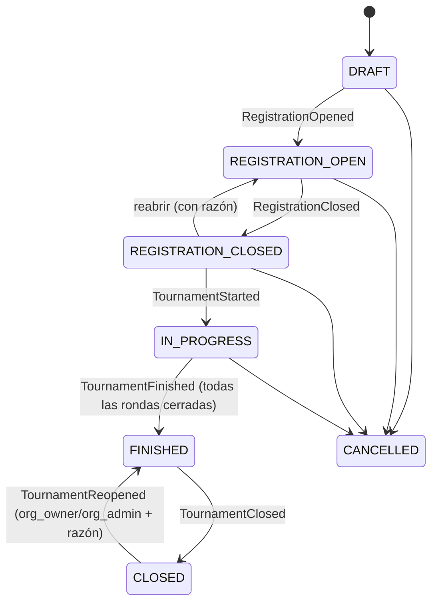
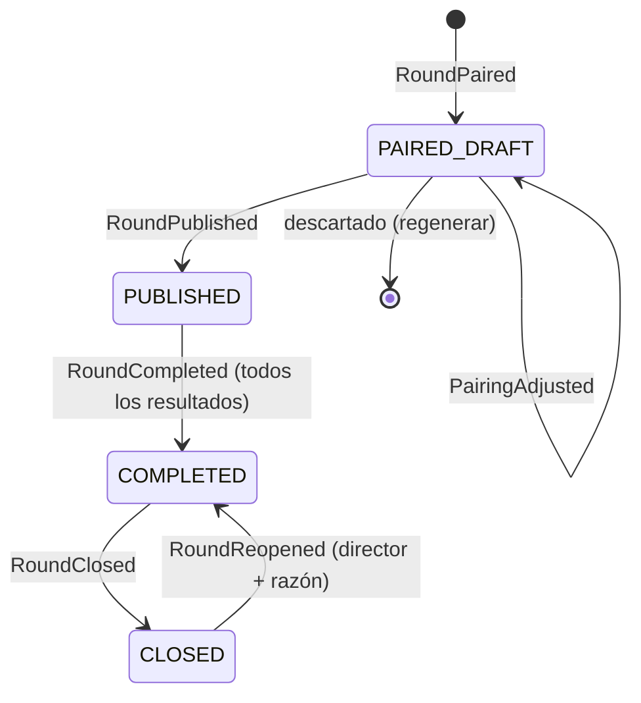

# CORE-BUSINESS.md — Reglas duras del negocio

> **Qué es:** la especificación del comportamiento del sistema que calcula puntajes, emparejamientos, desempates, ratings y todo lo que un campeonato necesita. **No es un juego**: es un sistema de cálculo y arbitraje. Un error aquí es un error de arbitraje.
>
> **Cómo se usa:** cada regla tiene ID (`BR-ÁREA-nn`). Las historias (`docs/stories/`), las pruebas (`TESTING.md`) y el código citan esos IDs. Si cambias una regla, cambia aquí primero.

## 0. Advertencia sobre el origen de las reglas

| Marca | Significado para quien implementa |
|---|---|
| *(sin marca)* | Regla del producto decidida por diseño (propuesta razonada); implementable. |
| `[PENDIENTE-ASCUN]` | **No inventar.** Depende del reglamento de ASCUN (`OQ-001`). Implementar como **parámetro** del `RuleSet` y dejar el `RuleSet` ASCUN en estado `DRAFT`. |
| `[ASCUN-2012]` | Valor tomado del reglamento técnico de ASCUN de 2012 (`SRC-01`, ver `SOURCES.md`). Es real pero **puede no estar vigente**: se usa en el preset `ascun-chess` en estado `DRAFT` y cuenta como "sin confirmar" hasta resolver `OQ-001`. |
| `[VERIFICAR]` | Dato externo (FIDE, legal) aún no transcrito del texto oficial. **Leer la fuente vigente de `SOURCES.md` antes de implementar** (FIDE: Dutch C.04.3 2026 = `SRC-05`, Tie-Break C.07 2026 = `SRC-04`, Rating B.02 = `SRC-06`). |
| `[PROPUESTO]` | Valor por defecto razonable, sujeto a confirmación. |

Regla madre: **`BR-GEN-03` — no se inventan reglas.** Ante una duda de reglamento, el sistema falla de forma explícita o exige configuración; nunca asume en silencio.

## 1. Principios generales

**BR-GEN-01 — Determinismo.** Toda función de cálculo (emparejar, clasificar, desempatar, calificar) es pura: mismo estado + mismo `RuleSet` + misma semilla ⇒ mismo resultado. Prohibido leer reloj, azar o red dentro del dominio. El azar (sorteos) usa un PRNG con **semilla guardada en el evento**.
*Por qué:* reproducir y defender cualquier número ante una reclamación; pruebas fiables.

**BR-GEN-02 — Reglas como datos.** El comportamiento de competencia se deriva del `RuleSet` fijado al torneo. No hay `if (ascun)` en el código; hay estrategias seleccionadas por el `RuleSet`. El torneo guarda un **snapshot** del `RuleSet` dentro del evento `TournamentConfigured`.
*Por qué:* reglamentos distintos por competencia; la historia no cambia si el `RuleSet` evoluciona.

**BR-GEN-03 — No inventar reglas.** Cualquier parámetro sin fuente confirmada queda sin valor por defecto efectivo para torneos reales; solo se permite un valor `[PROPUESTO]` en `RuleSet` marcados `DRAFT` (demo/simulación).

**BR-GEN-04 — Ciclo de vida del `RuleSet`.** Estados: `DRAFT` → `APPROVED` → `DEPRECATED`. Solo `APPROVED` puede usarse en torneos no demo. Un `RuleSet APPROVED` es **inmutable**; los cambios crean una versión nueva. Aprobar exige: referencia a la fuente (`source.document`, `source.version`) y que **no queden parámetros marcados "sin confirmar"**. Los valores `[ASCUN-2012]` cuentan como "sin confirmar" hasta resolver `OQ-001`.

**BR-GEN-05 — Fuente de verdad.** Los eventos del torneo son la fuente de verdad; clasificaciones, mesas y reportes son derivados y reconstruibles.

**BR-NUM-01 — Puntos como enteros en medios puntos.** Los puntajes de partida se guardan como **enteros en medios puntos**, de forma fija (`DEC-036`): 1 punto = 2 unidades → con la puntuación estándar, victoria = 2, tablas = 1, derrota = 0. El `RuleSet` declara los valores por resultado **en esas unidades** (`scoring.*`) y la división por 2 ocurre solo al mostrar. Otras escalas enteras (puntos de enfrentamiento de equipos, puntos institucionales de `BR-CHAMP-02`) son contadores propios y no se mezclan con los puntos de partida. **Nunca** `float` para puntajes.
*Por qué:* evitar errores de coma flotante en comparaciones y desempates.

**BR-NUM-02 — Desempates con aritmética entera.** Cada desempate declara su **escala** (p. ej. Sonneborn-Berger multiplica dos valores en medios puntos ⇒ se guarda en cuartos de punto y se divide por 4 al mostrar). La conversión a decimal ocurre solo al mostrar.

**BR-NUM-03 — Ratings en coma flotante con redondeo explícito.** Los cálculos de Elo/TPR usan `number` y una función de redondeo **configurable** y probada (`roundRating`), porque el Elo que calcula la plataforma es **interno y no oficial** (`BR-RAT-01`); el redondeo de FIDE está documentado en `SRC-06` Art. 8.3.4.

## 2. Modelo de dominio

| Entidad | Descripción | Observaciones |
|---|---|---|
| `Organization` | Tenant (universidad, liga, federación) | Aislamiento total (`DEC-009`) |
| `Institution` | Universidad participante | Catálogo global; `snies_code` opcional |
| `Player` | Persona que juega | Pertenece a una `Institution`; puede vincularse a un `User` |
| `Championship` | Campeonato que agrupa torneos de un mismo evento (p. ej. JUN 2026: rama × modalidad) | CRUD; calcula el ranking institucional (`BR-CHAMP-*`, `DEC-042`) |
| `Tournament` | Competencia con `RuleSet` fijado, rama (`branch`: F/M/mixta) y modalidad (`modality`: Clásico/Rápido/Blitz) | Un stream de eventos |
| `RuleSet` | Reglas parametrizadas, versionadas | §3 |
| `Competitor` | **Abstracción** de quien compite: `Player` (individual) o `Team` (equipos) | Los motores de emparejamiento y clasificación operan sobre `Competitor` (`BR-TEAM-08`) |
| `Team` | Equipo de una institución con plantilla | §11 |
| `Entry` | Inscripción de un `Competitor` en un torneo | Con *seed*/ranking inicial |
| `Round` | Ronda con número, estado y emparejamientos | §4 |
| `Pairing` / `Game` | Enfrentamiento entre dos competidores; en equipos, un `Match` contiene `Game`s por tablero | |
| `Result` | Resultado de un `Game` | §6 |
| `Standing` | Fila de clasificación con puntos y desempates | §8 |
| `InstitutionStanding` | Fila del ranking institucional de un campeonato | Derivada de clasificaciones finales (`BR-CHAMP-02`) |
| `Prize` | Medalla o premio asignado | Derivado de la clasificación final (`BR-PRZ-*`) |
| `Claim` | Reclamación sobre emparejamiento, resultado o desempate | En el stream del torneo (`BR-AUD-07`) |
| `RatingChange` | Variación de rating por torneo | §9 |
| `Event` | Hecho inmutable | `ARCHITECTURE.md` §7 |

## 3. `RuleSet` (esbozo no normativo)

> El esquema definitivo lo fija `US-010` en `packages/rules` (Zod). Este esbozo existe para orientar el diseño. Los valores de ASCUN viven en el preset `ascun-chess` (ver `SOURCES.md` §3), no aquí.

```ts
interface RuleSet {
  key: string;                         // p. ej. 'ascun-chess'
  version: number;
  status: 'DRAFT' | 'APPROVED' | 'DEPRECATED';
  organizationId: string | null;       // null = preset de plataforma; solo platform_admin lo aprueba (DEC-047)
  source: { authority: string; document: string; documentVersion?: string; url?: string; retrievedAt?: string; sourceId?: string /* SRC-nn */ };
  format: 'INDIVIDUAL' | 'TEAM';
  system: 'SWISS' | 'ROUND_ROBIN' | 'DOUBLE_ROUND_ROBIN' | 'KNOCKOUT';
  roundsPolicy: { kind: 'FIXED' | 'BY_PARTICIPANTS'; rounds?: number; table?: Array<{ min: number; max: number; rounds: number }> };
  gamesPerPairing: 1 | 2;              // 2 = doble partida con el mismo rival (Blitz, ASCUN-2012 Art. 7, OQ-025)
  scoring: {                           // todo en medios puntos (BR-NUM-01)
    win: number; draw: number; loss: number;
    forfeitWin: number; forfeitLoss: number; doubleForfeit: number;
    pairingBye: number;                // PAB: puntos de victoria salvo regla distinta (C.04.3 Art. 1.5)
    halfPointBye: number; zeroPointBye: number;
  };
  requestedByes: { allowed: boolean; kind: 'HALF_POINT' | 'ZERO_POINT'; allowedRounds?: number[];
                   maxPerPlayer?: number; requiresJustification: boolean };      // BR-WD-03
  swiss?: { variant: 'FIDE_DUTCH'; ruleVersion: string;   // p. ej. '2026-02-01' (SRC-05); SIMPLIFIED eliminado (DEC-043)
            avoidSameInstitutionRounds?: number[]; maxByesPerPlayer: number;
            initialColour: 'DRAW_LOTS' | 'WHITE' | 'BLACK' };                    // C.04.3 Art. 5.1
  tiebreaks: Array<{ id: TiebreakId; modifiers?: TiebreakModifier[]; params?: Record<string, unknown> }>;   // orden = prioridad
  tiebreakPolicy: { unplayedRounds: 'FIDE_C07_2026' | 'AS_AWARDED' | 'CUSTOM'; restartOnPartialSplit: boolean;
                    unresolved: 'SHARE_RANK' | 'DRAW_LOTS' | 'PLAYOFF' };
  team?: { boardsPerMatch: number; minPlayersToStart: number; boardOrder: 'RATING_DESC' | 'FREE' | 'FIXED';
           matchScoring: { win: number; draw: number; loss: number; basis: 'BOARD_POINTS' };
           teamTiebreaks: TiebreakSpec[]; substitutionRules: unknown };
  eligibility: { mode: 'EXTERNAL_VERIFICATION' | 'NONE' };    // DEC-048: no se guardan datos académicos
  entryQuota?: { perInstitution?: number; perNode?: { male?: number; female?: number } };   // BR-REG-06
  timeControl?: { modality: 'CLASSICAL' | 'RAPID' | 'BLITZ'; baseMinutes: number; incrementSeconds: number;
                  forfeitToleranceMinutes: number };                             // BR-SCORE-06
  schedule?: { maxRoundsPerDay?: number };                                      // BR-LIFE-06
  seeding: { order: Array<'FIDE_RATING' | 'NATIONAL_RATING' | 'PLATFORM_RATING'> };  // fuerza; luego título FIDE, nombre e id (BR-REG-04)
  corrections: { noticeDeadline: string };      // plazo de aviso de errores tras publicar resultados (BR-AUD-03, C.04.2 Art. 4.3)
  roundRobin?: { reverseLastTwoRoundsOfFirstCycle: boolean };                    // BR-RR-02
  rating: { computePlatformElo: boolean; initialRating: number };              // Elo interno no oficial: K por tramos (BR-RAT-01); 1500 por defecto (DEC-070)
}
```

`BR-GEN-04` define cuándo un `RuleSet` es utilizable. Presets previstos:
- `ascun-chess-classical` y `ascun-chess-blitz` (`DRAFT`): valores `[ASCUN-2012]` de `SOURCES.md` §3 + `OQ-001`. Rápido sin datos (`OQ-024`).
- `fide-dutch-2026`: validación contra el motor de referencia `bbpPairings` (`SRC-08`).
- `demo-round-robin`: marcado demo.

La variante `SIMPLIFIED` se eliminó: el Suizo se implementa como FIDE Dutch por etapas (`DEC-043`, `BR-PAIR-10`).

## 4. Ciclo de vida

### 4.1 Torneo



**BR-LIFE-01 — Estados y transiciones del torneo** según el diagrama. Una transición no listada es un error de dominio (`INVALID_TRANSITION`). Iniciar exige: `RuleSet APPROVED` (salvo torneo demo), ≥ 2 competidores válidos, número de rondas determinado (`BR-PAIR-12`).

### 4.2 Ronda



**BR-LIFE-02 — Estados de la ronda** según el diagrama. Solo `PUBLISHED` acepta resultados. `COMPLETED` se alcanza cuando toda partida tiene resultado final (incluye byes y forfeits). `STALE` **no es un estado**: es una marca sobre una ronda ya emparejada (`RoundMarkedStale`), compatible con cualquier estado (`BR-AUD-03`).

**BR-LIFE-03 — Una ronda activa a la vez en Suizo.** No se puede generar la ronda *n+1* hasta que la *n* esté `CLOSED`. En todos contra todos puede pre-generarse el calendario completo, pero las rondas se publican y cierran en orden.

**BR-LIFE-04 — Ronda cerrada = bloqueada.** No admite resultados nuevos. Solo admite **correcciones administrativas** del director (o de un rol superior) con `reason`, según `BR-AUD-03` (`DEC-051`). Reabrir una ronda (`RoundReopened`) exige rol de director, `reason`, que el torneo esté `IN_PROGRESS` y que la ronda siguiente **no** esté publicada; si ya lo está, se usa la corrección administrativa. Las rondas posteriores ya emparejadas se marcan `STALE` (`BR-AUD-03`).

**BR-LIFE-05 — Cierre de torneo.** `FINISHED` = todas las rondas `CLOSED`. `CLOSED` congela la clasificación final (instantánea en el evento, `BR-AUD-05`) y dispara premiación (`BR-PRZ-01`), cálculo del Elo interno (`BR-RAT-03`), reportes y notificaciones finales (`BR-NOTIF-02`). Reabrir es excepcional y auditado.

**BR-LIFE-06 — Programación de rondas.** Cada ronda puede tener hora programada (`RoundScheduled`), que se necesita para la tolerancia de W.O. (`BR-SCORE-06`) y para los avisos. El `RuleSet` puede limitar las rondas por día (`schedule.maxRoundsPerDay`; ASCUN: máximo dos de Clásico por día `[ASCUN-2012 Art. 14]`). Exceder el límite produce una advertencia, no un bloqueo, y queda en la auditoría (decidido el 2026-10-26).

**BR-LIFE-07 — Cambios tras iniciar.** Después de `TournamentStarted` solo se pueden cambiar metadatos (nombre, sede, fechas, visibilidad, descripción). Formato, sistema, `RuleSet`, rama, modalidad y número de rondas quedan fijos (decidido el 2026-10-26).

## 5. Inscripción y elegibilidad

**BR-REG-01 — Elegibilidad (verificación externa, `DEC-048`).** Los requisitos de ASCUN (`SRC-02` Arts. 12–16: matrícula vigente, promedio ≥ 3.3 en pregrado y ≥ 3.5 en posgrado, carné oficial, una disciplina y una IES, sin límite de edad) los verifican la IES y el nodo **en la plataforma de ASCUN**. Este sistema **no guarda datos académicos ni documentos**: `ParticipantRegistered` registra solo `eligibility = { verifiedBy, verifiedAt, externalRef? }`. La rama (femenina, masculina o mixta; `OQ-015` resuelta) y la modalidad las fija el torneo. Si `RuleSet.eligibility.mode = EXTERNAL_VERIFICATION`, inscribir sin la marca devuelve `ELIGIBILITY_NOT_VERIFIED` (en torneos demo es solo una advertencia).

**BR-REG-02 — Unicidad.** Un `Player` aparece una sola vez por torneo y representa a una sola institución (`SRC-02` Art. 13); en torneos por equipos, un jugador pertenece a **un** equipo por torneo (salvo suplencias que el `RuleSet` permita `[PENDIENTE-ASCUN]`).

**BR-REG-03 — Ventana de inscripción.** Inscribir solo en `REGISTRATION_OPEN`. Las inscripciones tardías (con el torneo en curso) dependen del `RuleSet` y de `BR-WD-02`. `[PENDIENTE-ASCUN]`.

**BR-REG-04 — Ranking inicial (*seed*) (`DEC-069`, `SRC-12` Arts. 2.1–2.3).** El orden inicial determina el TPN y el emparejamiento de la ronda 1. Orden: (1) fuerza según `RuleSet.seeding.order` (ASCUN: ELO FIDE y luego ELO nacional `[ASCUN-2012 Art. 15]`); (2) título FIDE: GM, IM, WGM, FM, WIM, CM, WFM, WCM, sin título; (3) apellido y nombre; (4) id, para que el orden sea total. El rating y el título se toman en la **instantánea** del momento de inscribir (`BR-RAT-07`). El director puede fijar un orden manual con `SeedingAdjusted` y una razón, pero los TPN no cambian después de emparejar la ronda 4 (`TPN_LOCKED`). Para equipos: criterio del `RuleSet` (C.04.6 lo deja al reglamento de cada competencia).

**BR-REG-05 — Datos mínimos.** Solo se piden los datos necesarios para operar el torneo (`BR-PRIV-01`).

**BR-REG-06 — Cupos.** El `RuleSet` puede limitar inscritos por institución o por nodo (`entryQuota`). ASCUN: hasta seis varones y cinco damas por nodo regional en Clásico `[ASCUN-2012 Art. 4]`. Exceder el cupo devuelve `ENTRY_QUOTA_EXCEEDED`.

## 6. Resultados y puntuación

**BR-SCORE-01 — Resultados posibles.** Partida jugada: `WHITE_WINS`, `BLACK_WINS`, `DRAW`. Sin jugar: `WHITE_WINS_BY_FORFEIT`, `BLACK_WINS_BY_FORFEIT`, `DOUBLE_FORFEIT` (ninguno se presentó). Sin rival: `PAIRING_BYE` (asignado por el emparejamiento, *PAB*), `HALF_POINT_BYE` y `ZERO_POINT_BYE` (solicitados). Para desempates, toda ronda posterior a un retiro cuenta como `ZERO_POINT_BYE` (`SRC-04` Art. 16.1.1). Una partida sin resultado está `PENDING`. Con `gamesPerPairing = 2`, cada emparejamiento tiene dos partidas con colores invertidos y **cada partida puntúa por separado** (hasta 2 puntos por ronda); decidido el 2026-10-26 (`OQ-025`), salvo que el reglamento vigente de ASCUN diga otra cosa (`OQ-001`).

**BR-SCORE-02 — Puntos por resultado.** Vienen de `RuleSet.scoring`. ASCUN: 1 / ½ / 0 `[ASCUN-2012 Art. 9]`.

**BR-SCORE-03 — Forfeits.** El forfeit se registra con motivo (incomparecencia pasada la tolerancia, descalificación, retiro). Su tratamiento en desempates lo define `tiebreakPolicy.unplayedRounds` (`BR-TIE-03`; FIDE: `SRC-04` Art. 16).

**BR-SCORE-04 — Bye por emparejamiento (PAB).** Puntos = `scoring.pairingBye`. ASCUN no lo regula; por la regla supletoria (`SRC-01` Art. 21) aplica FIDE: los puntos de una victoria salvo que el reglamento diga otra cosa (`SRC-05` Art. 1.5). No recibe el PAB quien ya lo recibió o ya sumó los puntos de una victoria sin jugar (`SRC-05` C2, `BR-PAIR-02`).

**BR-SCORE-05 — Validación al registrar un resultado.** MUST: (1) la partida existe y su ronda está `PUBLISHED`; (2) la partida está `PENDING` (si ya tiene resultado, solo se corrige por `BR-AUD-01`); (3) el valor pertenece a los permitidos; (4) quien registra tiene permiso sobre ese torneo y ronda; (5) llega con `Idempotency-Key`. En equipos: el resultado se registra **por tablero** y el del *match* se deriva (`BR-TEAM-03`).

**BR-SCORE-06 — Tolerancia de llegada (W.O.).** El `RuleSet` declara `timeControl.forfeitToleranceMinutes`. ASCUN: **0 minutos** de espera `[ASCUN-2012 Art. 10]`; las Leyes del Ajedrez de FIDE fijan 0 si el reglamento no dice otro valor (`SRC-15` Art. 6.7.1). El sistema avisa con base en la hora programada de la ronda (`BR-LIFE-06`), pero **el forfeit lo registra un árbitro** (decidido el 2026-10-26).

**BR-SCORE-07 — Digitación de partidas.** ASCUN exige que los ganadores y quienes hagan tablas con negras digiten la partida `[ASCUN-2012 Art. 12]`. El sistema puede marcar "partida digitada" como dato adjunto, que **no afecta** los puntos (`US-082`, `US-092`).

## 7. Emparejamientos

### 7.1 Contrato del motor (`BR-PAIR-01`)

**BR-PAIR-01 — Contrato.** Función pura:

```
pair(input: {
  competitors: Competitor[]            // con rating, seed, institución, estado (activo/retirado)
  history:     CompletedRoundsHistory  // quién jugó con quién, colores, byes, puntos por ronda
  roundNumber: number
  ruleSet:     RuleSet
  seed:        number                  // semilla del PRNG (solo si hay sorteo)
}) → Result<{ pairings: Pairing[]; bye?: CompetitorId; diagnostics: Diagnostics }, PairingError>
```

`diagnostics` incluye: criterios satisfechos/relajados, flotantes, versión del motor, hash de entrada. Los errores son explícitos (`NO_VALID_PAIRING`, `INCONSISTENT_HISTORY`, …).

### 7.2 Restricciones y calidad

**BR-PAIR-02 — Restricciones absolutas** (nunca se violan; si no hay solución, `NO_VALID_PAIRING`). Para `FIDE_DUTCH` son los criterios absolutos de `SRC-05` Art. 2.1–2.2:
1. **C1:** dos participantes no se enfrentan más de una vez. Una pareja que no jugó su partida (p. ej. por forfeit) puede volver a emparejarse (`SRC-12` Art. 3.5).
2. **C2:** quien ya recibió el bye por emparejamiento (PAB), o ya sumó en una sola ronda sin jugar tantos puntos como una victoria, no recibe el PAB.
3. **C3:** los no-*topscorers* (`BR-PAIR-11`) con la **misma preferencia absoluta de color** (`BR-PAIR-06`) no se enfrentan.
4. **C4 (completitud):** siempre debe existir un emparejamiento que cumpla los criterios absolutos para los jugadores que aún no están emparejados; esto guía la construcción por grupos.
5. Restricciones de producto: los retirados no se emparejan. Las restricciones configuradas del `RuleSet` (p. ej. misma institución, `BR-PAIR-07`) son **de calidad**: se cumplen mientras sea factible y toda relajación se reporta en `diagnostics`.

**BR-PAIR-03 — Ronda 1.** Orden por *seed* (`BR-REG-04`). En Suizo, mitad superior contra mitad inferior: con *n* competidores, `S1` = primeros ⌊n/2⌋ y `S2` = los siguientes; el *i*-ésimo de `S1` juega contra el *i*-ésimo de `S2` (`SRC-05` Arts. 3.2.2 y 3.3.1: en un *bracket* homogéneo, `S1` son los primeros MaxPairs por TPN). Si *n* es impar, el último del ranking queda sin pareja y recibe el PAB (`BR-PAIR-05`, `GV-005`). Colores: el color inicial se sortea con semilla antes de la ronda 1 (`SRC-05` Art. 5.1). En cada mesa, si el mejor clasificado tiene número de emparejamiento (TPN) impar recibe el color inicial; si es par, el opuesto (`SRC-05` Art. 5.2.5).

**BR-PAIR-04 — Grupos de puntaje y flotantes (`SRC-05` Arts. 1–4).** Para emparejar, el orden es puntaje y luego TPN (1.2). Los grupos de puntaje se procesan de mayor a menor (1.9.2); cada *bracket* reúne a los residentes del grupo y a quienes quedaron sin pareja en el anterior (MDP). En un *bracket* homogéneo, `S1` son los primeros MaxPairs y `S2` el resto; en uno heterogéneo, `S1` es el primer conjunto válido de M1 MDP (4.4) y los MDP excluidos quedan en el *Limbo*, obligados a flotar otra vez (3.2). El candidato empareja el *i*-ésimo de `S1` con el *i*-ésimo de `S2` (3.3). Si no es perfecto (no cumple todos los criterios C1–C21), se prueban en orden las transposiciones de `S2` (4.2) y los intercambios entre `S1` y `S2` (4.3); en un *bracket* heterogéneo, primero el *remainder* y luego los siguientes conjuntos de MDP (3.7). Si ningún candidato es perfecto, gana el que mejor cumple C5–C21 por orden de prioridad y, a igualdad, el generado antes (3.8). Criterios de calidad (Art. 2.4): C6 minimizar los *downfloaters*; C7 minimizar sus puntajes; C8 que el siguiente *bracket* cumpla C1–C7; C9 minimizar las partidas no jugadas de quien recibe el PAB; C10–C11 colores de *topscorers*; C12–C13 preferencias de color; C14–C21 flotantes repetidos. Quien flota: el mejor clasificado de una pareja con puntajes distintos recibe un *downfloat* y el otro un *upfloat*; también recibe *downfloat* quien recibe el PAB o suma sin jugar más que una derrota (1.4).

**BR-PAIR-05 — Bye (PAB).** Con número impar de competidores disponibles, un competidor elegible (C2) recibe el PAB. En `FIDE_DUTCH` se minimiza el puntaje de quien lo recibe (C5) y luego su número de partidas no jugadas (C9) (`SRC-05`). Recibe los puntos de `scoring.pairingBye` (`BR-SCORE-04`). Los byes solicitados no son PAB (`BR-WD-03`).

**BR-PAIR-06 — Color** (`SRC-05`). Diferencia de color = partidas con blancas − partidas con negras (Art. 1.6). Preferencia **absoluta** si la diferencia es > +1 o < −1, o si jugó con el mismo color sus dos últimas rondas; **fuerte** si la diferencia es ±1; **leve** si es 0 (Art. 1.7). Asignación por mesa, en este orden (Art. 5.2):
1. Conceder ambas preferencias.
2. Conceder la más fuerte; si ambas son absolutas entre *topscorers*, la de mayor diferencia.
3. Alternar respecto de la última ronda en que tuvieron colores distintos.
4. Conceder la del mejor clasificado.
5. Aplicar la regla del TPN impar y el color inicial (`BR-PAIR-03`).

Para los colores solo cuentan las partidas jugadas: las rondas no jugadas se corren al inicio del historial (BWBuW se trata como uBWBW; `SRC-12` Art. 3.4). Quien aún no jugó ninguna partida no tiene preferencia: se concede la del rival (`SRC-05` Art. 1.7.4).

**BR-PAIR-07 — Evitar misma institución.** Parámetro del `RuleSet` (`avoidSameInstitutionRounds`). Restricción **de calidad** (relajable con aviso), no absoluta, salvo que el `RuleSet` diga lo contrario `[PENDIENTE-ASCUN]`.

**BR-PAIR-08 — Ajuste manual.** Solo sobre rondas en `PAIRED_DRAFT`. Cada ajuste: `PairingAdjusted` con `reason`; debe seguir cumpliendo `BR-PAIR-02`; si el director fuerza una violación, requiere permiso especial y razón, y queda marcado `OVERRIDE` en la auditoría.

**BR-PAIR-09 — Fallo explícito.** El motor **nunca relaja en silencio** una restricción absoluta ni devuelve un emparejamiento inválido. Prefiere error con diagnóstico.

**BR-PAIR-10 — Estrategia de implementación (`DEC-034`).**
1. *Base (`US-015`):* `FIDE_DUTCH` **por etapas** (`DEC-043`). La v1 cumple siempre C1–C4, aplica C5 y un **subconjunto declarado** de criterios de calidad (como mínimo C6, C7, C12 y C13); `diagnostics.criteriaImplemented` lista cuáles. Búsqueda por grupos de puntaje con transposiciones e intercambios acotados y retroceso con poda.
2. *Calidad (`US-016`):* propiedades (`INV-P-*`) y comparación con **bbpPairings** (`SRC-08`: v6.0.0, Apache-2.0, reglas Dutch 2026, entrada TRF-2026) para `fide-dutch-2026`, y oráculo de fuerza bruta para *n* ≤ 10 (`DEC-072`). JaVaFo queda descartado: su versión 2.2 es de 2018, anterior a las reglas de 2026 (`SRC-17`).
3. *Optimización (`US-017`):* reformulación como **emparejamiento perfecto de peso máximo** en un grafo: vértices = competidores (más un vértice ficticio si *n* es impar); aristas = pares permitidos por `BR-PAIR-02`; pesos que codifican **lexicográficamente** los criterios de calidad (de mayor a menor prioridad). Resolución con el algoritmo de Edmonds (Blossom), O(V³). Los pesos se codifican con enteros grandes (`BigInt`) o con optimización por niveles para no perder exactitud.
   - **Riesgo:** FIDE Dutch define un orden concreto de preferencia entre emparejamientos de igual calidad; la codificación de pesos debe reproducirlo y se valida contra la referencia.
4. Complejidad: el retroceso es exponencial en el peor caso; el matching es polinomial. El informe de benchmarks (`US-096`) compara ambos.

**BR-PAIR-11 — *Topscorers* y última ronda.** *Topscorers* son quienes tienen más del 50 % del máximo posible **al emparejar la última ronda** (`SRC-05` Art. 1.8). Para ellos y sus rivales no aplica C3, y las restricciones de color pasan a ser de calidad (C10: diferencia de color mayor que +2 o menor que −2; C11: mismo color tres veces seguidas).

**BR-PAIR-12 — Número de rondas.** Lo define `roundsPolicy` (fijo o por tabla según inscritos). ASCUN: 6 rondas en Clásico y 6 en Blitz `[ASCUN-2012 Arts. 6–7]`; Rápido sin dato (`OQ-024`). Si el reglamento dice, p. ej., "todos contra todos si hay ≤ N equipos, Suizo en otro caso", ese umbral va en el `RuleSet`.

**BR-PAIR-13 — Reproducibilidad.** `RoundPaired` guarda: versión del motor, hash canónico de la entrada, semilla, `diagnostics`. Re-ejecutar con los mismos datos **MUST** dar el mismo resultado (`INV-P-5`).

**BR-PAIR-14 — Numeración de mesas (`SRC-12` Art. 3.6, decidido el 2026-10-26).** Las parejas se ordenan por: (1) el mayor puntaje del mejor clasificado de la pareja; (2) la mayor suma de puntajes; (3) el menor TPN del mejor clasificado. El PAB no ocupa mesa y se lista después de las mesas (FIDE no lo regula).

**BR-PAIR-15 — Reclamos sobre emparejamientos.** ASCUN solo los admite por mala digitación y antes de iniciar la ronda `[ASCUN-2012 Art. 5]` (`BR-AUD-07`).

### 7.3 Todos contra todos

**BR-RR-01 — Tablas de Berger de FIDE (`SRC-14`).** El calendario es exactamente el de las tablas de Berger de FIDE: con *n* impar, el número más alto descansa. Se genera con el algoritmo de `SOURCES.md` §5.2, comparado el 2026-10-26 con todas las tablas oficiales de 3 a 16 jugadores; las pruebas vuelven a comparar contra ellas (`INV-RR-4`). Cada par se enfrenta exactamente una vez en *n−1* rondas y, por competidor, las blancas y las negras difieren como mucho en 1. ASCUN no regula los todos contra todos; rige FIDE como norma supletoria (`SRC-01` Art. 21).

**BR-RR-02 — Doble ronda.** Segundo ciclo con colores invertidos. FIDE recomienda invertir el orden de las dos últimas rondas del primer ciclo para evitar tres partidas seguidas con el mismo color (`SRC-14`): parámetro `roundRobin.reverseLastTwoRoundsOfFirstCycle`, activo en los presets que siguen a FIDE.

**BR-RR-03 — Sin restricciones de repetición;** sí rige `BR-LIFE-03` (publicación y cierre en orden).

### 7.4 Eliminación directa

**BR-KO-01 — Cuadro de eliminación** (solo si ASCUN lo usa en alguna fase; no aparece en `SRC-01`) `[PENDIENTE-ASCUN]`: siembra, byes para completar potencia de 2, y mecanismo para desempatar un duelo (partidas de desempate, *armageddon*, mejor ranking). Parametrizar; no implementar hasta tener la regla (`US-018`).

## 8. Clasificación y desempates

**BR-TIE-01 — Cadena ordenada.** El `RuleSet` define la lista ordenada de desempates. La clasificación se obtiene por **refinamiento iterativo**: se ordena por puntos; los grupos empatados se subdividen aplicando el siguiente desempate **dentro del grupo**; se repite hasta agotar la lista. Para desempates que no dependen del grupo equivale a un ordenamiento lexicográfico. Coincide con `SRC-04` Art. 4.2: el siguiente desempate se aplica solo a los subgrupos que siguen empatados.

**BR-TIE-02 — Catálogo de desempates.** Alineado con los códigos de FIDE C.07 2026 (`SRC-04`). Notación: `S(x)` = puntaje final de *x* en medios puntos; `o` = oponentes de *x*; `r(x,o)` = puntos de *x* contra *o*.

| ID (código) | FIDE (`SRC-04`) | Definición (resumen) | Notas |
|---|---|---|---|
| `WIN` | WIN, Art. 7.1 | Rondas en que obtuvo los puntos de una victoria, haya jugado o no | Antes `WINS` |
| `WON` | WON, Art. 7.2 | Partidas ganadas sobre el tablero | |
| `BUCHHOLZ` | BH, Art. 8.1 | Σ `S(o)` sobre los oponentes | **No usar en todos contra todos** (Art. 8). Rondas no jugadas: `BR-TIE-03` |
| `BUCHHOLZ_CUT1` / `BUCHHOLZ_CUT2` | BH-C1 / BH-C2, Art. 14.1 | BH sin el valor (o los dos valores) menos significativo(s) | Con VUR aplica la excepción de Art. 16.5 |
| `BUCHHOLZ_MEDIAN1` | BH-M1, Art. 14.3 | BH sin el menor y el mayor valor | Antes `BUCHHOLZ_MEDIAN` |
| `FORE_BUCHHOLZ` | FB, Art. 8.3 | BH calculado como si las partidas de la última ronda terminaran en tablas | |
| `AVG_OPP_BUCHHOLZ` | AOB, Art. 8.2 | Promedio del BH de los oponentes | |
| `SONNEBORN_BERGER` | SB, Art. 9.1 | Σ `S(o) × r(x,o)` | Escala en cuartos de punto (`BR-NUM-02`) |
| `KOYA` | KS, Art. 9.2 | Puntos contra quienes lograron ≥ 50 % del máximo posible | Umbral ajustable ±½ punto (Art. 14.5); para todos contra todos |
| `PROGRESSIVE` | PS, Art. 7.5 | Σ del puntaje acumulado tras cada ronda | |
| `DIRECT_ENCOUNTER` | DE, Art. 6 | Clasificación separada con las partidas entre los empatados | Se re-aplica a los subgrupos (Arts. 6.2–6.3); encuentros repetidos promedian (6.1.2) |
| `BLACK_GAMES` / `BLACK_WINS` | BPG / BWG, Arts. 7.3–7.4 | Partidas jugadas / ganadas con negras sobre el tablero | |
| `ELECTED_ROUNDS` | REP, Art. 7.6 | Número de rondas menos los byes de medio punto, los de cero puntos y las derrotas por forfeit | |
| `STANDARD_POINTS` | STD, Art. 7.7 | Rondas con más puntos que el rival programado (o, sin jugar, más que unas tablas), más ½ por cada ronda con los mismos puntos (o, sin jugar, los de unas tablas) | Nuevo en 2026 |
| `AVG_OPPONENT_RATING` | ARO, Art. 10.1 | Promedio del rating de los rivales sobre el tablero, redondeado (0.5 hacia arriba) | Requiere ratings |
| `TPR` | TPR, Art. 10.2 | ARO + dp(p) según la tabla 8.1.1 de `SRC-06` (§9) | Requiere ratings |
| `APRO` / `APPO` / `PTP` | Arts. 10.3–10.5 | Desempates de rendimiento | Después del primer motor de desempates |

Las definiciones resumen el texto oficial (`SRC-04`, leído completo el 2026-10-26); ante cualquier duda manda el artículo citado. Cada desempate lleva casos dorados propios. Si dos participantes se enfrentan más de una vez (p. ej. la doble partida del Blitz), cada partida es un encuentro aparte, salvo en `DIRECT_ENCOUNTER`, que promedia (`SRC-04` Arts. 4.4 y 6.1.2). Los desempates por rating se descartan si hay jugadores sin rating, salvo regla expresa (`SRC-04` Art. 10). ASCUN no fija la lista ("según las características técnicas del software", `[ASCUN-2012 Art. 13]`) → `OQ-023`. Cada desempate es un módulo independiente con firma `(standingContext) → integerValue`.

**BR-TIE-03 — Rondas no jugadas (`SRC-04` Arts. 15–16, texto oficial leído el 2026-10-26).** FIDE eliminó el "oponente virtual" en 2023. Regla vigente:
- **Ronda no jugada (15.1):** toda ronda en que el participante, emparejado o no, no jugó una partida (o un *match*, en equipos).
- **Todos contra todos (15.2):** las victorias y derrotas por forfeit (las únicas rondas no jugadas posibles) cuentan como partidas normales, salvo en los desempates por rating (Art. 10), donde todo forfeit sigue siendo ronda no jugada, y en los de tipo B (Art. 7), donde las derrotas por forfeit siguen siéndolo.
- **Suizo (16):** afecta a Buchholz, Sonneborn-Berger (también el de equipos, 13.2) y sus variantes (Fore Buchholz y los cortes de 14.1–14.4).
  - **Definiciones (16.1):** *bye solicitado* = bye de medio punto o de cero puntos (toda ronda posterior a un retiro es un bye de cero puntos); *VUR* (ronda voluntariamente no jugada) = ronda en que el participante no estuvo disponible: un bye solicitado o una derrota por forfeit.
  - **Categorías (16.2):** (1) PAB o bye de punto completo; (2) victoria por forfeit; (3) bye solicitado seguido de al menos una ronda que no es VUR; (4) derrota por forfeit; (5) bye solicitado seguido solo de VUR, o en la última ronda.
  - **Para los desempates de los rivales (16.3):** el puntaje del participante se ajusta: las categorías 1–4 cuentan con el resultado (victoria, tablas o derrota) que corresponde a los puntos otorgados (en equipos, puntos de *match* y de partida); la categoría 5 cuenta como tablas.
  - **Para los desempates propios (16.4):** cada ronda no jugada se evalúa como una partida contra un *dummy*, con el resultado que corresponde a los puntos otorgados. El puntaje del *dummy* es el del propio participante, pero no puede superar: (16.4.1) el puntaje ajustado (16.3) del rival programado, en los forfeits (categorías 2 y 4); (16.4.2) los puntos de unas tablas multiplicados por el número de rondas del torneo, en las demás (categorías 1, 3 y 5).
  - **Excepción de Cut-1 (16.5):** si un modificador pide cortar el valor menos significativo de un participante con una o más VUR, se corta la contribución más baja de esas rondas, siempre que no sea menor que el valor menos significativo. En Buchholz: se corta la contribución más baja de una VUR. En Sonneborn-Berger: se comparan la contribución más baja de una VUR y el valor menos significativo (14.1.1 d y 14.1.2) y se corta el **mayor** de los dos (son el mismo elemento si el menos significativo viene de una VUR). Si el modificador pide más cortes (14.2, 14.4), se reaplica a los elementos restantes.
  - **Alternativas (16.6):** el reglamento del torneo puede fijar de antemano otras reglas en lugar de 16.3, 16.4 o 16.5 (`AS_AWARDED`, `CUSTOM`).
- La versión 2026 reescribió 15.2 y 16.4 (tope del *dummy*). Los ejercicios de `SRC-07`, basados en C.07 2023, no sirven como casos dorados de los desempates propios sin recalcularlos.

El cálculo está **aislado en `unplayedRoundContribution()`**. Mientras no existan casos dorados verificados con el texto 2026, la política `FIDE_C07_2026` devuelve `NOT_IMPLEMENTED_POLICY` y `AS_AWARDED` funciona.

**BR-TIE-04 — Reinicio tras división parcial.** FIDE **no** reinicia la cadena: el siguiente desempate se aplica a los subgrupos que siguen empatados (`SRC-04` Art. 4.2); solo `DIRECT_ENCOUNTER` se re-aplica dentro de sí mismo (Arts. 6.2–6.3). Por defecto `restartOnPartialSplit = false`; el parámetro existe para reglamentos que digan lo contrario. Implementar y probar ambos comportamientos.

**BR-TIE-05 — Empates sin resolver.** Según `tiebreakPolicy.unresolved`:
- `SHARE_RANK`: puesto compartido, mostrado con `=`; el orden de listado es determinista por *seed* y luego id.
- `DRAW_LOTS`: sorteo con semilla; evento `TieResolvedByLot`.
- `PLAYOFF`: partidas de desempate; evento `PlayoffScheduled`; se implementa después de `SHARE_RANK` y `DRAW_LOTS`.

FIDE: el reglamento debe decir si se comparte el puesto; si la lista se agota, se sortea, salvo que el reglamento diga que no se desempata (`SRC-04` Arts. 2.1 y 4.2). ASCUN: `[PENDIENTE-ASCUN]` (`OQ-023`).

**BR-TIE-06 — Puestos por premios.** La clasificación determina premios/medallas; no se redondea ni se trunca ningún valor de desempate para decidirlos.

**BR-TIE-07 — Trazabilidad.** Cada valor de desempate mostrado se guarda con `computation_version`; la UI puede explicar "por qué este puesto" (puntos y cada desempate comparado con el vecino).

## 9. Ratings (Elo y rendimiento)

**BR-RAT-01 — Elo de plataforma (interno, no oficial; `DEC-049`).** La plataforma **consume** los ratings FIDE y nacionales para sembrar (`BR-REG-04`, `BR-RAT-07`) y calcula un Elo **propio** solo como dato interno, rotulado "no oficial". Fórmula logística: `E_A = 1 / (1 + 10^((R_B − R_A)/400))`; `ΔR_A = K × (S_A − E_A)`, con `S_A ∈ {0, ½, 1}`; `K` por tramos al estilo FIDE (decidido el 2026-10-26): 40 mientras el jugador tenga menos de 30 partidas en la plataforma, 20 por debajo de 2400 y 10 desde 2400. Sigue siendo un Elo interno.
*Diferencias con FIDE (no se implementa el Elo oficial):* FIDE obtiene la probabilidad de la **tabla 8.1.2**, no de la fórmula; usa K = 40/20/10 con tope K×n ≤ 700; limita las diferencias a 400 puntos solo por debajo de 2650 (desde 2025-10-01); y redondea la variación del período al entero más cercano, con .5 alejándose de cero (`SRC-06` Arts. 8.3.1–8.3.4).

**BR-RAT-02 — Rendimiento (TPR).** `TPR = ARO + dp(p)`, con ARO = promedio de los ratings de los rivales sobre el tablero (redondeado, 0.5 hacia arriba), `p = puntos / partidas` y `dp` de la tabla 8.1.1 de FIDE, donde 0 % y 100 % equivalen nocionalmente a ∓800 (`SRC-04` Arts. 10.1–10.2, `SRC-06`). La tabla está transcrita en `SOURCES.md` §5.3 y se copia a un archivo de datos de `@torre/ratings`, con una prueba que compara ambos; sin la tabla, la función falla. Con rivales sin rating, los desempates por rating se descartan salvo regla expresa (`SRC-04` Art. 10).

**BR-RAT-03 — Momento del cálculo.** El Elo interno se actualiza **al cerrar el torneo** (`TournamentClosed`), de forma idempotente por `(tournament_id, computation_version)`, a partir de los eventos. No se actualizan ratings por ronda salvo que el `RuleSet` lo pida.

**BR-RAT-04 — Glicko-2.** Se implementa después del Elo (F5 o posterior), detrás de la misma interfaz `RatingSystem` (decidido el 2026-10-26).

**BR-RAT-05 — Jugadores sin rating.** Se siembran después de los que tienen rating, con orden determinista (`BR-REG-04`). El Elo interno parte de **1500** para quien aún no lo tiene (`RuleSet.rating.initialRating`, `DEC-070`) y nunca se mezcla con los oficiales.

**BR-RAT-06 — Fuera de alcance.** Homologación FIDE, normas de título, envío de ratings oficiales y cálculo del Elo FIDE oficial no se implementan.

**BR-RAT-07 — Importación de ratings.** Los ratings FIDE y nacionales (con FIDE ID opcional) se cargan por CSV o desde la lista oficial, con la fuente y la fecha de la lista (`US-104`). El torneo usa una **instantánea** del rating tomada al inscribir, que va en el evento; no usa el valor vivo.

## 10. Premios y reconocimientos

**BR-PRZ-01 — Origen de los premios.** Premios y medallas (por puesto, por equipo, por categoría o rama) se derivan **solo** de la clasificación final con el torneo `CLOSED` (`BR-LIFE-05`) y de la configuración del torneo (categorías y cantidad de premios). ASCUN: medallas de oro, plata y bronce a los tres primeros por rama, en cada modalidad `[ASCUN-2012 Art. 19]`; `SRC-02` Art. 34 agrega trofeos por campeonato. Se registran con `PrizesAwarded` (`US-101`).

**BR-PRZ-02 — Acumulación.** Si el `RuleSet` declara que un jugador no puede acumular premios, la asignación se hace por orden de prioridad configurado y queda registrada con su razón. `[PENDIENTE-ASCUN]`.

### 10.1 Campeonato y ranking institucional (`DEC-042`)

**BR-CHAMP-01 — Campeonato.** Un `Championship` agrupa los torneos de un mismo evento (p. ej. JUN 2026). Cada torneo tiene rama (F, M o mixta) y modalidad (Clásico, Rápido o Blitz). Es CRUD (no *event-sourced*) y su configuración guarda la fuente (`SRC-*`).

**BR-CHAMP-02 — Ranking institucional "todo evento".** Por rama, cada institución suma puntos según el puesto de sus jugadores en la clasificación final de cada modalidad. Tabla ASCUN: Clásico 1.º 20 · 2.º 15 · 3.º 10 · 4.º 5; Blitz 1.º 15 · 2.º 10 · 3.º 6 · 4.º 2; gana la institución con más puntos `[ASCUN-2012 Art. 20]`. Rápido no tiene tabla (`OQ-024`). Solo cuentan torneos `CLOSED`.

**BR-CHAMP-03 — Empates institucionales y puestos compartidos.** ASCUN no los define (`OQ-028`). Sin regla, el empate se muestra como puesto compartido y el sistema **no** inventa un desempate (`BR-GEN-03`). Si un puesto individual está compartido (`SHARE_RANK`), el reparto de puntos institucionales también queda pendiente de `OQ-028` y el cálculo falla de forma explícita.

**BR-CHAMP-04 — Clasificación entre torneos.** El paso de clasificados de un torneo a otro (p. ej. "el Blitz lo juegan los primeros seis clasificados", `[ASCUN-2012 Art. 3]`) es un parámetro (`OQ-026`); no se implementa hasta resolver esa pregunta.

**BR-CHAMP-06 — Visibilidad del campeonato (`DEC-084`).** Un campeonato tiene su propia visibilidad (`PUBLIC`, `UNLISTED` o `PRIVATE`, como los torneos, `BR-PRIV-02`). Solo puede ser `PUBLIC` o `UNLISTED` si **todos** sus torneos lo son; así el ranking institucional público nunca revela resultados de un torneo privado. Se rechaza tanto subir la visibilidad del campeonato como bajar a `PRIVATE` un torneo de un campeonato visible (`VISIBILITY_EXCEEDS_TOURNAMENTS`).

**BR-CHAMP-05 — Reproducibilidad.** El ranking institucional se calcula con una función pura (`@torre/standings/championship`) a partir de las instantáneas oficiales de clasificación final (`BR-AUD-05`) y guarda sus hashes.

## 11. Torneos por equipos

> ASCUN 2012 **no** tiene torneo por equipos: la competencia entre universidades se resuelve con el ranking institucional (`BR-CHAMP-02`). El motor de equipos se mantiene como capacidad **genérica** con prioridad SHOULD (`DEC-054`), basada en FIDE C.07 (desempates de equipos MPvGP, ESB, EDE y SSSC; `SRC-04` Art. 13). Las marcas `[PENDIENTE-ASCUN]` de esta sección significan "parámetro genérico sin preset ASCUN".

**BR-TEAM-01 — Equipo.** Pertenece a una `Institution`; tiene capitán/delegado, una plantilla (*roster*) y, por *match*, una **alineación** (*lineup*). Tamaño de plantilla y de tablero lo define el `RuleSet`. `[PENDIENTE-ASCUN]`.

**BR-TEAM-02 — Alineación y orden de tableros.** Cada *match* recibe una alineación ordenada por tablero. Reglas de orden (por rating descendente con tolerancia, orden fijo del torneo, libre) y plazo para entregarla: `RuleSet.team.boardOrder` y plazos. `[PENDIENTE-ASCUN]`. Una alineación inválida se **rechaza** con motivo; no se corrige sola.

**BR-TEAM-03 — Puntuación del enfrentamiento.** Los **puntos de partida** (tablero) se suman por equipo. Los **puntos de enfrentamiento** (*match points*) se derivan de comparar los puntos de tablero (ganar/empatar/perder según `team.matchScoring`). `[PENDIENTE-ASCUN]` si ASCUN clasifica por puntos de enfrentamiento, por puntos de partida o por ambos.

**BR-TEAM-04 — Emparejamiento de equipos.** Se usa el mismo motor sobre `Competitor = Team`, con puntaje base elegido por el `RuleSet` (puntos de enfrentamiento o de partida). Restricciones adicionales de institución no aplican entre equipos de la misma institución salvo que el `RuleSet` los permita. `[PENDIENTE-ASCUN]`.

**BR-TEAM-05 — Colores por tablero (FIDE, decidido el 2026-10-26).** El color de un equipo en un *match* es el de su jugador del tablero 1 (`SRC-13` Art. 1.6.1). El equipo con blancas juega con blancas en los tableros impares y con negras en los pares (`SRC-16` Art. 4.1). Qué equipo lleva blancas: en Suizo, `SRC-13` Art. 4 (color inicial sorteado y preferencias de color de tipo A por defecto, `SOURCES.md` §5.4); en todos contra todos, la tabla de Berger (`BR-RR-01`). `[PENDIENTE-ASCUN]` (`OQ-009`).

**BR-TEAM-06 — Incompletos y forfeits.** Un tablero sin jugador es forfeit de ese tablero; si el equipo no alcanza el mínimo (`minPlayersToStart`), pierde el *match* por forfeit. `[PENDIENTE-ASCUN]`.

**BR-TEAM-07 — Desempates de equipos.** Lista propia en `RuleSet.team.teamTiebreaks` (p. ej. puntos de partida, enfrentamiento directo, Sonneborn-Berger de equipos, Buchholz de equipos). `[PENDIENTE-ASCUN]`.

**BR-TEAM-08 — Abstracción `Competitor`.** `@torre/pairing` y `@torre/standings` operan sobre `Competitor` con un `scoreBasis` calculado; la lógica específica de equipos (alineaciones, tableros) vive en `@torre/standings/team` y en el decider.

**BR-TEAM-09 — Clasificación individual dentro de equipos** (premios por tablero) es opcional y se activa por `RuleSet`. `[PENDIENTE-ASCUN]`.

## 12. Retiros, byes solicitados e inscripciones tardías

**BR-WD-01 — Retiro.** `ParticipantWithdrawn`: no se empareja en rondas posteriores. Sus resultados anteriores se conservan para puntos y desempates. Si se retira con la ronda ya emparejada y sin resultado, la partida se registra como forfeit a favor del rival. Para desempates, las rondas posteriores al retiro cuentan como bye de cero puntos (`SRC-04` Art. 16.1.1). Decidido el 2026-10-26; el reglamento vigente de ASCUN puede cambiarlo (`OQ-001`).

**BR-WD-02 — Inscripción tardía.** Entra con puntaje inicial y tratamiento de las rondas perdidas definidos por el `RuleSet`. FIDE: solo se empareja desde que llega y no recibe puntos por las rondas no jugadas, salvo regla del torneo (`SRC-12` Art. 2.4). `[PENDIENTE-ASCUN]`.

**BR-WD-03 — Byes solicitados.** Se piden **antes** de emparejar la ronda (`ByeRequested`, retirable con `ByeRequestWithdrawn`) y se registran como `HALF_POINT_BYE` o `ZERO_POINT_BYE` según `RuleSet.requestedByes`. ASCUN: solo bye de **medio punto** en la **primera ronda** de Clásico, por caso fortuito comprobado `[ASCUN-2012 Art. 11]`.

**BR-WD-04 — Incomparecencia (*no-show*).** Pasada la tolerancia (ASCUN: 0 minutos, `BR-SCORE-06`), el árbitro registra el forfeit. El retiro automático por incomparecencias repetidas solo aplica si el `RuleSet` lo declara `[PENDIENTE-ASCUN]`. Presentarse sin carné puede causar W.O. (`SRC-02` Art. 16, parágrafo 2): lo decide el árbitro, no el sistema.

**BR-WD-06 — Check-in por ronda (opcional por torneo, `DEC-068`).** El director lo activa en la configuración del torneo (`checkIn.enabled`, solo antes de iniciar, `BR-LIFE-07`). En cada ronda, el director abre (`CheckInOpened`) y cierra (`CheckInClosed`) el check-in; emparejar una ronda cuyo check-in no está cerrado devuelve `CHECK_IN_NOT_CLOSED`. El jugador vinculado marca el suyo desde su vista (`US-102`) y el árbitro o el director lo marcan por cualquier participante (`PlayerCheckedIn`, con su actor); mientras el check-in esté abierto se puede deshacer con un evento compensatorio (`PlayerCheckInRevoked`, `BR-AUD-01`). Quien no hizo check-in al cerrar no se empareja y recibe `ZERO_POINT_BYE` en esa ronda; su tratamiento en desempates sigue `tiebreakPolicy.unplayedRounds` (`BR-TIE-03`).

**BR-WD-05 — Reincorporación.** `ParticipantReinstated` solo antes de emparejar la siguiente ronda; las rondas perdidas se tratan según `BR-WD-02`.

## 13. Correcciones y auditoría

**BR-AUD-01 — Inmutabilidad.** Los eventos no se editan ni se borran. Una corrección es un evento nuevo (`GameResultCorrected`) con `reason` obligatorio y referencia al evento corregido.

**BR-AUD-02 — Trazabilidad de actor.** Todo evento guarda `actor` (usuario, rol, dispositivo) y `correlationId`. Los eventos de excepción (corrección, reapertura, override, forzar violación) exigen `reason`.

**BR-AUD-03 — Corrección de resultados según el momento del aviso (`DEC-051`, `SRC-12` Arts. 4.3–4.4).** Un resultado mal anotado, o una partida jugada con los colores cambiados, se corrige con `reason` (`GameResultCorrected`). Si la ronda *r* está `CLOSED`, o la *r+1* ya está publicada, solo lo hace el director (o un rol superior) como **corrección administrativa**, sin reabrir. El efecto depende de cuándo se avisa el error:
1. **Antes de publicar la ronda *r+1*:** la clasificación se recalcula desde los eventos (`scope: STANDINGS`). Si *r* estaba cerrada, se emite `RoundStandingsReissued` con la nueva instantánea (`BR-AUD-05`). Si *r+1* está en `PAIRED_DRAFT`, se marca `STALE` (`RoundMarkedStale`, con la causa) y el director la regenera (lo que pide FIDE: el dato nuevo se usa para el siguiente emparejamiento) o la mantiene con `StaleRoundAcknowledged`, que queda registrado.
2. **Con *r+1* publicada y antes de que termine:** la clasificación se recalcula igual que en el caso 1. La ronda *r+1* **no se cambia** (un emparejamiento publicado solo cambia en los casos de Art. 4.4, `BR-PAIR-08`): se marca `STALE` y el dato corregido entra en el emparejamiento de *r+2*.
3. **Después del final de la ronda *r+1*:** la corrección se registra con `scope: RATING_ONLY` y **no cambia ninguna clasificación del torneo** (`INV-S-5`); solo cuenta para el rating: la exportación TRF (`US-080`) y el Elo interno (`BR-RAT-03`).

El reglamento del torneo fija de antemano el plazo para avisar errores tras publicar los resultados (Art. 4.3); se guarda en `RuleSet.corrections.noticeDeadline` y se muestra al publicar cada ronda. ASCUN regula además los plazos de reclamo (`BR-AUD-07`).

**BR-AUD-04 — Auditoría legible.** Existe una línea de tiempo por torneo (quién, cuándo, qué, por qué), filtrable y exportable.

**BR-AUD-05 — Clasificación oficial congelada (`DEC-044`).** `RoundClosed`, `RoundStandingsReissued` y `TournamentClosed` **incluyen la instantánea** de la clasificación oficial: puestos, puntos, valores de desempate, `computationVersion` y hash. Las lecturas de rondas cerradas usan esa instantánea. Un cambio del algoritmo **nunca** modifica resultados oficiales en silencio: reconstruir con una versión nueva produce un **informe de diferencias**, no una sobrescritura (`INV-E-6`).

**BR-AUD-06 — Sin datos personales en eventos (`DEC-045`).** Los eventos llevan solo identificadores (`playerId`, `userId`), nunca nombres, emails ni documentos. Los datos personales viven en tablas CRUD que se pueden anonimizar (`BR-PRIV-03`). El campo `reason` es texto libre: la UI advierte que no se escriban datos personales en él.

**BR-AUD-07 — Reclamaciones.** Una reclamación (`ClaimFiled`) registra tipo (emparejamiento, resultado, desempate u otro), objeto, autor y plazo. Plazos ASCUN: sobre emparejamientos, antes de iniciar la ronda y solo por mala digitación; sobre desempates, antes de la premiación `[ASCUN-2012 Art. 5]`. Una reclamación fuera de plazo se rechaza con `CLAIM_OUT_OF_TIME`. La resolución (`ClaimResolved`: aceptada o rechazada, con razón y, si corresponde, la corrección que la aplica) la registra el director o el rol que represente a la comisión disciplinaria (`SRC-02` Art. 2). Historia: `US-103`.

## 14. Tiempo real

**BR-LIVE-01 — Versión y huecos.** Cada mensaje en vivo lleva la `streamVersion`. Si el cliente detecta un salto, resincroniza por REST.

**BR-LIVE-02 — Solo lo publicado.** Nunca se emiten borradores de emparejamientos ni datos que el rol del suscriptor no pueda ver.

**BR-LIVE-03 — Provisional vs oficial.** La clasificación en vivo se etiqueta **provisional** hasta que la ronda esté `CLOSED`.

**BR-LIVE-04 — Coalescencia.** Se agrupan cambios en ventanas cortas para no inundar a los clientes.

## 15. Notificaciones y suscriptores

**BR-NOTIF-01 — Consentimiento.** Toda suscripción registra consentimiento explícito (fecha, versión del texto, canal). Se exige **doble confirmación** por email (decidido el 2026-10-26). Sin consentimiento confirmado, no se envía (`DEC-029`; riesgo legal aceptado, `DEC-065`).

**BR-NOTIF-02 — Disparadores.** Por defecto: `RoundClosed` (resultados y clasificación) y `TournamentClosed` (clasificación final oficial, `BR-AUD-05`). Opcional por preferencia: `RoundPublished` (emparejamientos). Una corrección administrativa sobre una ronda ya notificada envía un aviso de **corrección** (`RoundStandingsReissued`). Se puede seguir un torneo, equipo, jugador o institución.

**BR-NOTIF-03 — Idempotencia.** `dedup_key = {tournamentId}:{kind}:{roundOrFinal}` por suscripción; reenvíos de cola no duplican correos.

**BR-NOTIF-04 — Baja.** Todo correo incluye enlace de baja de un clic; la baja es inmediata y auditada.

**BR-NOTIF-05 — Contenido.** Idioma del suscriptor; enlace a la vista pública; sin datos personales innecesarios.

## 16. Reportes

**BR-RPT-01 — Tipos:** emparejamientos de ronda, clasificación de ronda, cuadro cruzado, informe final del torneo, clasificación por equipos, hoja de resultados de jugador/equipo.

**BR-RPT-02 — Instantáneas.** Un reporte se asocia a una `source_stream_version`; regenerarlo con la misma versión y parámetros produce el mismo contenido (se guarda `sha256`).

**BR-RPT-03 — Contenido mínimo.** Torneo, `RuleSet` y versión, leyenda de desempates, fecha/hora de generación (`America/Bogota`), versión del flujo, firma/espacio de aprobación del árbitro.

**BR-RPT-04 — Asíncronos.** Se generan en cola; el cliente consulta estado o recibe notificación.

## 17. Privacidad

**BR-PRIV-01 — Minimización.** Datos requeridos: nombre, institución, rama y, opcionalmente, FIDE ID y ratings. **No** se guardan números de documento, fechas de nacimiento ni datos académicos: la elegibilidad se verifica fuera del sistema (`BR-REG-01`, `DEC-048`).

**BR-PRIV-02 — Visibilidad.** Niveles de torneo: `PUBLIC`, `UNLISTED` (solo con enlace), `PRIVATE`. Vistas públicas muestran solo: nombre para mostrar, institución, resultados y clasificación.

**BR-PRIV-03 — Retención.** **Sin eliminación automática** (`OQ-020` resuelta): los datos personales se conservan hasta que el titular pida la supresión, que se ejecuta como anonimización (`US-111`); los resultados deportivos se conservan siempre. El diseño permite anonimizar un jugador conservando los resultados, porque los eventos no contienen datos personales (`BR-AUD-06`).

**BR-PRIV-04 — Marco legal.** Ley 1581 de 2012 y Decreto 1377 de 2013, compilado en el Decreto 1074 de 2015 (`SRC-10`): autorización previa, expresa e informada; aviso de privacidad; política de tratamiento. La organización que opera el torneo es **responsable** del tratamiento y la plataforma es **encargada** (decidido el 2026-10-26). ASCUN admite estudiantes sin límite de edad (`SRC-02` Art. 15), así que puede haber menores de edad, cuyos datos tienen protección reforzada. Sin revisión jurídica: **riesgo legal aceptado** por tratarse de un proyecto académico sin datos reales ni producción (`DEC-065`).

## 18. Casos dorados (fixtures obligatorios)

> Los casos dorados se verifican **a mano** y se convierten en pruebas. Los que dependen de FIDE `[VERIFICAR]` se completan con ejemplos del texto oficial; **no se aceptan valores inventados**.

### GV-001 — Todos contra todos, 4 jugadores (clasificación y desempates)

Rondas (todos contra todos): R1: A–D, B–C; R2: A–C, D–B; R3: A–B, C–D.
Resultados: R1: A gana a D; B–C tablas. R2: A–C tablas; B gana a D. R3: A gana a B; C gana a D.

| Jugador | Puntos | Buchholz | Buchholz Cut-1 | Buchholz Median-1 | Sonneborn-Berger | Progresivo |
|---|---|---|---|---|---|---|
| A | 2.5 | 3.5 | 3.5 | 1.5 | 2.5 | 5.0 |
| C | 2.0 | 4.0 | 4.0 | 1.5 | 2.0 | 3.5 |
| B | 1.5 | 4.5 | 4.5 | 2.0 | 1.0 | 3.5 |
| D | 0.0 | 6.0 | 4.5 | 2.0 | 0.0 | 0.0 |

Notas de cálculo (sin partidas no jugadas):
- Puntajes finales: A 2.5, B 1.5, C 2.0, D 0. Suma = 6.0 = 6 partidas × 1 punto ✓.
- Buchholz A = D(0)+C(2)+B(1.5) = 3.5; B = C(2)+D(0)+A(2.5) = 4.5; C = B(1.5)+A(2.5)+D(0) = 4.0; D = A(2.5)+B(1.5)+C(2) = 6.0.
- Sonneborn-Berger A = 0×1 + 2×½ + 1.5×1 = 2.5; B = 2×½ + 0×1 + 2.5×0 = 1.0; C = 1.5×½ + 2.5×½ + 0×1 = 2.0; D = 0.
- Progresivo (suma de acumulados tras R1, R2, R3): A 1+1.5+2.5 = 5.0; B 0.5+1.5+1.5 = 3.5; C 0.5+1.0+2.0 = 3.5; D 0.
- Clasificación final: A, C, B, D.
- Este caso **no** ejercita partidas no jugadas ni empates en puntos: agregar `GV-005` con byes cuando se tenga el texto oficial de `BR-TIE-03`.
- FIDE desaconseja Buchholz en todos contra todos (`SRC-04` Art. 8): este caso valida la **aritmética** de las funciones, no un preset recomendado.
- Origen: cálculo manual, re-verificado el 2026-10-25.

### GV-002 — Elo de plataforma (logístico, no FIDE)

Jugador de 1500 contra uno de 1700, `K = 20`:
- `E = 1 / (1 + 10^(200/400)) = 1 / (1 + 3.1623) ≈ 0.2403`.
- Gana el de 1500: `ΔR = 20 × (1 − 0.2403) ≈ +15.19` · tablas: `20 × (0.5 − 0.2403) ≈ +5.19` · pierde: `20 × (0 − 0.2403) ≈ −4.81`.
- Propiedad: con el mismo `K` en ambos, `ΔR_A + ΔR_B = 0` (antes de redondear).
- Con `K` por tramos (`BR-RAT-01`) los dos jugadores pueden tener `K` distintos; entonces la suma deja de ser cero y la propiedad no aplica.
- El **redondeo** se prueba aparte (`BR-NUM-03`).
- No reproduce el Elo FIDE, que usa la tabla 8.1.2 (`BR-RAT-01`).

### GV-003 — Calendario todos contra todos, 4 jugadores (circular/Berger)

Rondas: R1: 1–4, 2–3 · R2: 4–3, 1–2 · R3: 2–4, 3–1. Coincide con la tabla oficial de FIDE para 3 o 4 jugadores (`SRC-14`). Cada par aparece exactamente una vez (6 pares). Colores: por jugador, blancas y negras difieren como mucho en 1.

### GV-004 — Ronda 1 Suiza, 8 jugadores (mitad vs mitad)

Ranking 1..8 → `S1 = {1,2,3,4}`, `S2 = {5,6,7,8}` → tableros: 1–5, 2–6, 3–7, 4–8 (`SRC-05` Arts. 3.2.2 y 3.3.1). Colores (`SRC-05` Art. 5.2.5): si el color inicial sorteado es blancas, juegan con blancas 1, 6, 3 y 8. En las mesas 1 y 3 el mejor clasificado tiene TPN impar y recibe el color inicial; en las mesas 2 y 4 lo tiene par y recibe el opuesto.

### GV-005 — Ronda 1 Suiza, 5 jugadores (número impar)

Ranking 1..5, todos con 0 puntos: un único *bracket* homogéneo con MaxPairs = 2 → `S1 = {1,2}`, `S2 = {3,4,5}` (`SRC-05` Art. 3.2). Candidato: 1–3 y 2–4; el 5 queda sin pareja, baja del último *bracket* y recibe el PAB (Art. 1.9.1). El candidato es perfecto: cumple C1–C4, y C5 y C9 no distinguen a nadie (todos tienen 0 puntos y ninguna partida no jugada). Colores (Art. 5.2.5): si el color inicial sorteado es blancas, juegan con blancas 1 y 4 (en la mesa 2, el mejor clasificado, 2, tiene TPN par y recibe negras).

### Casos dorados por completar

- Rondas 2+ con flotantes (casos tomados del texto oficial o de la salida del motor de referencia).
- Desempates con byes/forfeits (`BR-TIE-03`): tomar los ejercicios de `SRC-07` y revisarlos contra C.07 2026.
- Equipos: *match* 4 tableros con puntajes 2.5–1.5 y 2–2 (`BR-TEAM-03`).
- Correcciones: cambiar un resultado y verificar recalculo y marca `STALE` (`BR-AUD-03`).

### GV-006 — Ranking institucional "todo evento" (`BR-CHAMP-02`)

Rama femenina con instituciones ficticias A, B y C. Clásico: 1.º A, 2.º B, 3.º A, 4.º C. Blitz: 1.º B, 2.º A, 3.º C, 4.º A.
- A = 20 + 10 (Clásico 1.º y 3.º) + 10 + 2 (Blitz 2.º y 4.º) = **42**.
- B = 15 (Clásico 2.º) + 15 (Blitz 1.º) = **30**.
- C = 5 (Clásico 4.º) + 6 (Blitz 3.º) = **11**.
- Ranking: A (42), B (30), C (11). Verificación: 42 + 30 + 11 = 83 = (20 + 15 + 10 + 5) + (15 + 10 + 6 + 2).
- Origen: tabla de `SRC-01` Art. 20 `[ASCUN-2012]`, cálculo manual.

## 19. Resumen de lo pendiente de ASCUN (actualizado 2026-10-26)

| Tema | Reglas afectadas | Pregunta | Estado |
|---|---|---|---|
| Vigencia del reglamento | todas las `[ASCUN-2012]` | `OQ-001` | Se tiene la edición 2012 (`SRC-01`); falta la vigente |
| Sistema y número de rondas | `BR-PAIR-12` | `OQ-013`, `OQ-024` | Suizo; 6 rondas en Clásico y Blitz `[ASCUN-2012]`; Rápido sin dato |
| Variante de Suizo y color | `BR-PAIR-02..06` | `OQ-013` | ASCUN usa Swiss Manager → se adopta FIDE Dutch 2026 (`DEC-043`) |
| Desempates y orden | `BR-TIE-02`, `BR-TIE-05` | `OQ-023` | "Según el software": lista real pendiente |
| Puntuación, byes y W.O. | `BR-SCORE-*`, `BR-WD-03` | `OQ-016`, `OQ-017` | 1/½/0; bye de ½ solo en R1; W.O. 0 min `[ASCUN-2012]` |
| Blitz a doble partida | `BR-SCORE-01` | `OQ-025` | Parámetro `gamesPerPairing` |
| Ranking institucional | `BR-CHAMP-*` | `OQ-024`, `OQ-028` | Tabla Clásico/Blitz `[ASCUN-2012]`; empates y Rápido pendientes |
| Clasificación entre torneos y cupos | `BR-CHAMP-04`, `BR-REG-06` | `OQ-026` | `[ASCUN-2012]`, vigencia por confirmar |
| Equipos | `BR-TEAM-*` | `OQ-009` | No existe en 2012; motor genérico SHOULD (`DEC-054`) |
| Elegibilidad | `BR-REG-01` | `OQ-012` | **Resuelta**: verificación externa (`DEC-048`) |
| Uso de rating | `BR-RAT-*`, `BR-REG-04` | `OQ-008` | **Resuelta**: FIDE → nacional para sembrar; Elo interno (`DEC-049`) |
| Eliminación directa | `BR-KO-01` | `OQ-013` | No aparece en 2012 |
