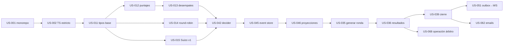

# USER-STORIES.md — Backlog de historias de usuario

> Índice, orden de implementación y trazabilidad. El **detalle de cada historia** (criterios de aceptación, pruebas, dependencias) está en `docs/stories/EP-*.md`. Plantilla: `docs/templates/story-template.md`.

## 1. Cómo leer y usar este backlog

1. Elige la historia por **nivel de dependencia** (§7) o por **rebanada vertical** (§5).
2. Ábrela en su archivo `docs/stories/EP-xx-*.md`; lee solo las reglas (`BR-*`), decisiones (`DEC-*`), invariantes (`INV-*`) y preguntas (`OQ-*`) que cita.
3. Si su estado es `BLOCKED(OQ-xxx)`, no la implementes: trabaja lo desbloqueado o avanza otra historia. Si es `PARTIAL(OQ-xxx)`, implementa la parte genérica y deja los parámetros pendientes **como parámetros** del `RuleSet`.
4. Termina cumpliendo la Definition of Done (`docs/AI-WORKFLOW.md` §6) y cambia el estado a `DONE` con el enlace al PR/commit.

### Estados
| Estado | Significado |
|---|---|
| `READY` | Sin bloqueos; puede empezar cuando sus dependencias estén `DONE` |
| `PARTIAL(OQ-…)` | Se puede avanzar con la parte genérica; lo pendiente depende de esas preguntas |
| `BLOCKED(OQ-…)` | No empezar |
| `LATER` | Planeada para una fase posterior |
| `IN_PROGRESS` / `DONE` | En curso / terminada |

### Prioridad y tamaño
- **MUST**: necesaria para el objetivo del proyecto. **SHOULD**: aporta mucho valor técnico o de calidad. **COULD**: si hay tiempo.
- **S**: una sesión corta. **M**: una sesión. **L**: varias sesiones; al empezar se divide en sub-historias de una sesión (`AI-WORKFLOW.md` §8). **XL**: **dividir antes de empezar** (la historia indica cómo).
- **Depende (parcial)**: dependencias que solo aplican a una parte de la historia; no cuentan para los niveles de §7.

## 2. Épicas

| Épica | Nombre | Archivo | Fase principal |
|---|---|---|---|
| EP-00 | Cimientos del proyecto | `stories/EP-00-foundation.md` | F0 |
| EP-01 | Núcleo de dominio (paquetes puros) | `stories/EP-01-domain-core.md` | F1 |
| EP-02 | Identidad, multi-organización y autorización | `stories/EP-02-identity-tenancy-authz.md` | F2 |
| EP-03 | Gestión de torneos (comandos) | `stories/EP-03-tournament-management.md` | F2 |
| EP-04 | Event store y proyecciones | `stories/EP-04-event-store-projections.md` | F2 |
| EP-05 | Tiempo real | `stories/EP-05-live.md` | F3 |
| EP-06 | Suscripciones, emails y reportes PDF | `stories/EP-06-notifications-reports.md` | F3 |
| EP-07 | Frontend y experiencia de usuario | `stories/EP-07-frontend-ux.md` | F0/F4 |
| EP-08 | Interoperabilidad | `stories/EP-08-interoperability.md` | F5 |
| EP-09 | Diferenciadores, calidad demostrable y operación | `stories/EP-09-advanced-quality.md` | F1/F5/F6 |

## 3. Fases

| Fase | Objetivo | Resultado demostrable |
|---|---|---|
| F0 | Especificación y cimientos | Repo que compila, lintea, prueba y se levanta con Docker en CI |
| F1 | Núcleo de dominio | Suite de propiedades verde, benchmarks, casos dorados |
| F2 | Backend de torneos | API con e2e sobre BD real, aislamiento por tenant, event store |
| F3 | Tiempo real, notificaciones y reportes | Prueba de carga, emails y PDF reales |
| F4 | Frontend completo | Torneo simulado operado de punta a punta desde la UI |
| F5 | Interoperabilidad y calidad | Exportaciones, informe de complejidad, simulacro de restauración |
| F6 | Diferenciadores | Árbitro sin conexión con sincronización, programador por restricciones |

Las fases se **solapan**: el frontend (F4) arranca en cuanto existen los endpoints de F2 correspondientes. La entrega real se organiza en **rebanadas verticales**.

## 4. Principio de entrega

Cada rebanada vertical (§5) debe terminar con algo **ejecutable y demostrable** de punta a punta, aunque sea pequeño. Prohibido acumular capas sin integrar.

## 5. Rebanadas verticales

### 5.0 Planificación

Los tiempos y el alcance de cada entrega los gestiona el responsable del proyecto (`DEC-055` anulado). Este backlog fija el **orden** recomendado (rebanadas verticales de esta sección y niveles de dependencia de §7) y la **prioridad** (MUST/SHOULD/COULD), no fechas.

### VS-1 — Esqueleto andante (round-robin individual con reglas demo)
**Objetivo:** un usuario crea una organización y un torneo demo, inscribe jugadores, genera un todos contra todos, registra resultados, ve la clasificación (solo puntos) y cierra el torneo.
**Historias:** US-001, US-002, US-003, US-004, US-005, US-006, US-007, US-008, US-009, US-117, US-011, US-021, US-010 (parte demo), US-012, US-014, US-095, US-042 (grupos a–d), US-045, US-046, US-022, US-023, US-024 (matriz básica), US-025, US-028, US-029, US-030, US-031 (CRUD básico), US-032, US-034, US-035 (round-robin), US-036, US-039, US-069 (mínimo), US-066, US-067, US-068 (mínimo), US-105 y US-106 (plan de despliegue y verificación).
**Dependencias parciales:** US-035 (solo todos contra todos), US-042 (grupos a–d), US-046 (sin desempates), US-067 (sin equipos ni tablas avanzadas) y US-068 (versión mínima) se cierran en VS-1 con su parte genérica; el resto se completa en VS-2 y VS-4 (campo "Depende (parcial)" de cada historia).
**Criterio de salida:** prueba e2e Playwright que recorre todo el flujo con datos del simulador, y `INV-E-3`/`INV-T-1` verdes.

### VS-2 — Suizo, desempates y correcciones
**Objetivo:** torneo Suizo con desempates explicables, correcciones auditadas, retiros y byes.
**Historias:** US-013, US-015, US-016, US-017, US-019, US-037, US-038, US-041, US-047, US-071, US-096 (parcial), US-115.
**Bloqueos:** lista de desempates de ASCUN (`OQ-023`) y vigencia del reglamento (`OQ-001`). Mientras tanto, se valida con el preset `fide-dutch-2026` (la variante `SIMPLIFIED` se eliminó, `DEC-043`).
**Criterio de salida:** suite de propiedades del Suizo a escala, `GV-001` y casos dorados con byes/forfeits; comparación con referencia si está disponible.

### VS-3 — En vivo
**Objetivo:** clasificación y mesas en vivo con recuperación y modo proyector.
**Historias:** US-050, US-051, US-052, US-053, US-054, US-074.
**Criterio de salida:** informe de carga publicado; `INV-L-1`, `INV-L-2` verdes.

### VS-4 — Equipos
**Objetivo:** torneo por equipos completo (plantillas, alineaciones, puntos de enfrentamiento y de partida, clasificación de equipos).
**Historias:** US-020, US-033, US-040 (+ pantallas correspondientes).
**Prioridad:** SHOULD (`DEC-054`): ASCUN 2012 no tiene torneo por equipos; el motor es genérico (FIDE C.07). **Bloqueos:** ninguno para la versión genérica; `OQ-009` solo aplica si el reglamento vigente incluye equipos.
**Criterio de salida:** enfrentamiento de punta a punta con `INV-TM-*` verdes.

### VS-5 — Comunicación y público
**Objetivo:** suscripciones con consentimiento, emails al cerrar ronda, PDFs, páginas públicas y compartir.
**Historias:** US-060, US-061, US-062, US-063, US-064, US-065, US-070, US-072, US-076, US-077, US-027, US-026, US-113, US-116.
**Criterio de salida:** cerrar una ronda dispara emails (visibles en Mailpit) con PDF adjunto opcional; `INV-N-1`, `INV-N-2` verdes.

### VS-6 — Profesional y diferenciadores
**Objetivo:** pulido, interoperabilidad y valor diferencial.
**Historias:** US-073, US-075, US-078, US-079, US-080, US-081, US-082, US-090, US-091, US-092, US-093, US-094, US-096, US-097, US-098, US-099, US-018, US-048, US-114.
**Criterio de salida:** informe de complejidad, simulacro de restauración y árbitro sin conexión sincronizando sin pérdidas.

### VS-7 — Reglas ASCUN completas
**Objetivo:** campeonato con ranking institucional, premiación, reclamaciones, siembra con ratings importados y vista del jugador.
**Historias:** US-100, US-101, US-102, US-103, US-104 (más el Elo interno y el TPR de VS-2).
**Bloqueos:** `OQ-001` (reglamento vigente), `OQ-023`, `OQ-024`, `OQ-028`.
**Criterio de salida:** `GV-006` e `INV-C-*` verdes; un campeonato demo con Clásico y Blitz cerrado de punta a punta.

### VS-8 — Plataforma: seguridad y administración
**Objetivo:** 2FA, permisos editables por el `platform_admin`, borrado lógico con papelera, consola de plataforma, derechos del titular y centro de avisos.
**Historias:** US-107, US-108, US-109, US-110, US-111, US-112.
**Bloqueos:** ninguno (`OQ-020`, `OQ-031` y `OQ-032` resueltas el 2026-10-26).
**Criterio de salida:** `INV-T-6..T-8`, `INV-D-1..D-4`, `INV-A-3` e `INV-N-3` verdes; un ciclo completo de borrar → restaurar y una anonimización verificada.

## 6. Ruta crítica

Sobre ASCUN: el cuello de botella de **negocio** es `OQ-001`; la ruta anterior no lo necesita hasta que se pase de reglas demo a reglas oficiales.

## 7. Backlog completo (generado)

<!-- GENERADO a partir de docs/stories/*.md (última regeneración: 2026-10-26). Si cambias una historia, regenera esta sección. "Depende (parcial)" no cuenta para los niveles. -->

#### EP-00

| ID | Historia | Fase | Prioridad | Tamaño | Estado | Depende de |
|---|---|---|---|---|---|---|
| US-001 | Estructura del monorepo y herramientas base | F0 | MUST | M | DONE | — |
| US-002 | Configuración compartida: TypeScript estricto, ESLint y Prettier | F0 | MUST | M | DONE | US-001 |
| US-003 | Entorno local con Docker Compose | F0 | MUST | M | IN_PROGRESS | US-001 |
| US-004 | Pipeline de integración continua | F0 | MUST | M | IN_PROGRESS | US-001, US-002 |
| US-005 | Módulo de configuración con validación de entorno (API) | F0 | MUST | S | READY | US-001 |
| US-006 | Capa transversal de la API: logging, errores, salud y seguridad básica | F0 | MUST | M | READY | US-005 |
| US-007 | Base de datos: Prisma, migraciones, seeds y utilidades de prueba | F0 | MUST | L | READY | US-003, US-005 |
| US-008 | Contratos de API con oRPC (prueba previa) y OpenAPI | F0 | MUST | M | READY | US-006 |
| US-009 | Esqueleto de la aplicación web | F0 | MUST | L | READY | US-002, US-008 |
| US-117 | Módulo de colas y proceso *worker* (BullMQ) | F0 | MUST | M | READY | US-003, US-005, US-006 (parcial: US-025) |

#### EP-01

| ID | Historia | Fase | Prioridad | Tamaño | Estado | Depende de |
|---|---|---|---|---|---|---|
| US-010 | Esquema de `RuleSet`, validación y ciclo de vida | F1 | MUST | L | DONE | US-011 |
| US-011 | Tipos base del dominio y utilidades de medios puntos | F1 | MUST | M | DONE | US-001, US-002 |
| US-012 | Cálculo de puntajes y clasificación base | F1 | MUST | M | DONE | US-010, US-011 |
| US-013 | Motor de desempates | F1 | MUST | L | PARTIAL(OQ-023) | US-012, US-021 |
| US-014 | Generador de todos contra todos (simple y doble) | F1 | MUST | M | READY | US-011 |
| US-015 | Motor Suizo v1 (base) con restricciones absolutas | F1 | MUST | XL | READY | US-012, US-014, US-021 |
| US-016 | Validación del Suizo: propiedades a escala y motor de referencia | F1 | MUST | L | READY | US-015 |
| US-017 | Motor Suizo basado en emparejamiento de peso máximo (Blossom) | F1 | SHOULD | XL | READY | US-015, US-016 |
| US-018 | Generador de eliminación directa | F1 | COULD | M | BLOCKED(OQ-013) | US-011 |
| US-019 | Ratings: Elo, rendimiento (TPR) y redondeo | F1 | SHOULD | M | READY | US-011, US-013 |
| US-020 | Motor de torneos por equipos | F1 | SHOULD | L | PARTIAL(OQ-009) | US-012, US-013, US-015 |
| US-021 | PRNG determinista y hash canónico de entradas | F1 | MUST | S | DONE | US-011 |
| US-042 | Decider del torneo (`@torre/tournament`): estado, `evolve`, `decide` y esquemas de eventos | F1 (integración en F2) | MUST | XL | PARTIAL(OQ-001) | US-010, US-012, US-014, US-021 (parcial: US-013, US-015, US-020) |

#### EP-02

| ID | Historia | Fase | Prioridad | Tamaño | Estado | Depende de |
|---|---|---|---|---|---|---|
| US-022 | Registro, inicio de sesión y sesiones con refresh rotativo | F2 | MUST | L | READY | US-006, US-007, US-008 |
| US-023 | Organizaciones y membresías | F2 | MUST | M | READY | US-022 |
| US-024 | Autorización con CASL y matriz de pruebas | F2 | MUST | L | READY | US-023 |
| US-025 | Aislamiento por tenant con Row-Level Security | F2 | MUST | L | READY | US-007, US-023 (parcial: US-117) |
| US-026 | Invitaciones y gestión de miembros | F2 | SHOULD | M | READY | US-024, US-028, US-061 |
| US-027 | Verificación de email y recuperación de contraseña | F2 | SHOULD | M | READY | US-022, US-061 |
| US-028 | Cambio directo de rol con razón | F2 | MUST | M | READY | US-024 (parcial: US-107) |
| US-029 | Solicitudes de rol con razón y bandeja de revisión | F2 | MUST | M | READY | US-028 (parcial: US-112) |
| US-102 | Jugador vinculado: vinculación con cuenta y vista personal | F2/F4 | SHOULD | M | READY | US-024, US-031, US-046 |
| US-107 | Autenticación de dos factores (TOTP) y confirmación de contraseña | F2 | SHOULD | M | READY | US-022 |
| US-108 | Gestión de roles y permisos estilo Spatie (solo `platform_admin`) | F2 | MUST | M | READY | US-024, US-107 |
| US-109 | Borrado lógico, papelera, restauración, archivo de torneos y anonimización | F2 | MUST | L | READY | US-025, US-107 |
| US-110 | Consola de administración de plataforma | F2/F4 | SHOULD | M | READY | US-108, US-109 |
| US-111 | Derechos del titular de datos (Ley 1581) | F2 | MUST | M | READY | US-022, US-109 |
| US-116 | Logo de la organización | F3 | SHOULD | S | READY | US-023, US-065 |

#### EP-03

| ID | Historia | Fase | Prioridad | Tamaño | Estado | Depende de |
|---|---|---|---|---|---|---|
| US-030 | Crear y configurar un torneo | F2 | MUST | L | READY | US-010, US-024, US-042, US-045, US-046 |
| US-031 | Registro de jugadores e instituciones, e importación CSV | F2 | MUST | L | READY | US-025 |
| US-032 | Inscripción de participantes (individual) | F2 | MUST | M | READY | US-030, US-031 |
| US-033 | Equipos y plantillas | F2 | SHOULD | L | PARTIAL(OQ-009) | US-032, US-020 |
| US-034 | Máquina de estados del torneo | F2 | MUST | M | READY | US-030, US-045 |
| US-035 | Generar, revisar y publicar una ronda | F2 | MUST | L | READY | US-014, US-034, US-117 (parcial: US-015) |
| US-036 | Registrar resultados | F2 | MUST | M | READY | US-035, US-046 |
| US-037 | Corregir un resultado | F2 | MUST | M | READY | US-036 |
| US-038 | Byes, forfeits, retiros, inscripciones tardías y reincorporación | F2 | MUST | L | PARTIAL(OQ-001) | US-036, US-013 |
| US-039 | Cerrar ronda y torneo; reabrir con razón | F2 | MUST | M | READY | US-036, US-045 |
| US-040 | Alineaciones y resultados por equipos | F2 | SHOULD | L | PARTIAL(OQ-009) | US-033, US-036, US-020 |
| US-041 | Ajuste manual de emparejamientos con auditoría | F2 | SHOULD | M | READY | US-035 |
| US-100 | Campeonatos y ranking institucional "todo evento" | F2 | MUST | M | PARTIAL(OQ-024, | US-039, US-046 |
| US-101 | Premiación: medallas por rama y modalidad | F2 | SHOULD | S | PARTIAL(OQ-001) | US-039 |
| US-103 | Reclamaciones: registro, plazos y resolución auditada | F2 | SHOULD | M | PARTIAL(OQ-001) | US-037, US-046 |
| US-115 | Check-in por ronda (opcional por torneo) | F2 | SHOULD | M | READY | US-035, US-038 (parcial: US-102, US-068) |

#### EP-04

| ID | Historia | Fase | Prioridad | Tamaño | Estado | Depende de |
|---|---|---|---|---|---|---|
| US-045 | Event store: append, lectura, idempotencia y concurrencia | F2 | MUST | L | READY | US-007, US-021 |
| US-046 | Proyecciones síncronas y reconstrucción | F2 | MUST | L | READY | US-045, US-012 (parcial: US-013) |
| US-047 | Línea de tiempo de auditoría | F2 | SHOULD | M | READY | US-046 |
| US-048 | Medición de rendimiento y *snapshots* | F2 | SHOULD | M | READY | US-045, US-046 |

#### EP-05

| ID | Historia | Fase | Prioridad | Tamaño | Estado | Depende de |
|---|---|---|---|---|---|---|
| US-050 | Gateway WebSocket, salas y autorización | F3 | MUST | L | READY | US-006, US-024 |
| US-051 | *Outbox relay* y difusión por Redis | F3 | MUST | M | READY | US-045, US-050 |
| US-052 | Biblioteca cliente en vivo (reconexión y resincronización) | F3 | MUST | M | READY | US-009, US-050 |
| US-053 | Vistas en vivo: clasificación, mesas y modo proyector | F3 | MUST | L | READY | US-052, US-069, US-071 |
| US-054 | Prueba de carga y presupuesto de capacidad | F3 | SHOULD | M | READY | US-051, US-095 |

#### EP-06

| ID | Historia | Fase | Prioridad | Tamaño | Estado | Depende de |
|---|---|---|---|---|---|---|
| US-060 | Suscripciones y consentimiento | F3 | MUST | M | READY | US-061, US-025 |
| US-061 | Infraestructura de email: puerto, cola, plantillas y reintentos | F3 | MUST | L | READY | US-006, US-007, US-117 |
| US-062 | Emails de resultados al cerrar ronda y al finalizar | F3 | MUST | M | READY | US-039, US-060, US-061 |
| US-063 | Baja y gestión de preferencias | F3 | MUST | S | READY | US-060 |
| US-064 | Generación de PDF y plantillas de reportes | F3 | MUST | L | READY | US-046 (parcial: US-116) |
| US-065 | Reportes asíncronos: cola, almacenamiento y descarga | F3 | MUST | M | READY | US-064, US-117, US-025 |
| US-112 | Centro de avisos en la app | F3 | MUST | M | READY | US-024, US-025 |

#### EP-07

| ID | Historia | Fase | Prioridad | Tamaño | Estado | Depende de |
|---|---|---|---|---|---|---|
| US-066 | Pantallas de autenticación y organización | F4 | MUST | M | READY | US-009, US-022, US-023, US-069 |
| US-067 | Pantallas de gestión del torneo: crear, configurar, inscribir, equipos | F4 | MUST | L | READY | US-030, US-031, US-032, US-069 (parcial: US-033, US-071, US-069) |
| US-068 | Operación del árbitro: rondas y registro de resultados | F4 | MUST | L | READY | US-035, US-036, US-039, US-069 (parcial: US-037, US-041, US-073) |
| US-069 | Sistema de diseño: tokens, capa `shared/ui` y catálogo | F0/F4 | MUST | L | READY | US-009 |
| US-070 | Páginas públicas del torneo y enlaces compartibles | F4 | MUST | M | READY | US-046, US-069 |
| US-071 | Tablas interactivas: orden, filtros, virtualización y estado en la URL | F4 | MUST | L | READY | US-069, US-046 |
| US-072 | Búsqueda inteligente | F4 | SHOULD | M | READY | US-031, US-069 |
| US-073 | Atajos de teclado y paleta de comandos | F4 | MUST | M | READY | US-069 |
| US-074 | Temas: modo oscuro y modo proyector | F4 | SHOULD | S | READY | US-069 |
| US-075 | Internacionalización (es primero; en después; pt más tarde) | F4 | SHOULD | M | READY | US-009 |
| US-076 | Seguir (guardar para después) jugadores, equipos y torneos | F4 | SHOULD | M | READY | US-060, US-071 |
| US-077 | Microinteracciones: notificaciones, copiar, compartir | F4 | SHOULD | S | READY | US-069 |
| US-078 | Autoguardado de borradores en formularios largos | F4 | COULD | S | READY | US-069 |
| US-079 | Línea base de accesibilidad y compatibilidad de navegadores | F4 | SHOULD | M | READY | US-068, US-070, US-071 |
| US-113 | Directorio público de torneos | F4 | SHOULD | S | READY | US-070, US-071 |

#### EP-08

| ID | Historia | Fase | Prioridad | Tamaño | Estado | Depende de |
|---|---|---|---|---|---|---|
| US-080 | Exportación e importación mínima de TRF (formato de torneo FIDE) | F5 | SHOULD | L | READY | US-046 |
| US-081 | Exportaciones CSV/JSON de clasificación, mesas y resultados | F5 | SHOULD | S | READY | US-046 |
| US-082 | Importación y exportación de PGN vinculadas a partidas | F5 | COULD | M | READY | US-092, US-036 |
| US-104 | Importación de ratings FIDE y nacionales para la siembra | F5 | SHOULD | M | READY | US-031, US-032 |

#### EP-09

| ID | Historia | Fase | Prioridad | Tamaño | Estado | Depende de |
|---|---|---|---|---|---|---|
| US-090 | PWA: caché de lectura para espectadores | F6 | COULD | M | LATER | US-053, US-070 |
| US-091 | Árbitro sin conexión: registro local y sincronización | F6 | SHOULD | XL | LATER | US-042, US-036, US-068 |
| US-092 | Registro de partidas: tablero, PGN y FEN | F6 | COULD | L | LATER | US-068, US-069 |
| US-093 | Análisis con motor de ajedrez (opcional) | F6 | COULD | L | LATER | US-092 |
| US-094 | Programador de calendario por restricciones (CSP) | F6 | COULD | XL | LATER | US-014, US-069 |
| US-095 | Simulador de torneos y datos de demostración | F1+ (se usa desde F1) | MUST | M | READY | US-011, US-012 |
| US-096 | Informe de complejidad y benchmarks | F5 | SHOULD | M | READY | US-012, US-013, US-015, US-017 (parcial: US-048) |
| US-097 | Diagramas, ADRs y documentación técnica viva | F5 | SHOULD | M | READY | — |
| US-098 | Copias de seguridad, restauración y simulacro | F5 | SHOULD | M | READY | US-046 |
| US-099 | Endurecimiento de seguridad y revisión final | F5 | MUST | M | READY | US-022, US-024, US-025, US-060 |
| US-105 | Plan de despliegue documentado (Vercel + Render + Neon) | F5 | MUST | S | READY | US-003, US-004 |
| US-106 | Ejecución del plan de pruebas e informe final | F5 | MUST | S | READY | US-039, US-068 |
| US-114 | Métricas y alertas de operación | F5 | SHOULD | M | READY | US-006, US-051, US-061 |

#### Niveles de dependencia (orden topológico)

Una historia solo puede empezar cuando las de niveles inferiores de las que depende están terminadas. Historias del mismo nivel son independientes entre sí (se pueden hacer en cualquier orden).

| Nivel | Historias |
|---|---|
| 0 | US-001, US-097 |
| 1 | US-002, US-003, US-005 |
| 2 | US-004, US-006, US-007, US-011 |
| 3 | US-008, US-010, US-014, US-018, US-021, US-105, US-117 |
| 4 | US-009, US-012, US-022, US-045, US-061 |
| 5 | US-013, US-015, US-023, US-027, US-042, US-046, US-069, US-075, US-095, US-107 |
| 6 | US-016, US-019, US-020, US-024, US-025, US-047, US-048, US-064, US-066, US-070, US-071, US-073, US-074, US-077, US-078, US-080, US-081, US-094, US-098 |
| 7 | US-017, US-028, US-030, US-031, US-050, US-060, US-065, US-108, US-109, US-112, US-113 |
| 8 | US-026, US-029, US-032, US-034, US-051, US-052, US-063, US-072, US-076, US-096, US-099, US-102, US-110, US-111, US-116 |
| 9 | US-033, US-035, US-053, US-054, US-067, US-104, US-114 |
| 10 | US-036, US-041, US-090 |
| 11 | US-037, US-038, US-039, US-040 |
| 12 | US-062, US-068, US-100, US-101, US-103, US-115 |
| 13 | US-079, US-091, US-092, US-106 |
| 14 | US-082, US-093 |

Total: **102** historias · MUST: 62 · SHOULD: 33 · COULD: 7

## 8. Trazabilidad: temas conversados → historias

| Tema tratado en el chat | Historias |
|---|---|
| Gestión y organización de campeonatos universitarios | EP-03 completo, US-030..US-041 |
| Salas en vivo con marcadores actualizados | EP-05, US-053, US-074 |
| Generación de PDF | US-064, US-065 |
| Emails con resultados a quienes se suscriban | US-060, US-061, US-062, US-063 |
| Reglas de ASCUN (individual y por equipos) | US-010, US-013, US-015, US-020, US-033, US-040 y `OPEN-QUESTIONS.md` |
| Motor de emparejamiento Suizo (y comparación con referencia) | US-015, US-016, US-017 |
| Otros formatos (round-robin, eliminación) | US-014, US-018 |
| Desempates (Buchholz, Sonneborn-Berger, progresivo, directo, Koya) | US-013 |
| Ratings Elo/TPR (Glicko-2 después) | US-019 |
| Torneos por equipos | US-020, US-033, US-040 |
| Event sourcing, CQRS, auditoría y correcciones | US-042, US-045, US-046, US-047, US-037, US-048 |
| Multi-tenant (RLS) | US-023, US-025 |
| Roles y permisos (CASL, alcances) | US-024, US-026, `AUTHORIZATION.md` |
| Cuenta espectador por defecto, cambio directo de rol y solicitudes de rol | US-028, US-029, `AUTHORIZATION.md` §9 |
| Autenticación estilo Fortify (2FA, sesiones, confirmación de contraseña) | US-022, US-027, US-107, `AUTHORIZATION.md` §11 |
| Permisos asignables a roles (estilo Spatie) | US-024, US-108, `AUTHORIZATION.md` §4.1 |
| Borrado lógico solo por `platform_admin`, papelera y anonimización | US-109, `AUTHORIZATION.md` §10 |
| Consola de plataforma, derechos del titular y centro de avisos | US-110, US-111, US-112 |
| Directorio público y métricas | US-113, US-114 |
| Tiempo real (WebSockets + Redis) y carga | US-050..US-054 |
| Colas (BullMQ), emails, reportes asíncronos | US-061, US-065 |
| Calendario por restricciones (CSP) | US-094 |
| Modo offline del árbitro | US-090, US-091 |
| Análisis con motor y partidas (PGN/FEN) | US-092, US-093, US-082 |
| Interoperabilidad (TRF, CSV, PGN) | US-080, US-081, US-082 |
| Librerías de UI homogéneas (calendarios, selects múltiples, formularios) | US-069, US-067 |
| Seguridad, observabilidad, CI/CD, Docker, backups | US-004, US-006, US-003, US-098, US-099 |
| Simulación, benchmarks y evidencia de complejidad | US-095, US-096, US-054 |
| Documentación (ADR, diagramas) | US-097 |
| Colombia: zona horaria, Ley 1581, idioma | US-075, US-060, US-063, `DEC-025`, `DEC-029` |
| Reglamento ASCUN 2012 (fuente encontrada en la auditoría) | US-010, `SOURCES.md`, `OPEN-QUESTIONS.md` §4 |
| Campeonato y ranking institucional ("todo evento") | US-100 |
| Premiación | US-101 |
| Vista del jugador | US-102 |
| Reclamaciones | US-103 |
| Siembra con ELO FIDE y nacional | US-104, US-032 |
| Plan de despliegue (Vercel + Render + Neon) | US-105, `ARCHITECTURE.md` §16.5 |
| Plan de pruebas (IEEE 829 / ISO 29119-3) | US-106, `TEST-PLAN.md` |

### Lista de 20 funciones de UX evaluadas

| # | Función | Decisión | Historia |
|---|---|---|---|
| 1 | Modo oscuro | Sí | US-074 |
| 2 | Cambio de idioma (es/en/pt) | Sí, por fases (es → en → pt) | US-075 |
| 3 | Botón "ir arriba" | Opcional | US-077 |
| 4 | Barra de progreso de lectura | **No** | — |
| 5 | Botón copiar | Sí | US-077, US-070 |
| 6 | Guardar para después | Replanteado como **seguir** | US-076 |
| 7 | Vistos recientemente | Después, simple | US-076 |
| 8 | Atajos de teclado | **Sí, prioridad alta** | US-073 |
| 9 | Tamaño de texto ajustable | Replanteado como modo proyector | US-074 |
| 10 | Tablas interactivas | **Sí, esencial** | US-071 |
| 11 | FAQ con búsqueda | Después; página estática de ayuda, sin historia por ahora | — |
| 12 | Autoguardado de formularios | Sí, con límites (nunca resultados) | US-078 |
| 13 | Mostrar/ocultar contraseña | Sí | US-066 |
| 14 | Botones de compartir | Sí (con endpoint de metadatos OG) | US-070 |
| 15 | Tiempo estimado de lectura | **No** | — |
| 16 | Filtrar y ordenar | **Sí, esencial** | US-071 |
| 17 | Tabla de contenido | **No** | — |
| 18 | Búsqueda inteligente | Sí | US-072 |
| 19 | Notificaciones de éxito (toasts) | **Sí, esencial** | US-077 |
| 20 | Acceso sin conexión | Sí, diferenciador (espectador: caché; árbitro: escritura) | US-090, US-091 |
